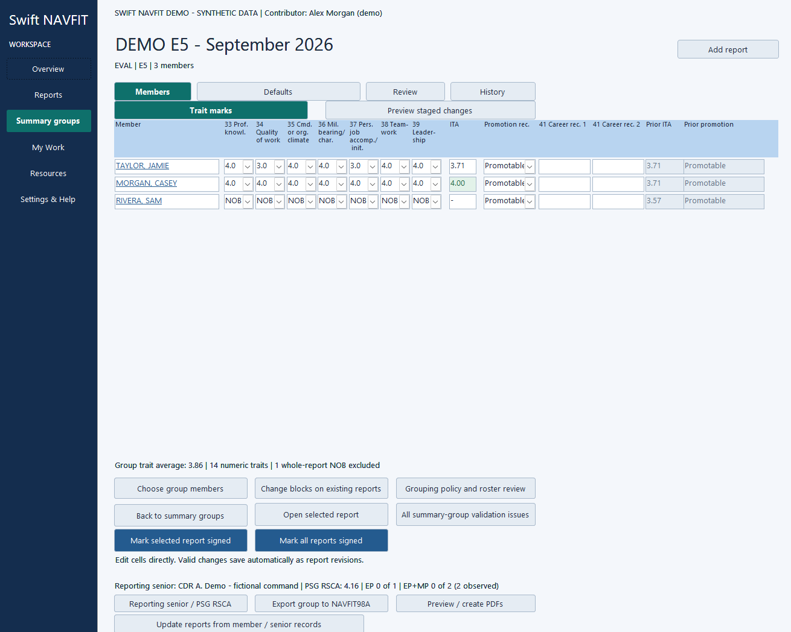
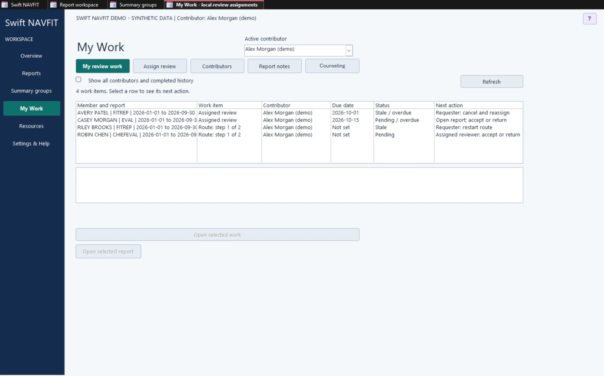
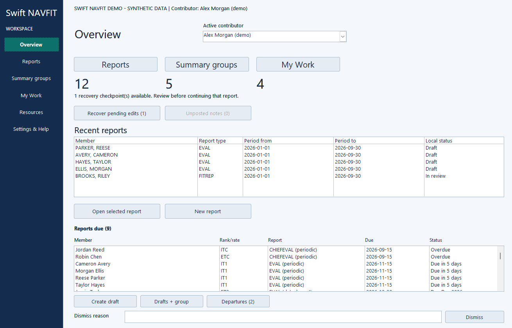
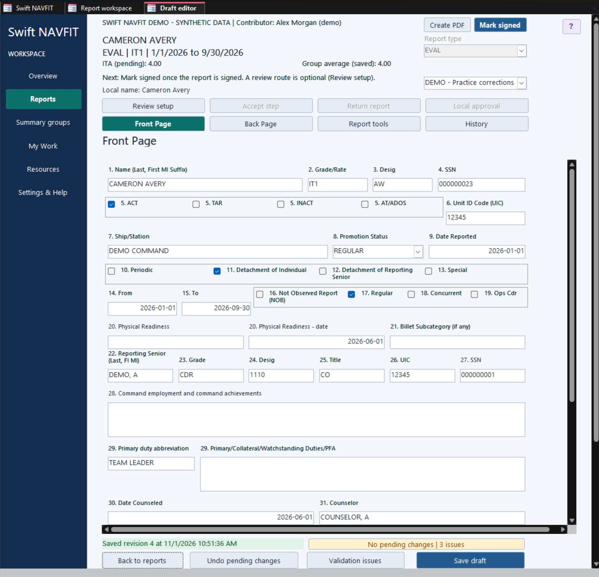

# Swift NAVFIT

  

**Draft, review, and manage Navy evaluations in one local workspace.**

[User guide (PDF)](docs/Swift_NAVFIT_User_Guide.pdf) | [Read the guide online](docs/Swift_NAVFIT_User_Guide.md) | [Download the latest release](https://github.com/MattMer/swift-navfit/releases/latest)

Swift NAVFIT is a Windows application, built in Microsoft Access, for writing EVALs, CHIEFEVALs, and FITREPs. It keeps report drafting, summary groups, member history, review, revision tracking, and recovery together in one workspace file on your computer.

It is meant to replace the spreadsheets, emailed copies, repeated data entry, and manual tracking that usually surround report writing. Swift works alongside NAVFIT98A: you import from it and export to it, and NAVFIT98A remains the place for final native validation and submission.

The 39-page user guide covers setup, drafting, notes, validation, summary groups, RSCA, review, exchange with NAVFIT98A, recovery, and upgrades. It follows the procedure-based layout of the eNavFit guide.

*Rack and stack a summary group: every member's marks and recommendations in one table. All screenshots show the Demo's made-up data.*

## What Swift helps with

### Know what changed, and get it back

- **Change history for every field:** see who saved a change, when, and the old and new values.
- **Compare and restore:** compare two versions of a report and restore an earlier one as a new version, without erasing history.
- **Unsaved-work recovery:** edits you haven't saved yet are checkpointed separately, so a crash or a failed save doesn't lose them.
- **Clear save status:** Swift tells you whether a change is unsaved, checkpointed, saved, or failed. A failed save keeps your values so you can fix and retry.
- **Archive and recover:** move reports out of the active lists without losing their history.

### Coordinate review without a separate tracker

- **My Work:** one list of your assigned reviews, route steps, and reports ready for local approval, plus a tab for report notes.
- **Review routes:** the report moves up your chain of command as one shared draft. Whoever holds it can edit it, then forward it or send it back; earlier reviewers can pull it back.
- **Report notes:** a running conversation inside each report, separate from its versions and approval.
- **Clear review history:** Swift records which version each reviewer passed on, and flags when someone lower in the chain changes what a higher reviewer edited.
- **Mark signed:** record that a report was signed outside Swift, for one report or a whole summary group. Signed reports become read-only until reopened.

### Work across a command and its summary groups

- **Command member directory:** reuse member details, filter by paygrade or rank/rate, and create reports one at a time or in batches. [Review and merge duplicate Sailors](docs/Duplicate_Sailor_Review.md) with history kept and a guarded undo.
- **Prior evaluations:** keep each member's earlier evaluations alongside the current report for reference.
- **Shared fields and defaults:** apply group or command defaults, see exactly which reports change, and confirm each replacement.
- **Rack and stack:** edit every member's trait marks and recommendations in one table, compare ITA with prior reports, and stage proposed changes for review before applying them.
- **Reporting seniors and RSCA:** start a senior from the member directory, see each paygrade's RSCA history with every summary group posted to it, keep exact totals apart from estimates, and choose a group's baseline deliberately.
- **Midterm counseling:** track who is due, record sessions, and carry blocks 30–31 into the next report.
- **Rosters and departures:** import the command's NRRM or MNA roster. Members missing from a newer complete roster, or near their PRD, are flagged as departing for you to confirm.
- **Reports due:** the home screen lists members with periodic or detachment reports coming due, and clears each one once its draft exists.
- **People from the directory:** fill the rater, senior rater and counselor from the member directory, add contributors from it, and remove contributors who leave.

### Catch problems while drafting

- **Live findings with citations:** Swift checks values as you type and links each finding to the block it concerns.
- **Different kinds of finding:** invalid entries, incomplete drafts, policy issues, and matters that need human judgement are kept apart.
- **Drafts stay editable:** missing information never blocks saving a draft.
- **Familiar report pages:** fixed Front and Back pages laid out like the official forms, all seven traits together, and help for the current window.
- **Narrative tools:** a line counter that matches how NAVFIT98A prints, spell check, and rate-filtered example phrases kept apart from the official narrative.

### Bring data in and out

- **NAVFIT98A exchange:** import reports and groups, and export a whole summary group to NAVFIT98A. Incomplete drafts and findings don't block export.
- **Returned reports:** when a report comes back from NAVFIT98A, compare it with what you exported and what changed in Swift before applying anything.
- **PDF import:** read values from a filled report PDF into a new or existing draft, offline and without Acrobat.
- **PDF output:** print-ready PDFs of single reports and whole summary-group packets on the official form layouts.
- **Upgrades and backups:** move an earlier Swift workspace into a new version with every value checked, and back up or undo supported operations.

## Swift NAVFIT compared with NAVFIT98A

NAVFIT98A already provides report editing, folders and defaults, validation, import and export, summary calculations, and printing. Swift builds on those foundations; its main additions are the history, recovery, and review tools around each report.

| Capability | NAVFIT98A | Swift NAVFIT |
| --- | --- | --- |
| Saved-change history | - | Who changed what and when, compare versions, and restore. |
| Unsaved-work recovery | - | Checkpoints for edits not yet saved. |
| Review tracking | - | My Work, assignments, ordered steps, decision notes, and local approval. |
| Report discussion | - | A running notes log inside each report. |
| Member reuse and history | - | Command directory, batch report creation, prior evaluations, and duplicate merging. |
| Reporting-senior averages | Summary and average calculations. | Reusable senior records and dated RSCA history per paygrade. |
| Shared group values | Folder defaults and common values. | Shows every affected report and asks before replacing values. |
| Validation | Report and folder validation. | Live findings with citations and links to the field. Run NAVFIT98A validation after export as well. |
| Returned-report reconciliation | - | Compares the exported, current, and returned versions of a report. |
| Final printing | Built-in report, folder, and summary printing. | Print-ready PDFs; final printed fit is not yet confirmed. |

The NAVFIT98A column is based on the [Navy user guide](https://www.mynavyhr.navy.mil/Portals/55/Career/PerformanceEvaluation/NAVFIT98A%20Version%2030%20user%20guide.pdf), the [v33 FAQ](https://www.mynavyhr.navy.mil/Portals/55/Career/PerformanceEvaluation/NAVFIT98A%20v2.2.0.33%20Frequently%20Asked%20Question.pdf), and the v33 Patch 2 package. A **-** means no equivalent was found in that material; it is not a claim about every NAVFIT98A version.

## Your data stays on your computer

Swift stores reports, history, review records, and recovery checkpoints in the workspace file (`.accdb`). It does not connect to the internet: it never uploads report data, syncs with an online service, or sends usage data. No online account is needed.

Protect the workspace the way you protect other files with the same information. Keep it in your command's approved, access-controlled folder; it takes that folder's Windows permissions, and your device encryption, backups, and data-handling rules still apply. Swift adds no password or encryption of its own, and contributor names identify who made a change; they are not logins. SSNs are stored readable inside the file; masking on screen does not encrypt them.

Optional reference links, such as NavyWriter, open a website only when you select them, and never include report contents.

## Get Swift NAVFIT

**You need Windows and full desktop Microsoft Access.** The free Access Runtime is not supported.

### Current release: 0.53.0

Download from the [0.53.0 release page](https://github.com/MattMer/swift-navfit/releases/tag/v0.53.0), which lists each file's SHA-256 hash so you can confirm your download.

- **Swift_NAVFIT_Blank_0.53.0.accdb:** an empty workspace. Start real work here.
- **Swift_NAVFIT_Demo_0.53.0.accdb:** made-up members, reports, and groups for practice. Never put real data in it.

> **Not yet tested:**
> 1. printed fit against the official forms;
> 2. screen readers (NVDA and JAWS);
> 3. a computer without Adobe Acrobat;
> 4. a Navy-managed workstation under its normal Office settings.
>
> The files are not digitally signed yet, so Access asks you to **Enable Content**.

### First steps

1. Download the Blank (or the Demo to practise). Keep the original and open a copy in desktop Access. Choose **Enable Content**.
2. Set up your command and your contributor name. Swift asks you to [choose your contributor every time it opens](docs/Contributor_Startup.md).
3. Create a summary group, add members and reports, and use **My Work** for review. The **?** at the top right of each window opens help for it.

### Upgrading from an earlier version

1. Open a copy of the new Blank.
2. Choose **Settings & Help → Import data from a previous Swift NAVFIT version** and pick your current workspace. Every value is checked before anything is saved, and your old file is not changed.
3. Close and reopen the new workspace.

Never copy a Blank over an existing workspace.

### Test builds

Releases tagged `-dev` on the [releases page](https://github.com/MattMer/swift-navfit/releases) are test builds of work in progress, not verified releases.

## Important limits

- Swift NAVFIT is an independent project, not an official Navy system. It does not replace governing instructions or human review.
- **Local approval and Mark signed are not official submission, signature, or Navy approval.**
- Use one workspace file per command, with one person working in it at a time. Separate copies do not sync with each other.
- Validation covers the checks Swift implements, not every policy. Always run NAVFIT98A validation after export.
- Recovery checkpoints, saved versions, backups, and upgrades do different jobs. An upgrade copies an old workspace into a new one; it does not merge two populated workspaces.

## Help and documentation

- [User guide (PDF)](docs/Swift_NAVFIT_User_Guide.pdf) and the [online edition](docs/Swift_NAVFIT_User_Guide.md)
- [Choosing your contributor at startup](docs/Contributor_Startup.md)
- [Reviewing duplicate Sailors](docs/Duplicate_Sailor_Review.md)
- [Accessibility](docs/Swift_NAVFIT_User_Guide.md#34-accessibility) and the [screen-reader test procedure](docs/Accessibility_Screen_Reader_Test.md)
- Found a problem? [Open an issue](https://github.com/MattMer/swift-navfit/issues/new/choose) using made-up data only. Report security problems privately as described in [SECURITY.md](SECURITY.md).

**Reviewing Swift for your command?** The [security and system description](TECHNICAL_README.md) is written for ISSMs, privacy officers and application approvers. It covers what Swift is, the registration and approval questions, every kind of personal data it holds and where, its security controls and residual risks, accessibility, testing, the release process and known limitations, and links the DoDAF, DevSecOps, SBOM and threat-model documents.

## License

Swift NAVFIT is licensed under the [Apache License 2.0](LICENSE): you may use, copy, change and share it, including inside an organization, provided you keep the license and [NOTICE](NOTICE). It comes with no warranty.

Swift NAVFIT is a personal project, built on its author's own time and equipment. It is not an official U.S. Navy or Department of Defense system, and neither endorses it. Using it on government systems is a decision for your command and its ISSM.
