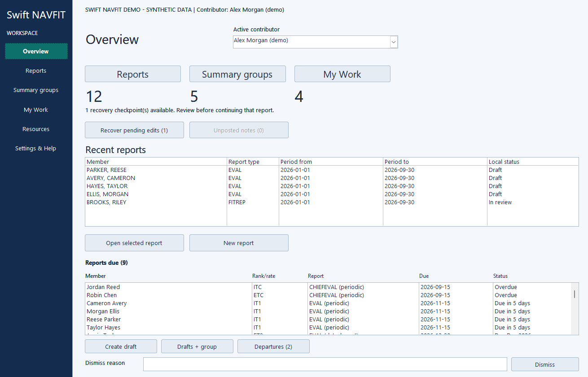
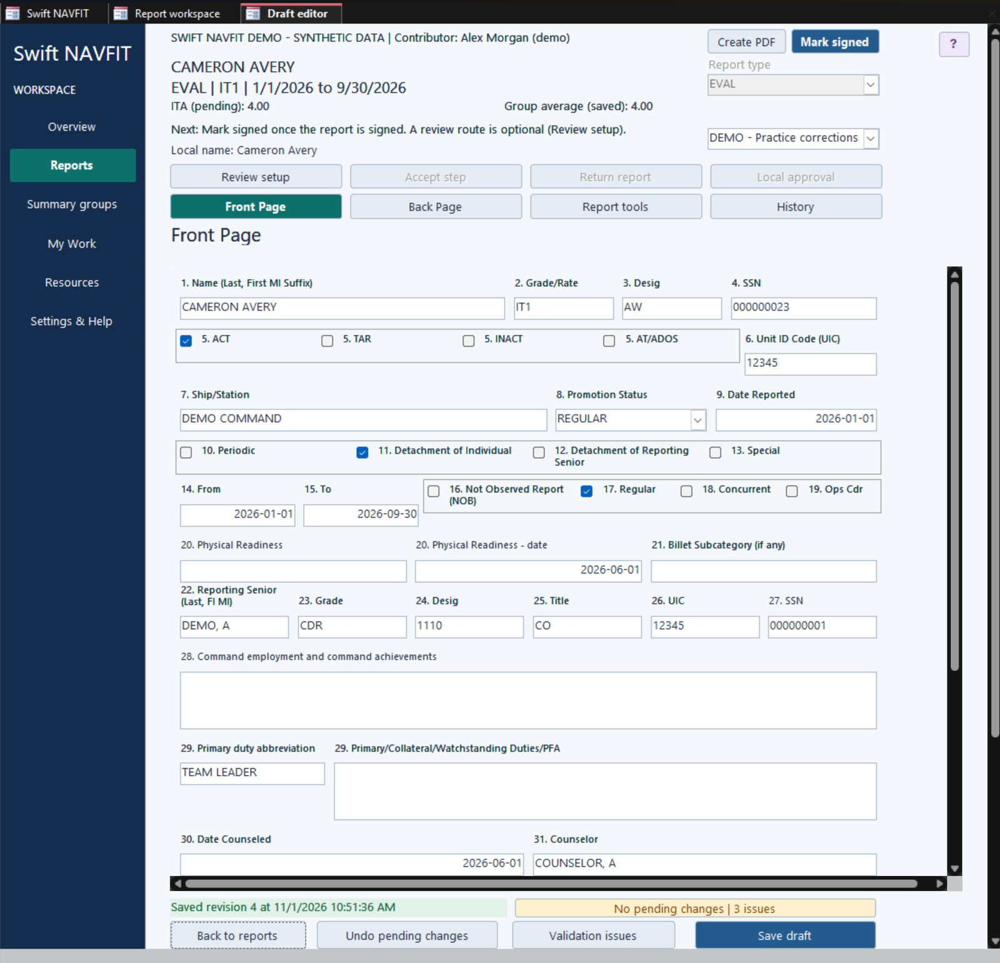
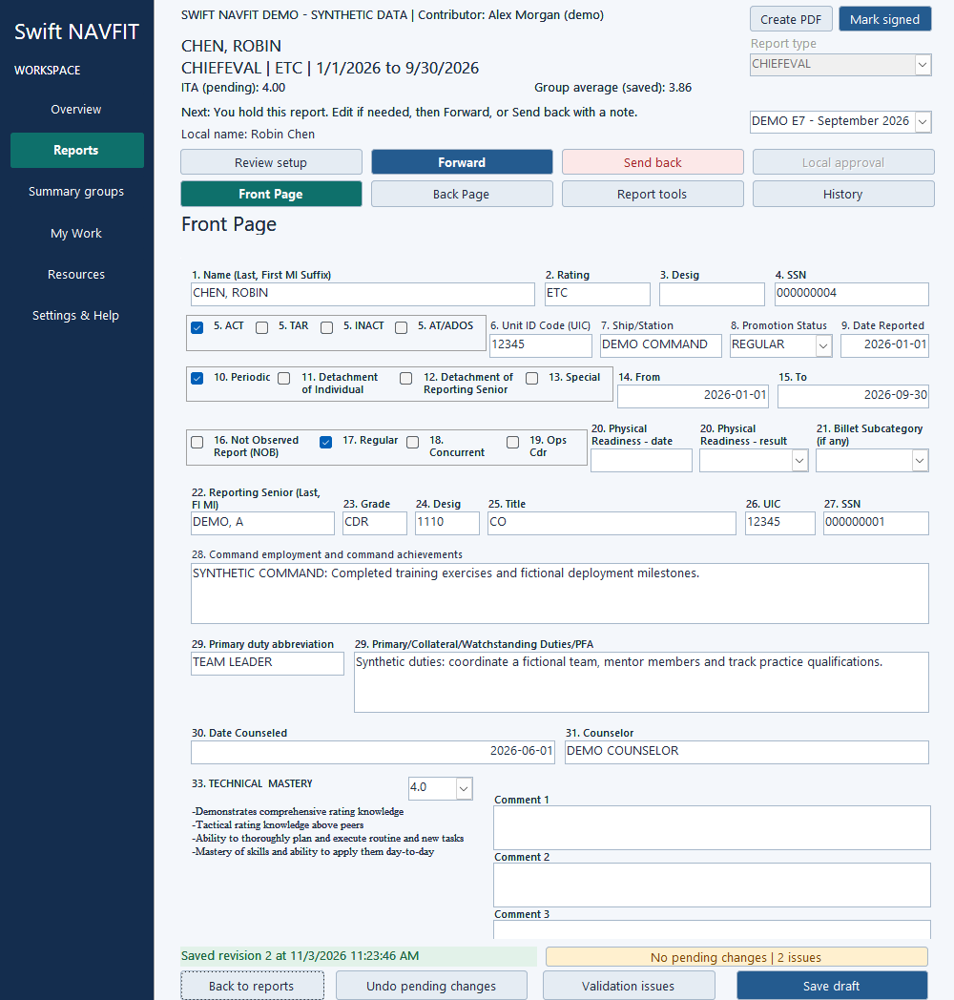
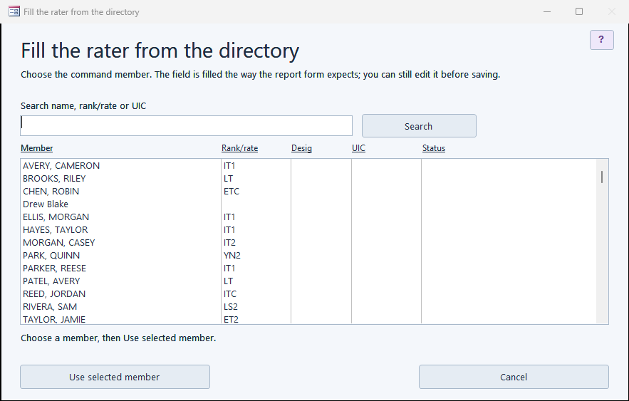
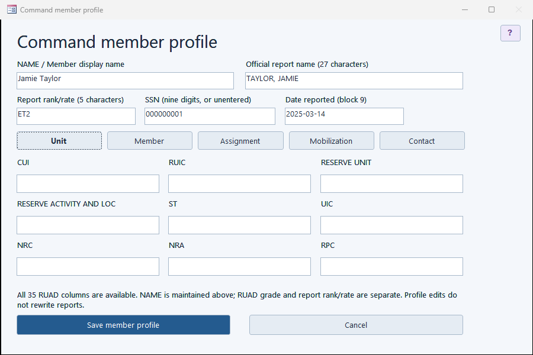
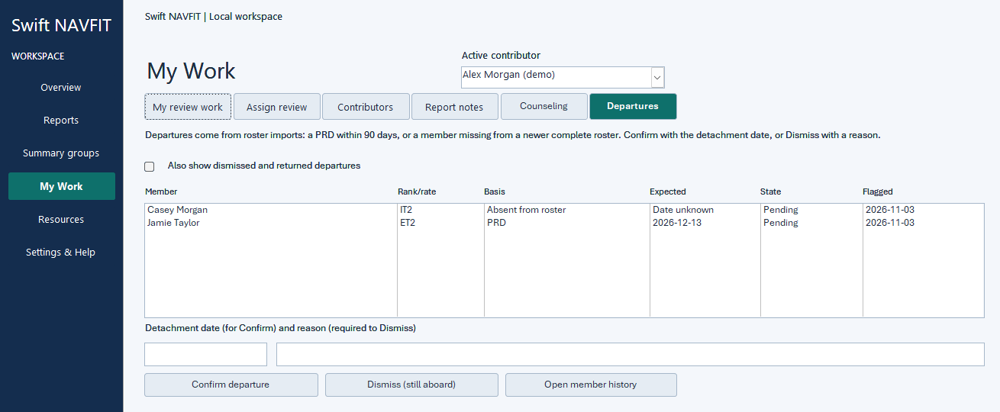
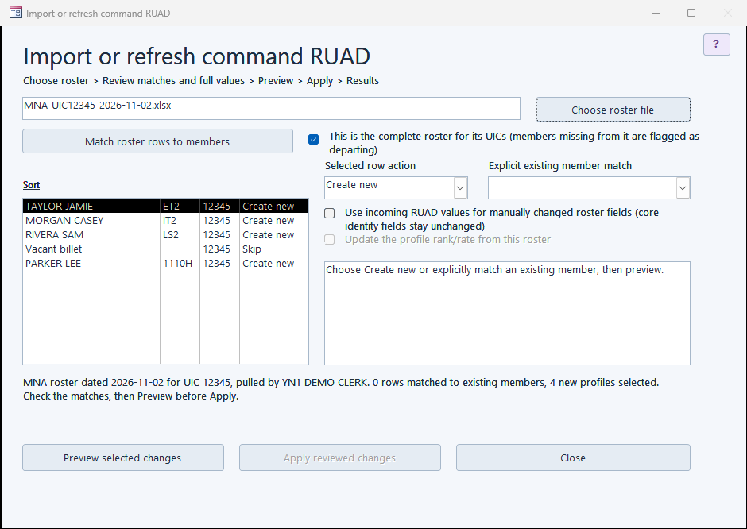
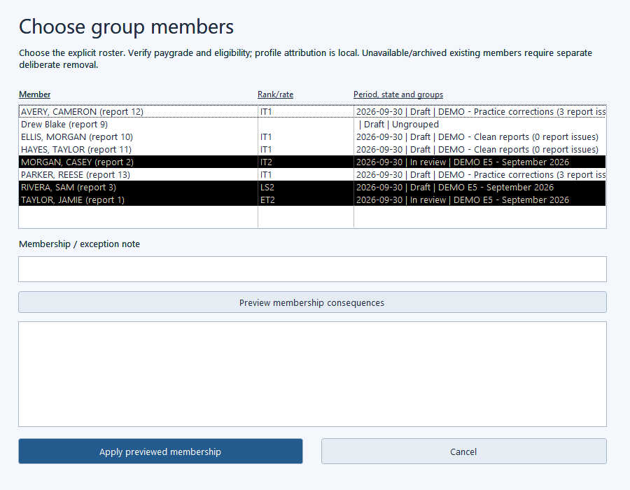
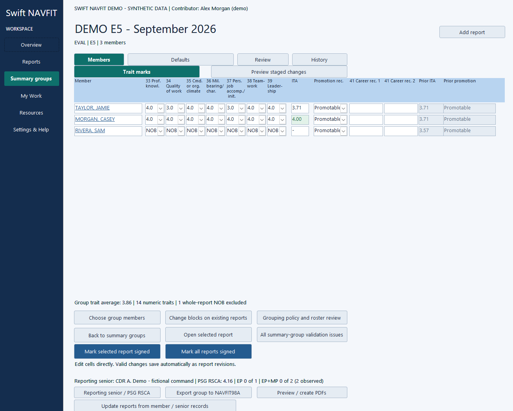
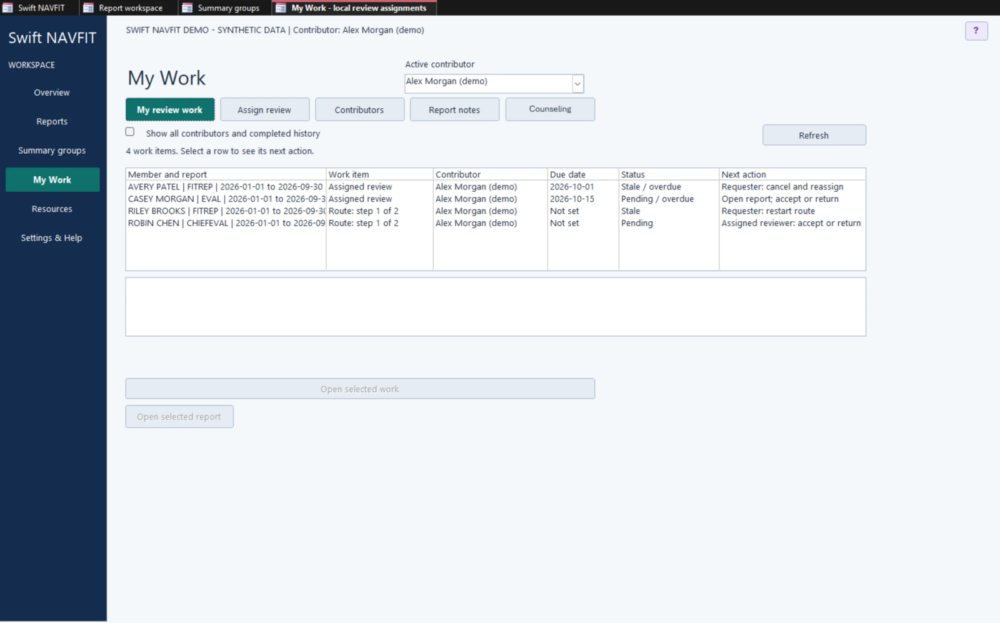

# Swift NAVFIT User Guide

Version 1.9 | 9 November 2026

For Swift NAVFIT 0.55.0 | schema 48

## Draft. Coordinate. Review. Preserve.

A practical operating guide for EVAL, CHIEFEVAL, and FITREP workspaces in Microsoft Access.

This guide follows the training-manual approach of the supplied eNavFit User Guide: overview, responsibilities, setup, navigation, numbered procedures, workflow, and reference material. It describes Swift NAVFIT's own controls and local workflow. It does not describe an eNavFit connection or Navy submission service.

**Independent development application.** Local approval and group completion do not constitute official signatures, submission, or Navy approval. Use governing instructions and the command's authorized final processing procedure.

**Guide scope:** Swift NAVFIT 0.54.0 navigation and behavior. Screen maps are orientation diagrams. Screenshots show the Demo workspace's made-up data. Older releases can have different controls. Physical display, accessibility, and final print acceptance remain separate from automated application checks.

---

# Contents and quick start

## Find a procedure

| Chapter | Topic | Page |
| --- | --- | --- |
| 1 | Overview, responsibilities, and data protection | 3 |
| 2 | Open and set up a workspace | 4 |
| 3 | Navigate the application | 5 |
| 4 | Create, edit, and save reports | 6 |
| 5 | Add messages to a report | 7 |
| 6 | Check validation and calculations | 8 |
| 7 | Use revision history and recover work | 9 |
| 8 | Manage command members and prior evaluations | 10 |
| 9 | Create and manage summary groups | 11 |
| 10 | Edit traits and compare members | 12 |
| 11 | Manage reporting seniors and PSG RSCA | 13 |
| 12 | Run an ordered review route | 14 |
| 13 | Use My Work and individual assignments | 15 |
| 14 | Complete a group and prepare final output | 16 |
| 15 | Exchange data with NAVFIT98A | 17 |
| 16 | Import PDFs and use narrative resources | 18 |
| 17 | Upgrade, back up, and protect continuity | 19 |
| 18 | Troubleshooting and status reference | 20 |
| 19 | Practice exercise and glossary | 21 |
| 20 | Scope, references, and document control | 22 |

## First useful session

1. Open the **Demo** (its application and data file, saved together in one folder) for practice, or the **application** for a new operational workspace; setup makes its data file.
2. Complete setup and confirm the active contributor's name.
3. Open **Reports** and create or open a report. Work through **Front Page** and **Back Page**, then **Save draft**.
4. Use **Report tools > Notes and replies** for communication; its other views provide review steps, validation checks, and trait calculations.
5. Put the report in the correct summary group. Check its saved traits, reporting senior, and group findings.
6. Run the command's local review process. Export for the separately authorized final validation, printing, signatures, and submission process.

---

# 1. Overview, responsibilities, and data protection

## 1.1 What the application does

Swift NAVFIT stores report drafts, summary groups, members, prior evaluations, reporting-senior history, local reviews, notes, revisions, and recovery checkpoints in one local Access data file, which the Swift NAVFIT application opens. Supported report types are EVAL, CHIEFEVAL, and FITREP.

Use one authoritative workspace file and one contributor at a time. Separate copies do not synchronize. Sending someone a copy does not create a live shared conversation or merge their edits back automatically.

## 1.2 Who does what

| Responsibility | Swift activity |
| --- | --- |
| Workspace coordinator | Maintains the authoritative file, backups, members, groups, and contributor list. |
| Drafter | Enters report information, saves revisions, addresses findings, and participates in notes. |
| Reviewer | Uses the correct contributor profile; while holding a report, edits it and forwards or sends it back. |
| Route requester | Starts routes, edits reports sent back to them, pulls reports back, and restarts or cancels routes. |
| Final local reviewer | Records local approval once every route step has forwarded. |
| Reporting-senior administrator | Maintains reusable senior information and verified historical RSCA inputs. |

These are operating responsibilities, not authenticated security roles. A local contributor profile records attribution; it does not prove identity or enforce folder access.

## 1.3 Local data protection

Normal report drafting and review do not send data to the internet, synchronize to a service, or send telemetry. Swift requires no internet account or application-specific network protection. Optional reference links open an external site only when selected; report contents are not included in those links.

Store the data file (and the application) in an approved protected folder. Under normal Windows inheritance, it receives that folder's permissions; explicit file permissions still apply. Device encryption, organizational handling rules, backups, and any configured folder synchronization remain relevant. Swift adds no separate authentication or encryption layer. Microsoft Access and Office operate under their own settings.

**Expected result:** Everyone knows which file is authoritative, whose contributor name is active, and who owns backup and final processing responsibilities.

---

# 2. Open and set up a workspace

## 2.1 Prerequisites

Use Windows with full desktop Microsoft Access. Free Access Runtime is not supported. The application is a development candidate; consult the current release notes for platform and interoperability boundaries.

A release has three files. `Swift_NAVFIT_<version>.accdb` is the application. `Swift_NAVFIT_Demo_<version>.accdb` and `Swift_NAVFIT_Demo_data_<version>.accdb` are the Demo, an application and its data file; save them in the same folder. The Demo holds made-up data only.

Choose the file that matches your purpose:

| File | Purpose |
| --- | --- |
| Application (`Swift_NAVFIT_<version>.accdb`) | The program you open. Its first-run setup makes your workspace's data file, so it is also the starting point for a new command workspace or an empty destination for an older Swift workspace. |
| Demo application and Demo data file | Practice using synthetic reports, groups, reviews, and reporting-senior history. Keep the two files together in one folder. |
| Data file | Your workspace's data, made by setup. It holds tables only: no forms or code. Open it through Swift NAVFIT, never directly. |
| Existing populated workspace | A single-file workspace from an earlier version. Continue real work; preserve it when upgrading. |

## 2.2 Start a new workspace

1. Save the application (`Swift_NAVFIT_<version>.accdb`) in an approved folder. Keep the downloaded file as a master if you want one.
2. Open the application in desktop Access. Follow organizational Access trust policy; application VBA must be allowed to run for the buttons to work.
3. On the first-run setup screen, read the line that says where the work will be kept. It names a new data file, `Swift NAVFIT data.accdb`, in the same folder as the application (`Swift NAVFIT data 2.accdb` and so on if the name is taken). To use another folder, choose **Change folder...** beside the line and pick it.
4. Enter the command name and your contributor name.
5. Choose **Create workspace**. Swift NAVFIT makes the data file, links the application to it and opens **Overview**.
6. Confirm the workspace context and active contributor before entering report data.
7. Make a backup before substantial data entry or import.

**Expected result:** The data file exists in the folder you saw, the workspace is configured, and **Overview** opens with no existing reports or command history. The application file stays the application, so a newer version can replace it without moving the data.

**Startup warnings.** The setup and contributor screens show a yellow warning when the file is somewhere Swift cannot protect it:

| Warning | What to do |
| --- | --- |
| Open from a temporary folder (inside a zip file or an e-mail attachment) | Exit. Save the file to an approved folder and open it from there; Windows can delete the temporary copy and your work with it. |
| In a folder a sync service uploads (OneDrive, a SharePoint library, Dropbox) | Move the workspace to a folder that is not synced. Sync can damage an open Access file or create conflicting copies. |
| Read-only | Nothing can be saved. Copy the file to a folder you can write to. |
| Already open in another session | Close the other session first. Swift supports one person at a time. |

The warning does not stop you continuing. A network share is not flagged; only one person should have the file open there at a time. If another session chooses a different contributor while you work, your next action says so and keeps your unsaved edits open.

The "Already open in another session" warning also appears for the data file. It does not name the other computer, and only the session that starts second is warned.

### Other setup buttons for the data file

Two more buttons sit on the first-run setup screen, below **Import data from a previous Swift NAVFIT version**:

- **Open an existing data file** opens a file picker. Choosing a data file links the application to it. Swift NAVFIT then starts on that data: first-run setup if the data file is empty, or contributor choice if it holds a workspace. If you choose a complete workspace from release 0.49.0 to 0.55.0, Swift NAVFIT brings it in (see 2.3).
- **Import data from a previous Swift NAVFIT version** first makes the new data file, then imports into it (see 17.1).

These buttons work only on an application that has no workspace yet. An application that already holds a workspace is never relinked, so no saved data can be lost.

Keep the data file where the startup-warnings table above says to keep a workspace: in an approved folder that is not synced, not temporary, and not read-only. Only one person should have it open at a time.

**When the data file cannot be opened.** If Swift NAVFIT cannot open its data file at startup, a window titled "Swift NAVFIT data file" says "Swift NAVFIT cannot open its data file" and gives the reason: the file is missing, moved, renamed, on a drive or share that is not there, not a Swift NAVFIT data file, from a version that cannot be upgraded, or another error. It has three buttons:

- **Find the data file...** opens a file picker. Choose the data file, or a different one.
- **Create a new data file...** opens a folder picker. Swift NAVFIT makes a new, empty data file in that folder and goes to setup. The old data file, if it turns up later, is not changed.
- **Close Swift NAVFIT** closes the application.

If you moved or copied the application and its data file together into another folder, the application finds the data file beside it and starts without asking.

## 2.3 Continue an older Swift workspace

Do not overwrite the old file with a newly downloaded application.

**One action.** An earlier workspace is a complete single-file workspace from release 0.49.0 to 0.55.0. Open a newly downloaded application and choose **Open an existing data file** on the setup screen, then choose the earlier file. Swift NAVFIT recognizes it and explains that it will make a new data file beside it and bring the workspace in; the earlier file is only read and never changed. Choose **OK**. Swift NAVFIT creates `<earlier file name> data.accdb` in the same folder, links to it, runs the same verified import as **Import data from a previous Swift NAVFIT version** (every row and field checked) and opens contributor choice. If the import fails, the application keeps the new, empty data file and says so; you can try the import again from **Settings & Help**.

**Two steps.** Alternatively, open a separate newly downloaded application and use **Import data from a previous Swift NAVFIT version**. On the setup screen this makes the new data file first, then imports into it. Chapter 17 describes the transfer. A populated Demo is not an upgrade destination.

## 2.4 Change the active contributor

1. Finish or save report work and close the report editor.
2. Open **Resources**, then **Contributors**. The Contributors window opens.
3. Double-click a name in the list (or select it and choose **Switch contributor**), or add a new contributor.
4. Confirm the displayed active name before posting notes or recording review decisions.

Contributor switching is guarded while report work is open. Do not bypass the guard by editing tables or creating a duplicate profile to impersonate another person.

**Add a contributor.** Type a name in **New contributor name** and choose **Add contributor**, or choose **Add from directory** and pick a command member; the contributor is then named with their rank/rate and report name (for example, *LCDR JONES, PAUL A*) and linked to that member.

**Delete a contributor.** Select them and choose **Delete contributor**. You cannot delete the active contributor. Deleting someone:
- removes them from every route template (a template left with no reviewers is deleted) and from every active review route. Later steps move up; if they held a report, the next reviewer now holds it; if they were the last reviewer, the route is complete with the reviewer before them; a route with no reviewer left is cancelled;
- cancels review requests assigned to them;
- keeps their name on everything they already did (saved revisions, messages, decisions).

Adding the same name again brings their profile back.

---

# 3. Navigate the application

## 3.1 Main destinations

| Left navigation | Use it for |
| --- | --- |
| Overview | Workspace status, work counts, reports due, and recovery entry points. |
| Reports | Search, filters, report creation, import, and selected-report actions. |
| Summary groups | Membership, shared defaults, traits, group status, and closeout. |
| My Work | Assigned reviews, current route work, the active contributor, and report conversations. |
| Resources | Reporting seniors, contributors, the member directory, ISICs, narrative snippets, and reference tools. |
| Settings & Help | Help, backups, transfer from older Swift versions, operation history, and diagnostics. |

The top-right **?** opens help for the current window. Use the application's navigation and return buttons to keep the report or group context correct. Leaving a report follows its normal save/recovery guards. Leaving a group closes its working view so another group can open with the correct context.

### Find reports and keep filter sets

In **Reports**, search words can appear in any order. For example, `Jamie Taylor`
finds `TAYLOR, JAMIE`; apostrophes and hyphens can be omitted. Searching changes
only the list, never the stored name.

**Period overlaps from** and **Through** include reports overlapping that date
range, including either boundary. Leave either date blank for an open-ended
range. A report missing the date needed for a bound is excluded. A reversed
range leaves the previous list in place and shows a correction message.

Choose **Save filter** to name the current search, period, group, report type,
review status, rank/rate and archive filters. Select a **Saved filter** to apply
it later. Saving under the selected name asks before replacing it; a new name
creates a separate set. **Delete filter** removes only the saved set. **Clear
filters** resets the current criteria without deleting saved sets. Sets belong
to the selected contributor and transfer with the workspace. This is a
convenience, not an access-control boundary: protect the workspace file itself.
A saved set whose group is archived or unavailable shows an error; it never
silently changes to all reports.

### Reports due

**Overview > Reports due** lists the reports the command owes:

- **Periodic** reports for each active member, from the periodic calendar for their paygrade (BUPERSINST 1610.10H tables 1 and 1A), shown from 90 days before the date until 90 days after it. E-9 and CWO5 have no Regular periodic report from 3 June 2026 (NAVADMIN 132/26).
- **Detachment** reports for members flagged in **My Work > Departures**, at the confirmed detachment date or the PRD.

Each row shows the member, rate, report form, due date and status (overdue, or due in N days). A row clears once a matching draft exists: a Regular report for that member ending on the due date (within 30 days of a detachment date). A Concurrent-only report does not count.

- **Create draft** makes that report for the member, already linked to them: the form for their paygrade, Regular and Periodic (or Detachment of Individual), ending on the due date and starting the day after their latest earlier report. It opens in the editor.
- **Drafts + group** does the same for several rows at once. Select them with Ctrl+click or Shift+click. Swift creates every draft and a new summary group for each report type, paygrade, basis and due date, named for example *E5 EVAL periodic, ending 2026-03-15*, with the drafts already in it. Either everything is created or, if one row can't be (for example a matching report already exists), nothing is, and the note says which row stopped it. Open the new groups from **Summary groups**.
- **Dismiss** needs a reason in the **Dismiss reason** box beside it, for example when a detachment report is not needed because the periodic report falls close by.
- **Departures (N)** opens **My Work > Departures**. Double-click a row to open the member's history.

Members with no rank/rate are counted below the list, because no due date can be worked out for them. Swift does not decide whether a report is required; check eligibility against current policy.

## 3.2 Report workspace map

| Layer | Controls and purpose |
| --- | --- |
| Report header | Member, report type, period, ITA, saved group average, and local review context. |
| Report pages | Front Page, Back Page, Report tools, History. |
| Report tools views | Notes and replies, Review steps, Validation checks, Trait calculations. |
| Action area | Back to reports, Undo pending changes, Validation issues, Save draft, and save/issue status. |

The four Report tools buttons switch content inside the editor. **Notes and replies** contains report conversations. Validation can also open in a separate popout.

## 3.3 Color and availability cues

The navigation rail shows the current destination. Stronger button emphasis indicates a current or primary action; warning and issue treatments draw attention to pending work or problems. Read the label and status text as well as the color. A disabled button can mean the wrong contributor, a stale review, an archived report, local approval, or missing saved context.

In group traits, green ITA means higher than that sailor's prior ITA; yellow means lower. Equal values or no prior ITA receive no comparison highlight. Gray prior-value cells are references, not editable current marks.

## 3.4 Accessibility

Swift NAVFIT targets the Section 508 standard (WCAG 2.0 Level AA) for desktop software.

**Keyboard.** Everything runs from the keyboard with standard Access keys:

| Key | Action |
| --- | --- |
| Tab / Shift+Tab | Next or previous field. On report pages, fields follow NAVPERS block order. |
| Enter or Space | Press the focused button. |
| Space | Tick or clear the focused check box. |
| Alt+Down Arrow | Open the focused drop-down list. |
| Arrow keys | Move through a list or drop-down. |
| Esc | Undo typing in the current field. On a report, **Undo pending changes** clears every unsaved edit. |

**Screen readers.** Each field announces its label: the official block caption on report pages, or the visible caption elsewhere. Where a field has no visible label, it still announces a name:
- trait cells announce their trait (for example "Trait 33");
- RSCA table cells announce their paygrade and column (for example "E5 RSCA");
- lists announce what they hold (for example "Reports").

Buttons announce their caption. Status, issue and save messages are text, so they can be read as well as seen.

**Color and contrast.**
- Text meets a 4.5:1 contrast ratio against its background.
- Color is never the only cue: status, findings and comparisons also show text.
- With a Windows contrast theme on (**Settings > Accessibility > Contrast themes**), Swift uses the theme's colors instead of its own. Reopen any screen that was already open.

**Magnification.** Swift's text doesn't grow with the Windows text-size setting. Use Windows Magnifier: **Windows key + Plus** zooms in, and **Windows key + Esc** turns it off. Resizing a Swift window changes what's visible, not the layout.

**Known limits.**
- Screen-reader acceptance testing with NVDA and JAWS is still in progress.
- Printed and PDF output reproduces the official NAVPERS forms. It hasn't been checked for screen-reader tags.

Report accessibility problems through **Settings & Help > Support and limitations**. Include the screen, the field, and the assistive technology you used.

---

# 4. Create, edit, and save reports

In a summary group, **Previous** and **Next** at the top of the editor move
between the group's active reports in the order its **Members** view showed when
you opened the report, including any heading sort you chose. A report added since
comes at the end; a report opened from elsewhere uses alphabetical order. Navigation uses the normal
save and recovery handling for pending edits. If neither saving nor recovery
succeeds, the current report stays open.

A gray field matches its linked member or reporting senior record. Hover over
it for the source hint. It remains editable: a differing local value uses the
normal background. This is a current-value indicator, not a locked field or
proof of import origin.

Selecting **16. Not Observed Report (NOB)** sets all seven trait marks and the
promotion recommendation to **NOB** in the pending draft. Save keeps the change.
Clearing block 16 before you save puts back the marks it replaced. If you changed
any mark after selecting NOB, or after saving, clearing block 16 leaves the marks
for you to grade deliberately.

## 4.1 Create a draft

1. Open **Reports** and choose the new-report action.
2. Choose EVAL, CHIEFEVAL, or FITREP. Select a command member when using the member picker, or enter the required identity information.
3. Confirm the member, report type, reporting period, and summary-group context.
4. Work through **Front Page** and **Back Page**, following the official block captions.
5. Choose **Save draft** and confirm the saved-revision message.

All seven performance traits are grouped on Front Page for editing. This does not change their official printed-page associations. The pages use fixed field geometry. Resize or scroll the viewing area to reach fields; the report fields do not reflow to a different block order.

Front Page follows the printed form's rows: blocks 5–9 share a row, as do 10–15 and 16–21. Block 21 (billet subcategory) is a list of NAVFIT98A's subcategories. On an EVAL or FITREP, block 20 is the physical readiness code only. On a CHIEFEVAL, block 20 is the PFA date followed by the result, chosen from a list, as on NAVPERS 1616/27. Type the PFA month as MM/YY, or choose **Pick...** and any day of that month; either way it shows as MM/YY, so any date in November 2026 shows as **11/26**.

### Check that the comments fit

The comments box, and block 44 on an EVAL, use the same font, point size and width as Swift's PDF, so the text wraps on screen where it will wrap on paper, and each box is tall enough to show every line the PDF holds without scrolling: Courier New on an EVAL and Times New Roman on a FITREP or CHIEFEVAL. The box shows 12 point and switches to 10 point as soon as the text no longer fits at 12 point, exactly as the PDF does.

Below the comments box, the line meter shows how many lines the comments take when NAVFIT98A prints them, for example **14 of 18 lines in NAVFIT98A**. It ends with the room left in Swift's PDF, for example **PDF 12 pt: 3 lines left (about 220 characters) before 10 pt**; once the comments need 10 point it reads **... before an added page**, and past that, how many lines continue on the added page. The character count is an estimate from the comments' own average character width. It updates shortly after you stop typing. The limits are NAVFIT98A's own, and they differ by report type:

| Block | EVAL and FITREP | CHIEFEVAL |
| --- | --- | --- |
| Comments | 18 lines | 6 lines |
| Block 28, command employment | 3 lines | 3 lines |
| Block 29, primary duties | 4 lines | 4 lines |
| Each performance comment | Not used | 2 lines |

| Meter | Meaning |
| --- | --- |
| *N* of *M* lines in NAVFIT98A | The comments fit. |
| Amber, "last line" | The comments fill the block; the next line will not fit. |
| Red, "2 lines over its limit" | NAVFIT98A warns that text past its limit will be truncated when printed. |
| "last line holds one word" | Shortening the text slightly would save a line. |
| Line count unavailable (no printer) | Swift measures text on Microsoft Print to PDF, and it is not available on this computer. Editing and saving carry on; ask IT support to turn it on (see 18.1). |

The meter reproduces NAVFIT98A's print wrapping (Courier New in its printed block sizes) at its default comments pitch, which is how Swift's exports print. Hover over the meter to see the same comments measured on Swift's own PDF. The PDF prints the comments at 12 point; when they don't fit at 12 point it prints them at 10 point, as the form's "10 or 12 pitch" rule allows, and only text that still doesn't fit continues on an added page. Check the final print in NAVFIT98A. Validation also lists an **Information** finding, *Narrative is longer than NAVFIT98A's block*, for the comments, command employment, primary duties and, on a CHIEFEVAL, each performance comment. It never blocks saving, PDF output or NAVFIT98A export.

### Block 44, qualifications and achievements (EVAL)

An EVAL's Back Page has block 44 between the comments and the promotion recommendation: courses and credit hours, degrees or certificates, qualifications attained, personal awards and community involvement during the period (BUPERSINST 1610.10, EVAL block 44). FITREPs and CHIEFEVALs have no block 44; put qualifications in their comments. Block 44 is personal to each report, so it is not a group default.

The printed box holds two lines, below the block caption, at 12 point or, when needed, 10 point. Longer text continues on an added page of Swift's PDF, and Validation lists an **Information** finding, *Block 44 is longer than its printed box*. NAVFIT98A's own block 44 limit is not measured; check the final print in NAVFIT98A.

NAVFIT98A imports and exports carry block 44 (its *Qualifications* column), and Swift reads it from an official EVAL PDF. When you import a workspace from an earlier Swift version, each EVAL that came from a NAVFIT98A import gets its original block 44 text back, and its History shows **Block 44 restored from NAVFIT98A**. Text you already entered is never replaced.

### Check spelling

Choose **Check spelling** beside the line meter, or press **F7** in any narrative block: the comments, block 28 (command employment), block 29 (primary duties), block 44 on an EVAL and, on a CHIEFEVAL, each performance comment. Spell check uses Microsoft Office's own spelling checker on this computer; your text is never sent anywhere. The button checks the narrative block you were last in, or the comments.

Corrections you accept become pending edits, like typing: they appear in the line meter and validation, are kept in recovery, and are saved when you choose **Save draft**. On a signed report, Swift first asks whether to reopen it for correction, as it does when you type.

If Office's proofing tools aren't installed, which can happen on locked-down workstations, Swift says so and your text is unchanged. Words you add with **Add to Dictionary** go to your own Office dictionary.

Office normally skips words in all capitals, which are common in Navy writing. Swift's spell check includes them: it turns off **Ignore words in UPPERCASE** for that check only and puts your Access setting back when the check ends. Office's own "The spelling check is complete" message is unchanged.

**Add the Navy word list (once per computer).** Office's dictionary flags many Navy terms: ratings and paygrades such as ITCS, grades such as LCDR, and terms such as RSCA, NAVFIT98A, DDG and watchbill. Swift includes a list of about 800 of them. Apart from the uppercase setting above, which it restores, Swift never changes your Office settings, so you add the list yourself:

1. Open **Resources** and choose **Save Navy word list for spell check**. Choose a folder you keep, such as Documents. Swift saves *Swift NAVFIT Navy words.dic* there.
2. In Access, choose **File > Options > Proofing > Custom Dictionaries**.
3. Choose **Add**, pick the saved file, and choose **OK**.

Office then accepts those terms in Access, Word and Outlook. To stop using them, remove the file in the same dialog.

## 4.2 Understand the save states

| State | Meaning and next action |
| --- | --- |
| Pending changes | Current editor values differ from saved data. Save when ready. |
| Saved revision | The current report values were saved; narrative changes and workflow checkpoints add visible history. |
| Recovery checkpoint | A separate copy of pending work; it is not a committed revision. |
| Save failed | Pending values remain available. Correct the indicated entry and retry. |
| No pending changes | No unsaved report changes are detected. A no-op save does not create history. |

Incomplete drafts can be saved when their entered values meet storage requirements. A saved draft is not a certification that every policy check is satisfied.

Saving formats entries the way NAVFIT98A does. Names, grades and rates, designators, titles, and rater and counselor names become uppercase. The member's name becomes **LAST, FIRST MI SUFFIX** (for example, *john q smith jr* becomes *SMITH, JOHN Q JR*), and the reporting senior's name becomes **LAST, F M**. Middle names are shortened to initials and periods are removed. A name typed without a comma is read as first, middle, last; type a comma after a last name of more than one word, such as *VAN DER BERG, ANNA*.

Choose the **31. Counselor...** button, or double-click the rater, senior rater or counselor field to fill it from the member directory. The rater and senior rater become **LAST, F M, RANK** (28 characters at most) and the counselor **LAST, F M** (20 at most); a name too long is shortened to the last name, and one that still does not fit is left for you to type.

Check boxes start blank. A box you never click is saved as not answered; a cleared box is saved as No.

Leaving the editor attempts a save. If raw entries cannot be saved, Swift keeps
them in a recovery checkpoint and allows navigation once that checkpoint succeeds.
Use **Settings & Help > Recover pending edits** to resume them. If the saved
report changed meanwhile, recover as a new draft. A failed checkpoint keeps the
editor open so pending work is not lost.

## 4.3 Move between pages or leave

Page changes preserve pending report values without creating revisions. Leaving a changed report normally saves through the application workflow. If a save fails, correct the values or deliberately undo pending changes; do not assume the failed save committed. Use **Undo pending changes** only when you intend to abandon those unsaved report edits.

Locally approved or archived reports are read-only. Reopen local approval with a reason, or recover an archived report, before editing. Notes can continue after local approval; archived reports remain read-only for notes too.

## 4.4 Mark a report signed

When the official report has been signed outside Swift, record it so the workspace keeps the signed copy for the reporting senior's binder.

1. Save any pending edits. Mark signed records the saved version.
2. Choose **Mark signed** in the report header. In a summary group's Members view, choose **Mark selected report signed** for one report or **Mark all reports signed** for the whole group.
3. Enter the date it was signed. To remove the drafts now, select **Dispose of drafts now** (see below).
4. Choose **Mark signed**.

The report becomes read only and its list status shows **Signed**. Mark signed is not an official signature or submission.

If the report is under review, marking it signed ends that review: an open route (including one waiting for local approval) is cancelled and a pending assignment is cancelled, each with a history entry saying the report was marked signed. The Mark signed window says so first, and so does completing a group with reports under review. Reopening a signed report does not restart the old review; start a new one if needed.

**Correcting a signed report.** Start editing any field. Swift asks whether to reopen the report for correction:

- **Yes:** enter an optional reason. The report reopens as a draft, your edit continues, and the reopening is recorded with its reason. Save, and when the corrected report is re-signed, mark it signed again. Both signed versions stay in its history.
- **No:** the field stays unchanged.

The Members grid asks the same question. Shared-field and default changes skip signed reports and say how many they skipped.

**Completing a summary group.** Setting a group to **Completed** asks for the date its reports were signed and marks every draft or locally approved report in the group signed on that date. Setting a completed group back to another status reopens, after you confirm, the reports that completion signed. A report you marked signed on its own keeps its signature, and so does an archived one.

**Finding signed reports.** In Reports, choose **Signed** in **Local review status**. The list also has a **Rate** column and a **Rank / rate** filter.

**Disposing of drafts.** BUPERSINST 1610.10H says drafts should be destroyed once the report is signed. **Dispose of drafts**, on the History page of a signed report or when you mark it signed, removes:

- the contents of superseded draft versions (the version rows stay, marked **[Draft contents disposed]**),
- recovery checkpoints and unposted note drafts,
- imported source values.

It keeps every signed version, all conversations, reviews, group membership and RSCA accounting. Disposal can't be undone, and existing backups and exports still contain the drafts. A disposed draft can't be restored or compared.

Signed reports are kept: FITREPs and CHIEFEVALs for at least 5 years, and EVALs for at least 2 years after the report's end date.

**Expected result:** The binder holds each signed report and its conversations; corrections are deliberate and recorded.

---

# 5. Add messages to a report

## 5.1 Purpose

Each report has one running message log that everyone working in the workspace can read and add to, like a message board. Messages stay with the report permanently, independent of review, approval and signing, so once a report is done you can look back at what was said. Posting a message never changes the report's values or its status.

## 5.2 Post a message

1. Open the saved report and choose **Report tools > Notes and replies**.
2. Read the log. Messages appear oldest first, each with who posted it and when.
3. Type in the message box. The caption shows the contributor you are posting as.
4. Choose **Post message**. It is added to the log straight away.

There are no private drafts. If you start typing and then leave the report, Swift asks you to post or clear the message first. Messages, replies and drafts from earlier versions are kept when upgrading; earlier replies appear in the log in time order, and old unposted drafts can still be recovered from **Unposted notes** on the Overview.

---
# 6. Check validation and calculations

## 6.1 Review report findings

1. Open the report and choose **Report tools > Validation checks**.
2. Select a finding. Read the message, affected block, and available policy reference or application rule.
3. Choose **Go to affected report block** to return to the relevant entry.
4. Correct the report. Refresh the checks and save the report when ready.

Checks include pending editor values. They do not create saved report revisions merely by running. Coverage is limited to implemented cases; a clean list is not complete policy or signature certification.

## 6.2 Keep findings beside the report

Choose **Validation issues** in the report action area, or **Pop out validation issues** from the embedded validation view. The popout is modeless: it can remain open while you return to report fields. Move it beside the report using normal window controls. Refresh or use its field navigation as needed. Close the validation window when finished; closing the report also closes its report popout.

### Possible prohibited or sensitive content

Validation also checks the narrative blocks (comments, blocks 28, 29 and 44, and the CHIEFEVAL performance comments) for wording that BUPERSINST 1610.10H says not to include, such as a previous failure of selection, proceedings or investigations that aren't concluded, a non-punitive letter of caution, marital or family matters, medical issues, an award recommended but not yet received, or civilian employment (enclosure 2, 13-5). It also flags a detachment for cause, classification markings, complaints or reprisal, and, in block 44, achievements that aren't complete yet. As **Information** only, it notes protected characteristics, political activity, personal identifiers such as an SSN, and text in all capitals.

Each finding quotes the words it matched and cites the rule. Swift matches words, not meaning: it can't tell whether a proceeding has concluded, and ordinary duty wording (for example a Corpsman who *screened 400 Sailors for hypertension*) is written to pass. When a finding is acceptable:

- **Dismiss for this report** hides it on this report only. If the matched words change, a new finding appears.
- **Allow this phrase** skips those words for that rule on every report, for example a command term the check doesn't know.
- **Content checks...** opens a window with two pages. **Allowed and dismissed** lists every allowed phrase and dismissed finding with who added it, when and why; add a phrase for all rules there, or select an entry and choose **Remove or restore selected** to bring its findings back. **Checks** lists the 24 checks, each with its pattern written like a regular expression (for example `\b(failure\s+of\s+selection|passed\s+over|fos)\b`, where `\w*` means any ending and *within 3 words of* means the words must sit close together) and why it exists. Every check is on until you turn it off: select one and choose **Turn on/off** (or double-click it), or use **Turn all off** and **Turn all on**. A check that is off finds nothing on any report in the workspace, and Validation issues says how many are off. Turning checks on or off isn't recorded.

Type a reason first if you want one recorded. Dismissing or allowing never changes the report, and both are kept in the operations journal.

## 6.3 Interpret categories

| Finding | How to handle it |
| --- | --- |
| Invalid entry | Correct the format, range, or storage problem. |
| Incomplete draft | Supply missing information when available; drafting may continue. |
| Policy issue | Review the cited rule and correct or substantiate the report as appropriate. |
| Needs review | A person must verify applicability, an exception, or unavailable evidence. |
| Information | A note that changes nothing, such as a narrative longer than NAVFIT98A's block. It isn't counted as an issue or recorded in saved readiness. |

Summary-group checks also include grouping, membership, and provisional-capacity reminders. When the group's reports must match on a check box, such as Concurrent or Ops Cdr, a box that was never ticked counts as No. The Demo's clean group has zero member-report findings, but keeps group reminders. A group reminder does not mean every member report has an entry error.

## 6.4 Inspect trait arithmetic

Open **Report tools > Trait calculations**. The view separates current editor values, latest saved values, and summary-group calculation context. Pending and saved figures can differ until you save. NOB and missing traits affect the calculation basis; read the explanation rather than treating every blank as zero. Group projections use saved member traits and the selected reporting-senior history.

---

# 7. Use revision history and recover work

## 7.1 Inspect or restore saved history

1. Open a report and choose **History**.
2. Select the revision of interest. Compare it with the current saved report to see recorded field changes and attribution.
3. If an earlier version is needed, use the restore action and confirm its scope.
4. Verify the restored values and the new saved revision.

Routine administrative saves update the current report and replace its prior unreferenced working state. History retains the creation checkpoint, workflow checkpoints (routing, forwarding, return, approval and signing), Members-grid changes made while the report is under review, the states before and after an import into an existing draft, and saves that change main comments (EVAL block 43; FITREP block 41; CHIEFEVAL block 40), command employment, duties, or Chief trait comments. Clearing narrative text also retains a version. Unchanged saves add no history. Existing imported history is preserved; older administrative saves are hidden from this view. Snapshots referenced by undo, conversations or previews remain protected. Recovery of pending edits stays separate. If a comparison references a replaced working state, close and reopen the comparison against the current report. Restore saves the selected values into the current report without erasing retained history. Older revisions may lack fields introduced later; inspect the restore preview rather than assuming missing historical fields contain today's values.

## 7.2 Recover pending report edits

1. From **Overview** or **Settings & Help**, open **Recover pending edits**.
2. Select the relevant report checkpoint and review its member, time, and baseline context.
3. Use the available recovery action. If the underlying saved report has changed, recover as a new draft rather than overwriting unrelated newer work.
4. Inspect the recovered report and choose **Save draft** when ready.

Checkpoints preserve work separately from committed revisions. They do not replace a backup of the whole database. Invalid raw entries can remain in recovery for correction instead of being committed as valid report data.

## 7.3 Archive, duplicate, and undo

Use the report-selection actions in **Reports** to archive or recover reports. Archive removes an item from active views while retaining its history. Archiving a report under review ends that review (Swift asks first), with a history entry; recovering the report does not restart it. Adjust the archive filter to find it again. Duplicate creates a separate report identity; it is not a revision of the original.

**How to undo.**

| To undo | Use |
| --- | --- |
| Edits you have not saved | **Undo pending changes** in the report. |
| A saved change to one report, including an import | The report's **History**: select the version to go back to and restore it. Restoring the **Before PDF import** or **Before NAVFIT98A import** checkpoint undoes that import, as long as nothing was saved after it, and lets you import the same file again. |
| An import that created a new draft | Archive the draft in **Reports** while it is unchanged; that also undoes the import. |
| Everything since a backup | Restore the backup into a new blank workspace (chapter 17). |

**Settings & Help > Operation history** is a read-only log of operations, import receipts and report activity. An entry left **Started**, or a NAVFIT98A export left **Prepared** (files written but not published), can be acknowledged after you check the reports or the export folder. It keeps undo only for folder operations from earlier versions.

**Keep the three protections distinct:** a revision records a saved report change; a checkpoint retains pending editor or note work; a backup protects the workspace file and its complete collection of records.

---

# 8. Manage command members and prior evaluations

## 8.1 Build the member directory

Use the command-member tools associated with report creation to maintain reusable identities. Confirm spelling, identifiers, rank/rate, and paygrade before creating reports. A member-directory record and a report are related but distinct records; prior evaluations remain historical information rather than silently replacing today's report.

Saving a changed profile also updates the member's open reports: the name, rank/rate, SSN, UIC, designator and date reported in every draft confirmed as that member's. The profile window stays open to say how many reports changed and which were not: signed or locally approved reports, reports under review, a report open in the editor, and a rank/rate that no longer matches a summary group's paygrade. Change those through the report once it can be edited, or with **Update reports from member / senior records** in the group.

A member profile also holds **Date reported** (block 9), the date the member reported aboard. Neither roster format carries it, so enter it on the profile; leave it blank when unknown. New reports created for the member (from **Reports due** or from the directory) start with it filled in, and you can still change it on the report. Saving a report with a later date reported updates the profile; an earlier date never moves it back.

### Import a roster and track departures

**Resources > Command member directory > Import / refresh roster** reads the command's roster: an NRRM RUAD export (CSV) or an MNA roster workbook (.xlsx). Choose the file, then **Match roster rows to members**: rows for one existing member are matched to that member, rows for new people get a new profile, and a name shared by several members waits for you to choose. Check the matches, **Preview**, then **Apply**.

- Tick **This is the complete roster for its UICs** when the file is the full roster. Swift then compares it with the last complete roster for the same UICs, and anyone missing from the newer one is flagged as departing. Leave it clear for a partial or filtered export; then nobody is flagged as missing.
- A member whose PRD is within 90 days is also flagged as departing, with the PRD as the expected date.
- When the roster shows a different rate or rank, the preview says so. Tick **Update the profile rank/rate from this roster** on that row to change the profile; otherwise it stays as it is.

Swift never archives or deletes anyone because of a roster. **My Work > Departures** lists the flagged members. Select one and choose **Confirm departure** with the detachment date, or **Dismiss (still aboard)** with a reason. A member who reappears on a later complete roster is marked returned automatically. Every import is kept as a dated snapshot.

For an MNA workbook, Swift reads the date and UIC at the top and the POC at the bottom, and shows them after you choose the file. The roster's date becomes the snapshot date, and everyone listed (local, cross-assigned in or out, and IAP) counts for that UIC. Vacant billets are skipped. MNA rows carry the member's DoD ID, so a member whose name changed is still matched to the same profile. Names are converted to report format (LAST, FIRST MI). MNA does not list officer ranks, so an officer's rank comes from their latest report in Swift; with no report, enter it on the profile. A roster dated before the last complete roster for its UIC cannot be marked complete.

## 8.2 Create reports from members

1. Open the member-based report creation workflow.
2. Filter by paygrade, such as E6, or by a specific rank/rate, such as YN1.
3. Select the intended member and report type, then review the proposed report context.
4. Create the report, inspect its Front/Back pages, and save it.

Changing a member filter clears the earlier selection. Re-select the member after filtering so a hidden previous selection is not used accidentally.

## 8.3 Create a batch

1. Open the batch report creation workflow and apply the appropriate member filters.
2. Select the intended members and provide the common report context.
3. Preview the batch. Check member names, types, periods, and group placement.
4. Apply only after the preview matches the intended scope, then inspect the created reports.

Changing the filters or source selections invalidates an earlier preview. Generate a new preview before applying. Batch creation reduces repeated entry; it does not verify individual reporting eligibility or remove the need to review each report.

## 8.4 Retain prior evaluations

Record prior evaluations against the correct command member using the prior-history tools. Confirm the prior report's date, type, traits, ITA, and promotion recommendation before relying on comparisons. An incorrect member link or missing historical entry can explain why a prior-value column is blank.

In the summary-group trait table, **Prior ITA** and **Prior Promotion** are read-only references. Correct the underlying member's prior evaluation when those references are wrong. Do not change current report marks merely to compensate for an incorrect historical value.

**Expected result:** Reusable member information supports current report creation, while historical evaluation data remains distinguishable from current saved report values.

## 8.5 Track midterm counseling

In a report's block 30, type an ISO date (YYYY-MM-DD), **NOT REQ**, or **NOT PERF**.
Use **Calendar** to choose a date. **Use date** stages it in the draft; Cancel
keeps the existing entry. A NOT PERF entry needs its explanation in block 31.

BUPERSINST 1610.10H chapter 18 sets a midterm counseling month for each paygrade; a new schedule takes effect 1 January 2027. Swift uses the member's grade/rate from the directory to show when each member is due.

1. Open **My Work > Counseling** to see members who are overdue, due this month, due within 60 days, or whose worksheet disposition is due. Select **Show every active member** to see everyone. Members without a grade/rate are not scheduled; enter it in the command member directory.
2. Select a member and choose **Record counseling for selected member**, or open the member's history and choose **Record counseling**.
3. Enter the date and choose the outcome:
   - **Completed:** enter the counselor exactly as block 31 of the report will show it.
   - **Not performed:** choose a common reason such as TEMADD or ILLNESS, or type your own.
4. Save. The record appears in the member's history with the schedule status.

A session held earlier or later than the scheduled month still counts for that cycle. Archive a record entered in error; it is kept but no longer counts.

In the member's history, select **Archived counseling** to view retained archived
records. Select one and choose **Restore selected counseling** to return it to
the active history and schedule/report suggestions. Archived records cannot be
edited until restored. Restore the member first if their directory profile is
archived. Changing the archive view never changes a counseling record.

When you create a report for the member (from the directory or a summary group), blocks 30–31 start with the recorded session in the report's period: the date and counselor, or NOT PERF and the reason. You can change them, and Swift never replaces values already entered. A session already entered on another of the member's reports is not used again. For an existing report, **Report tools > Validation** shows a finding when blocks 30–31 differ from the record; select it and choose **Use recorded counseling in blocks 30-31**.

The signed worksheet stays on paper; Swift records the session, not the signature. After the member has a Detachment of Individual report, record whether the worksheet was **Given to member** or **Destroyed**, as chapter 18 requires; Swift notes the date itself.

Master chiefs and CWO5s have no Regular periodic report since 3 June 2026, so Swift does not show them as due.

**Expected result:** Each member's counseling is recorded once, appears on the right report, and the worksheet's final disposition is noted.

---

# 9. Create and manage summary groups

Use **Update reports from member / senior records** to refresh existing drafts
from confirmed member profiles and the group's selected reporting senior record.
Review the field list and confirm replacements. Unentered member values do not
clear existing entries. The selected senior record replaces its fields, including
cleared details, so an old senior's contact/name parts are not carried forward.
Signed reports are skipped; unconfirmed links do not supply member values.
Locally approved reports return to In-Work. Reports under review or a changed
paygrade need review before the update. A stale source or failed write leaves
the entire update unapplied; correct the cause and try again. This action only pulls
values into reports; it does not update member or reporting senior records.

## 9.1 Create and open a group

1. Open **Summary groups** and choose **Create summary group**.
2. Enter the group context, including its title, report type, and paygrade as requested.
3. Open the group and add the intended reports or create reports in its context.
4. Check the roster and group findings against the applicable summary-group criteria.

**Move a report from inside it.** In the report, the summary group box lists every active group for the report's type. A group the report is not in is marked *(move here)*; choose it and confirm, and the report moves into that group and leaves any other. Choosing a group it is already in just shows that group's averages. Save a new report before moving it.

In **Choose group members**, each report shows its report number, period, status and current groups, so two unnamed drafts can be told apart.

The group workspace provides Members, Defaults, Review, and History. Use its return-to-list action to choose another group. Selecting another main menu closes the working group view; opening a different group should show that group's roster and title.

## 9.2 Apply defaults deliberately

Defaults are laid out like the report's Front Page, with the same captions, lists and formats. They cover blocks 5 to 21 and block 28. The reporting senior (blocks 22 to 27 and the address and phone, block 48) comes from the reporting senior record selected for the group, and new reports created in the group start with it. Block 29 is written for each Sailor, so it is not a default. Global defaults use the same fields.

1. Open the group's **Defaults** or the selected-group defaults action.
2. Change the intended shared report block.
3. Read the confirmation's affected-report scope, including customized values and local approvals.
4. Confirm only if that scope is intended. Check the saved member values afterward.

These shared-field changes save through their field confirmation; there is no additional general Preview/Apply stage for defaults. Group defaults can replace that field in active members and affect future reports. Global defaults can also replace it across active groups. Archived groups/reports are excluded by this workflow. A failure rolls the change back together.

Do not assume a default only fills blanks. The confirmation exists because a change can replace customized values and return affected local approvals to editable work.

## 9.3 Interpret list information

The group list shows report counts, archive state, local group status, and closeout date. Closeout date comes from member period-ending values: **Mixed** means different dates; **Incomplete** means one or more are missing.

Archiving a summary group hides the group from active views but does not delete its member reports. Group archive state is different from report archive state. Use the archive filter and recovery action when needed.

Group status is local tracking. It does not certify that every member is complete or automatically accept the members' review steps. Chapter 14 explains completion and reporting-senior count effects.

---

# 10. Edit traits and compare members

## 10.1 Use the group trait table

1. Open the group's **Members** view and its trait table.
2. Check the member names and prior-value references before editing. Click a member's name to open their report; each member takes one row.
3. Edit the intended current trait or recommendation cell.
4. Leave the cell and confirm that the change saved. Valid direct edits save as report revisions. They appear in the report's History only while it is under review (a route or an assignment); otherwise each one replaces the report's working state.

Failed cells remain pending for correction, retry, or deliberate discard. Resolve pending cells before relying on saved group calculations, changing context, or reordering rows. Table headings sort rows; pending cells save before a new order is applied.

## 10.2 Read the comparison cues

| Cue | Meaning |
| --- | --- |
| Green current ITA | Higher than this sailor's prior ITA. |
| Yellow current ITA | Lower than this sailor's prior ITA. |
| No comparison highlight | Equal ITA or no prior ITA available. |
| Gray prior cells | Historical references that are not editable in the current trait table. |
| Gray italic name | The report is locked here (for example archived, or changed since the table opened). Select the row to read the reason in the status line. |
| Red bold name | The row has cells that did not save. Retry or discard them. |

Comparison color is a drafting aid, not a required direction of change. A higher or lower mark still needs an accurate report and appropriate judgment.

## 10.3 Distinguish ITA, group average, and PSG RSCA

ITA describes an individual report's applicable numeric traits. Group trait average describes the saved group basis. PSG RSCA projects the selected reporting senior's historical sum/count together with eligible group traits. These figures have different denominators and can legitimately differ.

Beside the PSG RSCA, the group page shows the promotion recommendation spread against the limits in BUPERSINST 1610.10H table 1-2, for example **EP 1 of 2 | EP+MP 3 of 5 (8 observed)**: Early Promotes used of those allowed, and Early Promotes plus Must Promotes used of the combined limit, from the group's saved, observed recommendations. **Over limit** marks a group past either limit. O-1 and O-2 groups other than LDO show that none are allowed. Like the PSG RSCA, it reads saved reports, so a cell you're still editing in the table counts once it saves.

Read counts and NOB exclusions beside the result. Whole-report NOB, missing traits, partial-NOB entries, and incomplete saved context can prevent a complete comparison or projection. Do not treat a displayed average as proof that group eligibility or promotion limits have been independently verified.

## 10.4 Use staged comparison proposals

The group comparison tools can preview staged mark proposals. Review the affected reports and before/after values before applying. Changes to membership, saved revisions, or locks require a fresh preview. Applying a proposal is distinct from editing a live trait cell and from changing a group default.

---

# 11. Manage reporting seniors and PSG RSCA

## 11.1 Record reusable senior information

Open **Resources > Reporting seniors and RSCA history**. The list shows each record's grade, designator, title, UIC and whether it is linked to a command member; choose **Sort** above a column to sort by it.

1. Choose **New reporting senior**.
2. Search the command member directory by name, rank/rate or UIC, select the member and choose **Use selected member**. Swift fills the name, grade, designator, UIC and SSN from the member's profile and links the record to the member. A member who already has a senior record is marked and can't be picked again. To enter everything yourself, choose **Enter details by hand**.
3. Enter the title (for example CO) and any address, phone or e-mail, then choose **Save record details**. Nothing is saved before this. The address, phone and e-mail print on the group's summary letter; the e-mail is kept on the record only, because the report forms have no e-mail block.

On the **Reporting senior details** page, the directory line shows the linked member and whether the directory now differs (after a promotion, for example). **Update from directory** copies the member's current values into the record as pending changes; save to keep them. **Change member** links a different member and **Unlink** removes the link; typed values stay.

Applying those details to reports is a separate deliberate action; editing a directory record does not silently rewrite saved reports.

## 11.2 Enter historical averages

1. Open the selected senior's RSCA history table.
2. For each applicable paygrade, enter the historical RSCA, previous graded trait count, and date verified or pulled from BOL.
3. Leave unused paygrades blank. The count is graded traits, not the number of reports.
4. Choose **Save RSCA table**.

The **Source** column shows where each paygrade's current RSCA comes from: the BOL entry, or the BOL entry plus the summary group completions posted since. Choose **View RSCA history** and pick a paygrade to see the trail: the entered BOL baseline, then each group completion (or correction after reopening) with its date, reports, traits added, total traits and RSCA after. Entries from before the latest BOL entry are marked **Earlier**. Select a group row and choose **Open selected group** to go to that summary group.

An entered rounded average and count produce an estimated historical sum. They do not establish an exact sum. Preserve the source and verification date so later users understand the basis of a projection.

## 11.3 Configure a group's projection

1. Open the summary group and choose **Reporting senior / PSG RSCA**.
2. Select the intended senior and matching historical paygrade baseline.
3. Confirm whether the baseline excludes this group's contribution, as requested by the calculator.
4. Save or confirm the selections through the provided controls and inspect the displayed PSG RSCA and calculation explanation.

Senior, baseline, and exclusion selections persist through their controls. Changing the senior or baseline clears the exclusion confirmation. A newer history entry does not silently replace a group's deliberate selection.

If PSG RSCA is unavailable, check the senior, matching paygrade history, baseline/exclusion confirmation, and complete eligible saved traits. Having a senior name alone does not establish every calculation input.

## 11.4 Account for completed groups

Marking a group **Completed** appends its eligible local contribution to the senior's paygrade totals. NOB traits are excluded. Re-completion applies differences rather than counting the same group twice. Reopening or archiving retains recorded totals until corrected completion. Later local totals are not a fresh BOL verification; independent BOL observations require deliberate reconciliation.

The group projection excludes its own already-counted contribution where its selected history contains that completion. Do not manually add the group a second time.

---

# 12. Run an ordered review route

## 12.1 How a review route works

A routed report is one shared draft that moves up your chain of command. At any moment one person **holds** it: the reviewer at the current step, or the requester when it has been sent back to them. The holder can edit and save the report as often as needed.

Later steps have more authority. A reviewer later in the chain than the holder can also edit the report at any time; the change is flagged to the holder. Earlier reviewers and the requester can read the report, but must **Pull back** before editing. If someone at a lower step changes a field that a higher reviewer had changed, Swift allows it but flags it, and the higher reviewer sees the flag when the report comes back to them.

**Draft report > Save > Start route > Each holder edits, then forwards > Final local approval > Group closeout > Authorized final processing.**

Notes and replies can occur throughout. They do not move the report. Individual assignments, described in chapter 13, are a simpler one-reviewer review.

## 12.2 Start review

1. Save the report and address the findings appropriate to the command's review stage.
2. Open **Review setup** or **Report tools > Review steps**.
3. Use **Route steps** mode. Select an available ordered route template. Maintain templates through the route-template tools if a new reviewer sequence is needed.
4. Choose **Start review**. The first reviewer now holds the report.

To change reviewers on a report already under review, select another template and choose **Replace current route with this template**. The old route stays in history and the new one starts at its first step. Route templates are managed under **Resources > Review route templates**; **Delete selected template** removes a template from future use, and reports already under review keep their reviewers in order.

Save or undo pending report changes before recording a review action. Starting a route does not send email or transmit a report to a remote service.

## 12.3 Forward or send back

1. The holder opens the report from **My Work** or the report's Review steps view. The status line says who holds it and lists any flagged changes.
2. Edit and save the report if needed.
3. Choose **Forward** to pass it to the next step, with an optional note. The next reviewer can compare what changed using **History**.
4. Or choose **Send back**, with a reason, to return it to an earlier step. Select a step in the steps list to choose where it goes; otherwise it goes back one step, and from step 1 it goes back to the requester. Every step from there up runs again.

When the report is back with the requester, the requester edits it and chooses **Forward** to resubmit it to step 1.

## 12.4 Pull back

The requester, or a reviewer whose step has already forwarded, can choose **Pull back** with a reason. The report returns to their step, and the chain runs upward again from there. Earlier decisions stay in the route's history.

## 12.5 Members grid changes

The summary-group **Members** grid is outside the review chain. Coordinators can change a member's marks there at any time, even while the report is with a reviewer. Each change is recorded on the report, flagged to whoever holds it and kept in History as a **Members grid change** checkpoint, so the holder can compare it.

## 12.6 Approval and restarts

When the last step forwards, the final reviewer records **Local approval**, or sends the report back. Local approval locks the report at its current saved version. **Reopen approval**, with a reason, permits further edits. Local approval is not an official signature or submission.

A route started from a summary group needs a restart only when the group's membership changes. Its requester restarts it from the Review steps view; earlier decisions remain in history.

---

# 13. Use My Work and individual assignments

## 13.1 Open eligible work

1. Open **My Work** and confirm the active contributor.
2. Select a row and read the report identity, period, status, contributor, and next action.
3. Choose **Open selected work** to open that report's appropriate **Review steps** view and selected route or assignment.
4. Use **Back to My Work** when finished; it returns focus to the existing My Work tab. **Open report** opens the report for normal report work.

Accept and return decisions, with their notes, are made inside the report from its header, not in My Work. Review routes are optional: a report can be saved and marked signed without one.

The review queue includes reports you hold: assigned reviews, your current route steps, reports sent back to you as requester, ready local approvals, and group routes that need a restart. Future route steps are not actionable yet. Assignment due dates appear when supplied; routes do not acquire invented due dates.

## 13.2 Assign a saved revision

1. Open the assignment controls in My Work and select the intended saved report.
2. Select the reviewer. Enter optional due date and instructions.
3. Confirm the saved-revision context and choose the assignment action.
4. The assigned contributor opens the work in **Assigned reviews** mode, reviews it, and accepts or returns it with the appropriate decision note.

One pending individual assignment per report is allowed. While it is pending, the assigned reviewer holds the report: they can edit and save it, then accept or return it. Other contributors' saves are refused until the review is finished or the requester cancels it. A return needs a reason. Swift records which saved version the reviewer finished on.

Acceptance records that assignment's outcome. It is not ordered-route final approval, official signature, or Navy submission. Archived or locally approved reports restrict review decisions according to their state.

## 13.3 Read conversations separately

Choose My Work's **Report notes** tab to browse workspace conversations, then **Open selected report conversation**. It opens the report's message log. Messages are not approval tasks and need not be closed to complete a review.

Use the completed/all-history controls to inspect older review work. If an action is disabled, check the active contributor, who holds the report, archive state and local approval before retrying.

---

# 14. Complete a group and prepare final output

## 14.1 Understand local group status

| Group status | Intended local use |
| --- | --- |
| Initialized | Group created; roster and report preparation are beginning. |
| In-Work | Reports and shared group information are actively being prepared. |
| Ready for Signature | Local tracking that the group is ready for the command's signature process. |
| Completed | Local closeout; eligible group traits are incorporated into reporting-senior history. |

These statuses are separate from each report's route, local approval, and archive state. Changing group status is not an automatic certification that all report or Navy requirements are satisfied.

## 14.2 Close out deliberately

1. Confirm the roster, report types, paygrades, periods, and reporting-senior context.
2. Review individual report findings and all summary-group findings. Independently verify eligibility, roster completeness, and provisional promotion capacities.
3. Confirm the intended local report reviews and approvals are complete on current saved values.
4. Check the reporting-senior baseline, eligible trait counts, and PSG RSCA explanation.
5. In the group list, choose the intended **Local group status** and **Set group status**. Use Completed when the command's local closeout criteria are met.
6. Verify the recorded senior history and retain any required supporting records.

Completed groups update local RSCA totals. Re-completion posts differences; reopening or archiving does not simply erase an earlier contribution. If a group needs correction, inspect its completion/history context rather than manually creating a second historical entry for the same traits.

## 14.3 Prepare official processing separately

Save report edits before exchange. Export the report or group using the supported NAVFIT98A workflow, retain its baseline, and open the exported file in NAVFIT98A for native validation and printing. Follow the command's authorized signature and submission process outside Swift.

Swift has no verified equivalent of NAVFIT98A's native final print engine. Its report-editing layout and a clean finding list do not prove final printed fit, signature completion, or acceptance by an official system.

## 14.4 Create PDFs and the summary letter

1. In a report, choose **Create PDF**; in a summary group, choose **Preview / create PDFs**.
2. For a group, leave **Summary letter first** ticked to put the FITREP/EVAL summary letter (NAVPERS 1610/1) at the front.
3. Choose the group's **ISIC (summary letter)** and whether the report was **Submitted on time**. The group remembers its ISIC for next time.
4. Choose **Preview printed pages** to check the pages, or **Create print-ready PDFs**. Swift lays the pages out on Microsoft Print to PDF, so your default printer does not matter.

To check one report without leaving it, choose **Preview** at the top of the report. It shows that report's printed pages, unsaved edits included, in Access print preview, and creates no file. The first time, it asks you to choose a PDF output folder on **Create PDFs**, because the preview keeps a temporary page file there; the file is removed when you preview again, create PDFs or close the report.
5. When the PDFs are created, **Findings and output information** shows the output folder's path and file names. Choose **Open first PDF** or **Open output folder**, or copy the path and paste it into File Explorer's address bar. On a workstation that blocks Access from opening files, copying the path is the way to reach them.

The summary letter fills its lower section from these choices and from the group's reporting senior record: the ISIC address and UIC, the reporting senior's address, e-mail and phone, the submitted-on-time box, and the date it was created. When the senior record has no address or phone, the values every report in the group shares are used instead.

Full dates print as two-digit year, three-letter month and day, such as 26NOV07 for 7 November 2026: the period of report, date reported, counseling date and signature dates on every report type, and the period end in block 12 of the summary letter. The CHIEFEVAL physical readiness date prints as month and year, such as 11/26.

On each report, block 48 prints the reporting senior's address only; the phone number goes on the summary letter. Text that doesn't fit its block prints on an added **additional text** page after the report. A ticked box that has no place on the form, such as Ops Cdr on an EVAL, is listed there too; an unticked box is not. Values a report type no longer uses, such as a physical readiness date saved on an EVAL or FITREP before that field was limited to CHIEFEVAL, are not printed.

**Keep the ISIC list.** Open **Resources > ISICs for summary letters** to add, change or delete an ISIC: a name, its UIC, and the address as it should print (up to four lines). The name is only how the ISIC appears in lists. The summary letter prints the address box, so put the command's title on its first line, then its mailing address. When the address is empty, the letter prints the name instead. Deleting one removes it from new choices only.

---

# 15. Exchange data with NAVFIT98A

## 15.1 Import reports or groups

1. Open **Reports > Import reports** and select the NAVFIT database workflow.
2. Choose the source database. Preview the available records and grouping context.
3. Select the intended items. Use **Select all** when the whole displayed selection is intended.
4. Review the import preview and apply it. Inspect the results and open the imported reports to verify identities, periods, traits, and narrative.

Imported native provenance is retained. Unsupported or unknown encodings still need review. The supported mapping does not make every possible native database or policy case equivalent to a fully verified report.

## 15.2 Export a summary group

1. Select the summary group in **Summary groups**, or open its Members page.
2. Choose **Export selected group to NAVFIT98A** or **Export group to NAVFIT98A**.
3. Confirm the displayed group and choose an export directory. Swift supplies its internal native template automatically.
4. Choose **Export summary group to NAVFIT98A**. All saved group members are included. Validation findings, incomplete content and report status do not prevent export. Pending edits remain separate; save them first if they belong in the export.
5. Open the native output in NAVFIT98A, validate it, and use its appropriate report/folder/summary printing actions.

Imported native-only values are retained. Exact PSG RSCA is written when complete traits and an exact historical sum support it; otherwise existing native values are preserved. A rounded-average estimate is not an exact historical basis. Export does not approve, sign or submit reports. Keep accompanying Swift baseline/provenance files locally; send the native report database.

## 15.3 Retained exchange history

The export screen is dedicated to creating a summary-group NAVFIT database. It does not present returned-file reconciliation or saved-return actions. Existing provenance, baselines, saved previews and historical records are preserved. Returned-group reconciliation and arbitrary-source matching remain unsupported.

---

# 16. Import PDFs and use narrative resources

## 16.1 Import a supported structured PDF

Extraction runs locally inside Swift NAVFIT. Acrobat, Reader, Python, external utilities and an internet connection are not required. Only the supported May 2025 fillable NAVPERS EVAL, CHIEFEVAL and FITREP templates are accepted. Flattened or scanned PDFs require manual entry. Use the extraction check to test a selected file. Password-required files, extraction-prohibited files, and unsupported encryption are rejected; the supplied CHIEFEVAL form opens without a password and permits extraction.

1. Open **Reports > Import reports** and choose the structured PDF workflow.
2. Choose the PDF and run **Check PDF extraction on this computer** if needed.
3. Leave the merge target blank to create a new draft, or choose the intended existing draft.
4. For an existing target, choose **Fill empty fields** or **Replace mapped values** deliberately.
5. Preview all mapped before/after values, including replacements and retained fields.
6. Apply, inspect Results, and open the imported or merged report for validation and saving as appropriate.

Close the target editor and resolve pending recovery before merging. Changed or locked targets require a fresh preview. Blank or missing source PDF fields do not clear existing values. Source or mapping-choice changes invalidate the preview.

If a PDF was applied to the wrong draft, open that draft's **History** and restore
its **Before PDF import** checkpoint; for a new draft the import created, archive
it in **Reports**. Then choose the same PDF again, select the correct draft and
preview/apply it. Each attempt retains its own receipt and raw source
values; Undo does not erase them. An active import of that PDF still prevents a
duplicate. Undo refuses later edits and locked reports so they are preserved.

The supported mappings cover defined structured fields for the three report types. They do not promise extraction from arbitrary scans or every PDF layout. Normal PDF import uses SSN; legacy DoDID mapping requires explicit compatibility selection. Inspect identifiers and leading zeros after import.

## 16.2 Use snippets and references

Open **Resources** for narrative snippets and reference tools. Filter by rate, inspect attribution and applicability, then use the available insertion workflow for the report narrative. Legacy untagged snippets appear as Unassigned until tagged.

From the report editor, click in the narrative block where the text belongs, then open the snippets and select **Insert**. The snippet goes in at that cursor, in that block; if you have not clicked in a narrative block, it goes after the comments. Starter text marks what to replace with bracketed capitals, such as `[MEASURABLE RESULT]`. Until each is replaced, the report shows an Information finding. It does not stop saving or output.

NavyWriter collection links open the complete external source when selected. Only supported reviewed excerpts can be imported through the catalog tools. Check that suggested wording fits the member's actual work, grade, period, and the report's narrative capacity.

## 16.3 Keep communication out of official narrative

Use report Notes and replies for discussion. Use the official Front/Back report blocks for text intended to leave with the evaluation. A shared note, private note draft, route decision note, and official narrative have different purposes; posting one does not populate the others.

---

# 17. Upgrade, back up, and protect continuity

## 17.1 Transfer an older Swift workspace

1. Finish report work and close the old source workspace. Keep an intact backup.
2. Open a separate newly downloaded application (`Swift_NAVFIT_<version>.accdb`), not the Demo or another populated workspace.
3. In setup or **Settings & Help**, choose **Import data from a previous Swift NAVFIT version**.
4. Select the old `.accdb`. Review the source version and record-count preview.
5. Choose **Import all workspace data**. Watch the running progress log for copying and verification phases. Do not start a second import because a large transfer takes time.
6. Wait for the committed-success message. Close and reopen the new destination.
7. Verify representative reports, groups, notes/replies, reviews, recovery, members, senior history, and settings before adopting the new file as authoritative.

Swift copies by table, restores relationships, and verifies original source values before committing. The source is read-only; source forms/code are not installed into the new application. Initial setup details in an otherwise blank destination are replaced by the source workspace's details.

This is a whole-workspace transfer into an empty destination, not a merge between populated files. Future schemas and unrecognized source tables are rejected. Workspaces from before release 0.49.0 (schema 35) are also rejected: import such a file into a Swift NAVFIT 0.55.0 application first, then import that workspace. On a reported failure, read the log and retain both files; do not delete source tables to force acceptance. The r126 release was tested against retained schema 1-26 fixtures.

### Update a workspace that uses a data file

The workspace is kept in a data file (section 2.2), so updating means giving the new application the same data file:

1. Download the new application, `Swift_NAVFIT_<version>.accdb`, and save it in place of the old one, or beside it.
2. Open it. If it finds the data file by itself, the upgrade happens at startup. If not, choose **Open an existing data file** and choose the data file; the upgrade happens then.
3. Check the workspace. Once the new application works, you can delete the old application file; the data file is the workspace.

When a newer Swift NAVFIT is pointed at (or starts on) an older data file, it upgrades the data file automatically. First it copies the data file beside itself, named `<data file name> before schema <N> <date-time>.accdb`, and checks that the copy is identical. Then it upgrades, and a message says which schema it went from and to and where the copy is. If anything fails part way, it puts the data file back exactly as it was from that copy and says so. Keep the copy until the upgraded file has been used and backed up.

Swift NAVFIT refuses, and changes nothing, in three cases: the data file is from a newer Swift NAVFIT (use a newer version), the data file is too old for this version to upgrade, or another session has the data file open (close it there first).

**Expected result:** The new application opens on the upgraded data file with all reports, groups and settings in place, and the pre-upgrade copy sits beside the data file.

## 17.2 Backup and restore

In **Settings & Help**, choose **Backup and restore**, then **Checkpoint and write a verified backup** and pick a folder. Swift NAVFIT saves pending editor values as a recovery checkpoint and writes every table into a new backup file. It then checks every row and field against the open workspace. Access stays open. A `.verification.json` record is saved beside the backup; **Read a backup verification result** displays it. Keep dated backups in the approved backup location, and protect them, exported native files and return baselines at the same data sensitivity as the workspace.

A backup holds the data, not the application. To restore, open a new blank Swift NAVFIT workspace, choose **Restore a backup into this blank workspace** (the same as **Import data from a previous Swift NAVFIT version**), select the backup and import it. Restore only fills a blank workspace and verifies every value before committing. Whole-file copies made by earlier versions import the same way.

The backup is a copy of the data file, checked row by row and field by field against the open workspace, with its verification record beside it. It restores through the same import. Back up the data file, not the application file.

Check the restored workspace before replacing the authoritative working file, and keep older backups until then. A backup can predate later report changes; report History is the better tool when only one earlier report revision is needed.

## 17.3 Watch the workspace size

Microsoft Access cannot grow a database file past 2 GB. **Settings & Help** shows the workspace file's size against that limit, and from 1.5 GB it shows a warning in bold. A command saving reports at a typical pace has years of room; a synthetic 4,700-report workspace with 10,340 saves is about 272 MB.

When the warning appears, write a verified backup and plan to start a new blank workspace for new reports. Keep the full workspace and its backups as the record of earlier reports; nothing in it is deleted. Swift does not yet copy the member directory, reporting seniors or RSCA baselines into a new workspace on its own; re-enter or import those you still need.

## 17.4 Check for a newer version

**Settings & Help > About this version** shows the version you are running, its release date and the address where new releases are published. Copy the address into a web browser to check for a newer version. Swift NAVFIT never connects to the internet itself.

Once a release is 90 days old, **Overview** shows one line above the heading saying so. It is a reminder only: the version keeps working. To upgrade, download the new application, save it in place of the old one (or beside it), open it and choose **Open an existing data file** if it does not find the data file by itself. The data file is upgraded in place (see "Update a workspace that uses a data file" in 17.1). A workspace from an earlier single-file version comes in through **Import data from a previous Swift NAVFIT version** (see 17.1). Keep the old file until you have checked the new one.

---

# 18. Troubleshooting and status reference

## 18.1 Find the next action

| Symptom or status | Check and next step |
| --- | --- |
| Button does nothing at startup | Confirm desktop Access and organizational VBA trust settings; read setup/error text. |
| Yellow warning at startup | Follow it: move the file out of a temporary, synced or read-only location, or close the other session (section 2.2). |
| "Another Swift NAVFIT session on this workspace chose..." | Someone else has the file open. Close one session, then choose your contributor again. |
| Save fails | Correct the reported entry; pending values remain available. Save again and confirm success. |
| Field is read-only | Check archive state or local approval. Prior-value cells are intentionally read-only. |
| Accept/Return is disabled | Confirm active contributor, current saved revision, current route step, and report locks. |
| Review needs restart | The group's membership changed; the requester restarts the route from Review steps. |
| PSG RSCA unavailable | Check matching senior/paygrade baseline, exclusion confirmation, and complete eligible saved traits. |
| Prior ITA is missing | Inspect the member link and prior evaluation records. Do not enter it in the read-only group reference cell. |
| Import looks busy | Read the timestamped progress log. Wait for success/failure instead of launching another import. |
| Workspace import rejected | Use a newly downloaded application with a new, empty data file; check supported source version and log. Preserve the old file. |
| Window "Swift NAVFIT cannot open its data file" at startup | The window gives the reason: the data file is missing, moved, renamed, on a drive or share that is not there, not a Swift NAVFIT data file, from a version that cannot be upgraded, or another error. Choose **Find the data file...** to pick it (or a different one), **Create a new data file...** to make an empty one in a folder you pick and go to setup, or **Close Swift NAVFIT** (section 2.2). |
| Data file is from a newer version | Nothing was changed. Use a newer Swift NAVFIT; an older one cannot open it (section 17.1). |
| Data file is open in another session and the upgrade is refused | Nothing was changed. Close the data file in the other session, then choose it again (section 17.1). |
| Message that the data file was upgraded | The message gives the schema before and after, and where the pre-upgrade copy is, named `<data file name> before schema <N> <date-time>.accdb`. Keep the copy until the upgraded file has been used and backed up (section 17.1). |
| An earlier workspace was chosen as a data file | Swift NAVFIT makes a new data file beside it and imports the workspace; the earlier file is not changed. If the import fails, the application keeps the empty data file; retry from **Settings & Help** (section 2.3). |
| "The section width is greater than the page width" when creating PDFs, or report pages split across several PDF pages | Swift lays PDF pages out on **Microsoft Print to PDF**, which is part of Windows, whatever your default printer is. If it says Microsoft Print to PDF is not available, ask IT support to turn it on (Windows features). Releases up to 0.55.0 use the Windows default printer instead: make Microsoft Print to PDF the default while you create PDFs (in **Settings > Bluetooth & devices > Printers & scanners**, turn off **Let Windows manage my default printer** first), then set your usual printer back. |
| Cannot leave a report | Correct a failed save/checkpoint, or record/clear unfinished review decision text. Do not force-close to bypass it. |
| Report/group seems missing | Clear search and filters; check archive status and the selected summary group. |
| Notes are not in review queue | Open My Work's Report notes tab; communication is independent of approval tasks. |

## 18.2 Terms that can be confused

**Draft / Approved:** report editing workflow. Approved means locally locked after local review; it is not official Navy approval.

**Pending / Accepted / Returned / Cancelled:** a review assignment or route's local activity state. A group route needs a restart if the group's membership changes.

**Active / Archived:** visibility and editing lifecycle; archived items are retained and can be recovered.

**Initialized / In-Work / Ready for Signature / Completed:** summary-group tracking; separate from member-review decisions and external submission.

For a repeatable error, retain the file and note the version, action, report/group context, and full message. Use **Settings & Help > Support and limitations** for diagnostics. Avoid sending real member data when a synthetic reproduction is sufficient.

---

# 19. Practice exercise and glossary

## 19.1 Guided practice in a separate Demo copy

1. Save a fresh Demo pair (its application and data file) together in one folder, open the Demo application, and confirm the synthetic-data banner. Do not import real workspace data into it.
2. Open **DEMO - Clean reports (0 report issues)**. Inspect its members, ITA values, prior references, and reporting-senior projection.
3. Open a member report. Switch Front/Back pages, inspect Validation checks, and try the validation popout beside the report. Observe that group reminders are separate from member-report findings.
4. Post a new synthetic note, reply to it, and save another reply as a private unfinished draft. Switch views, then resume the draft.
5. Open **DEMO - Practice corrections (3 report issues)** and inspect the findings. Navigate to an affected block, correct a value, save, and inspect History.
6. Inspect existing synthetic review examples through My Work. Confirm that shared notes do not appear as unresolved review tasks.
7. Close the practice copy. Keep practice changes separate from the authoritative operational workspace.

## 19.2 Glossary

| Term | Meaning in Swift NAVFIT |
| --- | --- |
| Authoritative workspace | The one local database the command currently uses for its work. |
| Contributor | Local attribution profile used when saving, posting, or reviewing. |
| Revision | Committed report version with recorded changes. |
| Checkpoint | Pending work retained separately for recovery or private note continuation. |
| Conversation | Report-level shared note and replies, independent of approval. |
| Assignment | A named review task for a saved report revision, optionally with a due date. |
| Route | Ordered local review steps using a selected template. |
| Stale | Review context no longer matches current saved report or relevant group values. |
| ITA | Individual trait average using the report's applicable numeric traits. |
| PSG RSCA | Post-summary-group reporting-senior cumulative-average projection. |
| Baseline | Retained reference values for a calculation, export return, or guarded operation. |
| NOB | Not Observed; read the calculation's eligibility/exclusion explanation. |
| Provenance | Retained information about a value's source and import/exchange history. |

---

# 20. Scope, references, and document control

## 20.1 What this guide establishes

This manual describes the Swift NAVFIT 0.54.0 local workflow. It is not a Navy instruction, authorization to sign, or certification of report policy compliance. Use applicable governing instructions and command procedures for eligibility, required content, signatures, and submission.

Swift does not provide BOL login, Navy role acknowledgment, online trusted-agent delegation, email delivery, automatic notifications, official signatures, or official submission. Contributor profiles and reporting-senior records are local data, not Navy account roles.

Native automated checks cover defined workflows, every released workspace schema, accessibility names and contrast, and malformed import files. They do not establish physical display/DPI acceptance, screen-reader acceptance, every policy case, every NAVFIT round trip, or final printed fit. Free Access Runtime is not a supported target. Consult current release evidence for other platform limitations.

## 20.2 Reference basis

| Reference | Use in this guide |
| --- | --- |
| eNavFit User Guide, Version 1.0, 10 December 2021; supplied 86-page PDF | Training-manual organization: overview, responsibilities, access, navigation, workflow, procedures, and reference material. Its online roles and submission process are not Swift features. |
| Swift NAVFIT 0.54.0 source and generated control definitions | Current captions, destinations, save guards, messages, review, counseling, Mark signed, calculations and migration procedures. |
| [Architecture description](architecture/Swift_NAVFIT_Architecture_Description.md) and current project state | Interfaces, data model, rules, standards and boundaries. |
| Current workspace help and earlier feature documentation | Report editing, groups, members, defaults, RSCA, import/export, recovery, and backup context, reconciled to current navigation. |

The reference eNavFit manual is used as an organizational model, not reproduced as Swift instructions. Screen maps in this guide are schematic orientation aids; no eNavFit screenshot is presented as Swift's interface.

## 20.3 Maintenance

Guide version 1.0 was prepared on 20 October 2026 for r126. Version 1.3, 26 October 2026, covered application 0.49.0. Version 1.4, 31 October 2026, covered application 0.50.0. Version 1.5, 1 November 2026, covered application 0.51.0. Version 1.6, 3 November 2026, covered application 0.52.0, schema 41. Version 1.7, 4 November 2026, covered application 0.53.0, schema 44, including named report filters, counseling restore, PDF reapply and summary-letter details. Version 1.8, 7 November 2026, covers application 0.54.0, schema 45, including startup safety warnings, the report lifecycle, ISIC and date fixes on PDF output, and opening PDF output without shell objects. Version 1.9, 9 November 2026, covers application 0.55.0, schema 48, including EVAL block 44, PDF comments at 12 or 10 point, fit hints, the EP and EP+MP spread, drafts and a summary group from Reports due, the print preview and content checks. The editable Markdown and reproducible PDF renderer (`scripts/build_user_guide.py`) accompany the PDF in the repository. Update procedures when controls or behavior change, then regenerate and visually inspect the PDF.

Start with this guide for current user procedures. Older feature guides retain historical service and verification detail and may describe superseded windows or review/comment behavior. The repository's current-state notes identify the latest delivered artifacts and remaining work.
