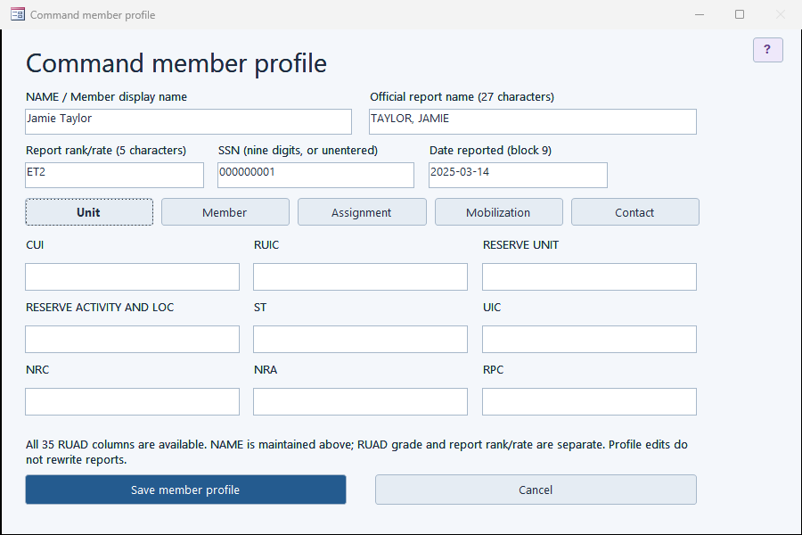
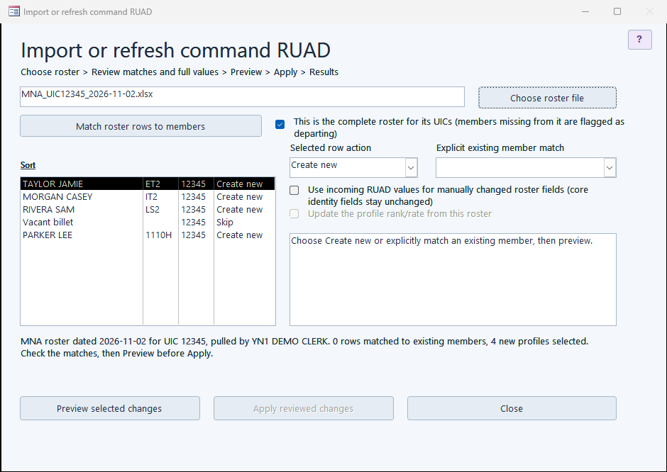
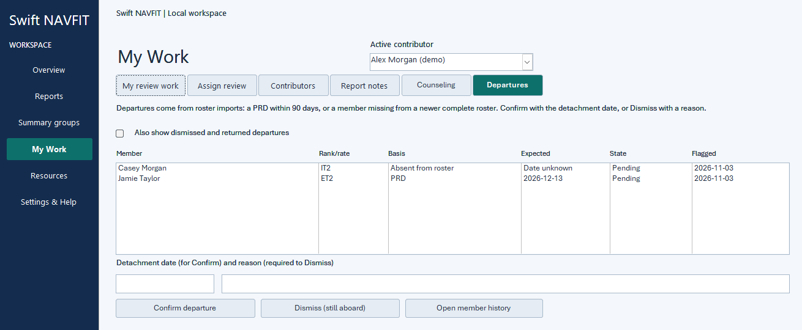
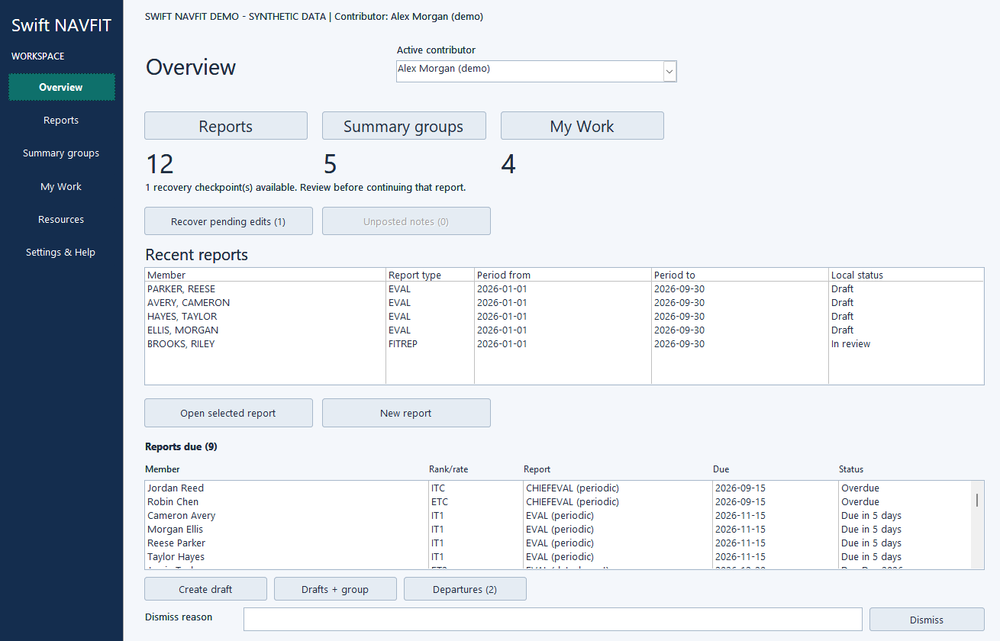
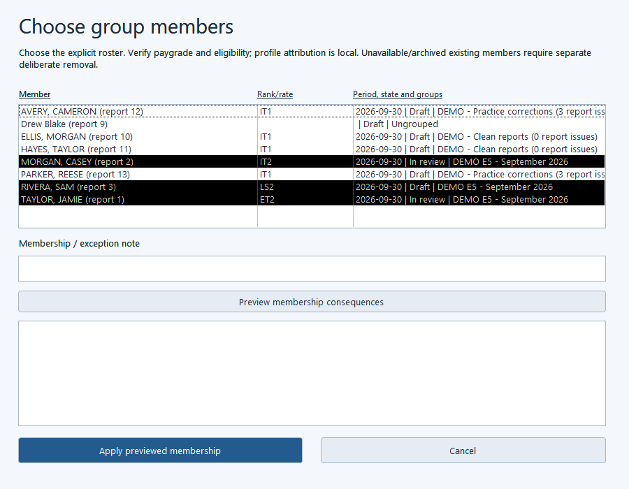
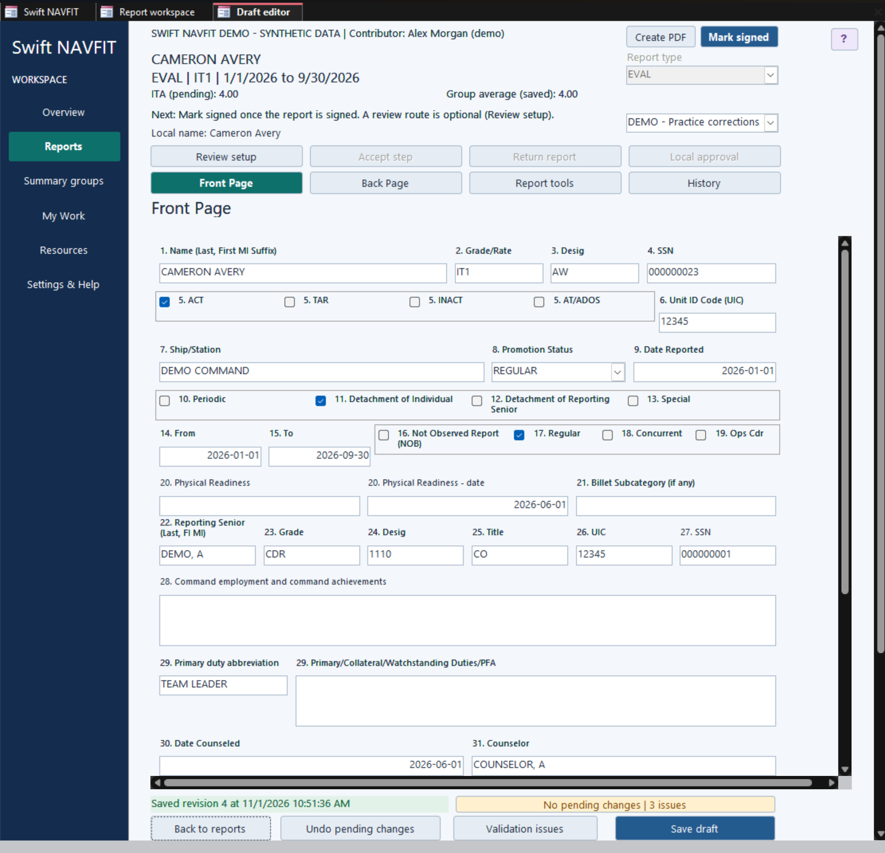
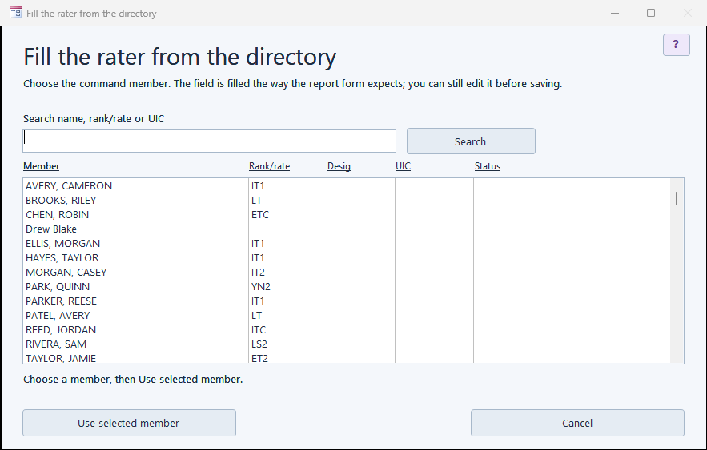
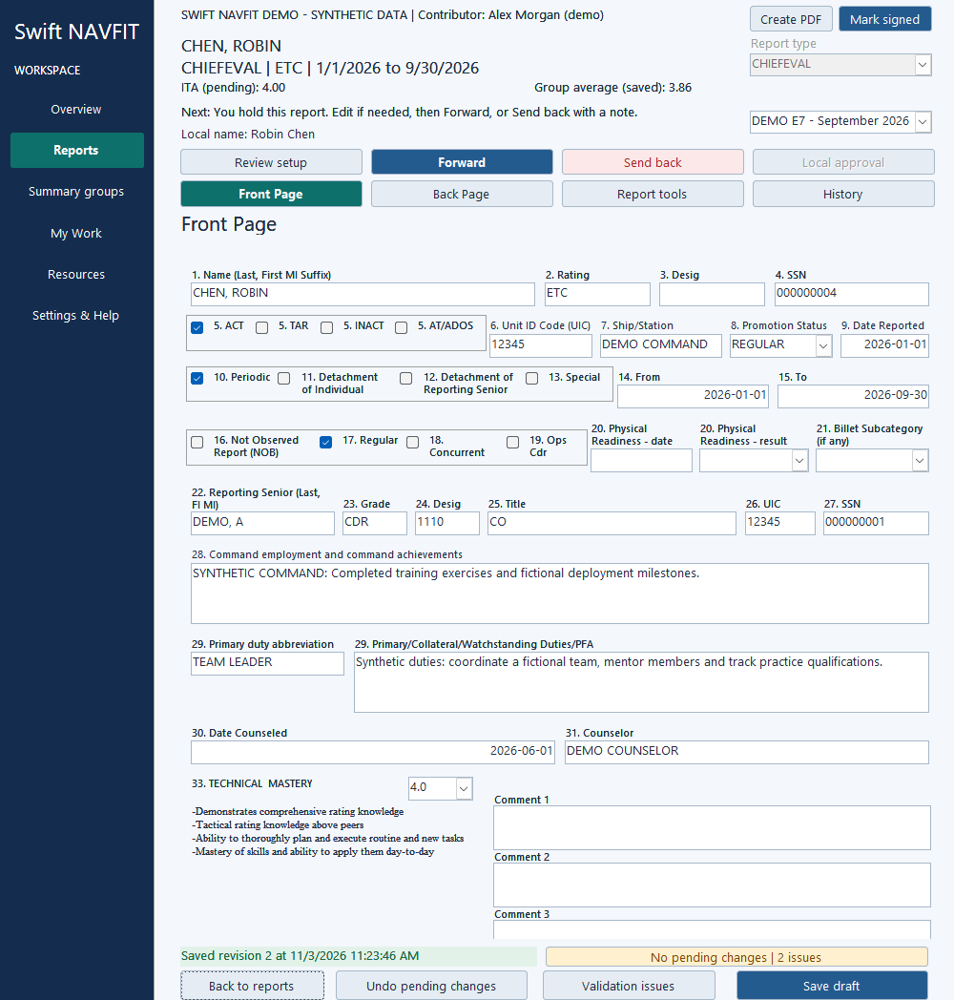
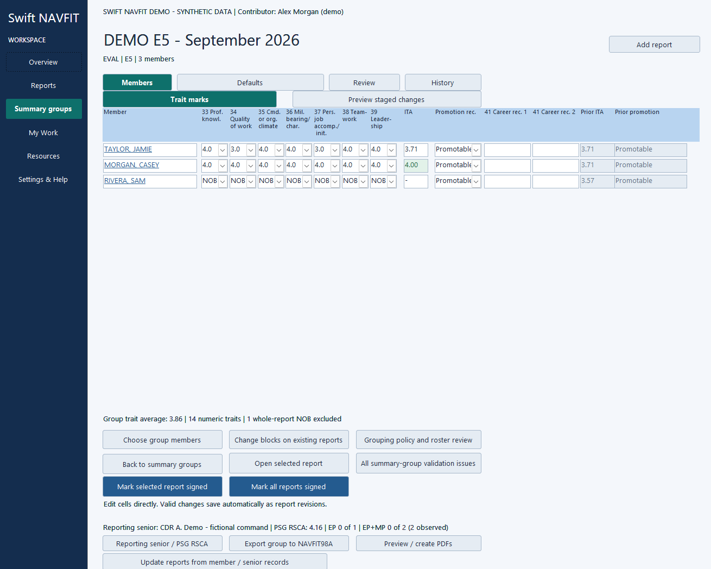
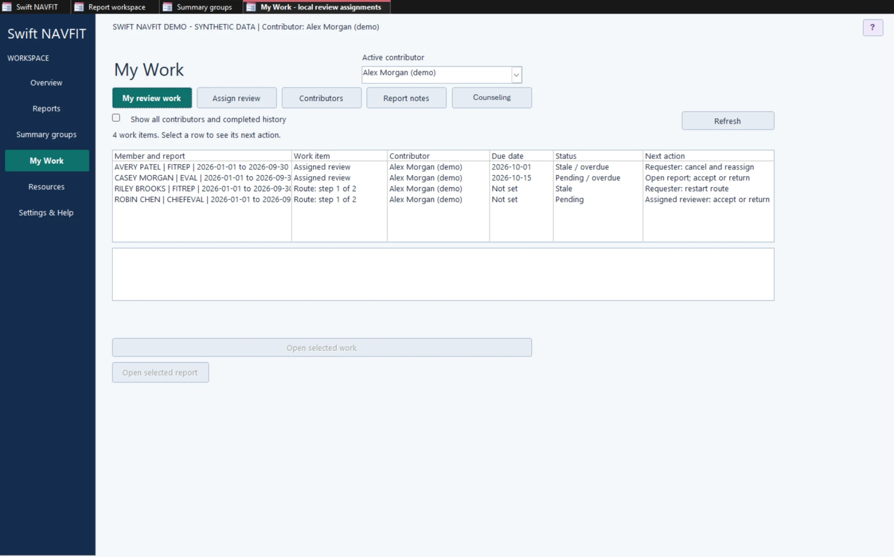

# Swift NAVFIT User Guide

Version 3.0 | 16 November 2026

For Swift NAVFIT 0.58.0 | schema 51

## Draft, review and keep Navy performance evaluations

How to write EVAL, CHIEFEVAL and FITREP reports in Swift NAVFIT, route them for review, and prepare them for signature.

**Keep this guide.** It covers everyday drafting and the coordinator's jobs: setup, rosters, summary groups, backups and upgrades. The newest version comes with each Swift NAVFIT release. **Settings & Help > About this version** shows where releases are published.

**Swift NAVFIT does not sign or submit reports.** Signing and submission happen outside Swift NAVFIT, by your command's official process.

---

# Contents and how to use this guide

## Contents

| Chapter | Topic | Page |
| --- | --- | --- |
| 1 | Evaluations and Swift NAVFIT in brief | 4 |
| 2 | Set up a workspace | 5 |
| 3 | Find your way around | 6 |
| 4 | Practice in the Demo | 7 |
| 5 | Set up the command's records | 8 |
| 6 | Import reports from NAVFIT98A or PDF | 9 |
| 7 | Plan reports and summary groups | 10 |
| 8 | Write and save a report | 11 |
| 9 | Check a report | 12 |
| 10 | Compare marks across a summary group | 13 |
| 11 | Discuss a report | 14 |
| 12 | Route a report for review | 15 |
| 13 | Use My Work and single reviews | 16 |
| 14 | Produce PDFs and export to NAVFIT98A | 17 |
| 15 | Record signatures and close out a group | 18 |
| 16 | Undo changes and recover work | 19 |
| 17 | Back up, upgrade and maintain | 20 |
| 18 | Troubleshooting | 21 |
| 19 | Glossary | 22 |
| 20 | Index | 23 |
| 21 | About this guide | 24 |

## Who this guide is for

You do not need to know Microsoft Access. If you have never written a Navy evaluation, start with chapter 1, which explains the terms used in the rest of the guide.

Each chapter starts with a **Who** line, so you can skip what is not your job:

| Who | Usually | Chapters |
| --- | --- | --- |
| Everyone | Anyone who uses Swift NAVFIT | 1, 3, 4, 11, 13, 16, 18 |
| Drafter | Writes reports: a division officer, LPO, chief or admin staff | 8, 9 |
| Reviewer | Checks and edits reports in the chain of command | 9, 12, 13 |
| Coordinator | Runs the workspace: the admin officer, YN or LPO who owns the data file | 2, 5, 6, 7, 10, 14, 15, 17 |

These are jobs, not permissions. Swift NAVFIT lets anyone who can open the data file do any of them.

## Before you start

> **Important:** Swift NAVFIT does not sign, approve or submit reports for the Navy. **Local approval**, **Mark signed** and a **Completed** summary group are records inside Swift NAVFIT only. Sign and submit reports through your command's official process.

> **Important:** The data file holds personal information, including SSNs. Keep it, and every backup and export, in a folder your command approves for that information. Swift NAVFIT adds no password or encryption of its own.

> **Important:** Keep one data file for the command, in a folder that is not synced (not OneDrive, SharePoint or Dropbox) and not temporary. A synced or temporary folder can damage the file or lose your work (2.3).

> **Important:** Back up before you import, upgrade or make a large change (17.2).

> **Important:** The Demo holds made-up data. Never put real reports or personal information into it.

## How to read the procedures

1. Numbered steps are done in order. Each step is one action.
2. **Bold text** is a button, field or window name exactly as it appears on screen.
3. **A > B** means choose A, then choose B.

**Result:** after a procedure, this line says what you should see when it has worked.

> **Important:** a step that can lose data or cannot be undone. It comes just before that step.

> **Note:** a tip, or a fact that is useful but not urgent.

Section numbers such as 8.3 point to chapter 8, section 3.

---

# 1. Evaluations and Swift NAVFIT in brief

**Who:** Everyone. Experienced report writers can skip to 1.4.

## 1.1 The three report forms

Navy enlisted members and officers are graded on a performance evaluation report. The governing instruction is BUPERSINST 1610.10H, *Navy Performance Evaluation System*. Which form a member gets depends on their paygrade:

| Form | Swift NAVFIT name | For |
| --- | --- | --- |
| NAVPERS 1616/26 | EVAL | Enlisted members, E-1 to E-6 |
| NAVPERS 1616/27 | CHIEFEVAL | Chief petty officers, E-7 to E-9 |
| NAVPERS 1610/2 | FITREP | Warrant officers and officers, W-2 to O-6 |

Each form is a set of numbered **blocks**. Swift NAVFIT shows the same blocks, with the same numbers and captions, on two pages: **Front Page** and **Back Page**.

## 1.2 What goes in a report

- **Identity and period:** the member's name, rate or rank, SSN, unit (UIC), and the dates the report covers.
- **Occasion:** why the report is written, such as **Periodic** (on the member's regular schedule) or **Detachment of Individual** (when the member leaves).
- **Performance traits:** seven graded areas, each marked 1.0 to 5.0, or **NOB** (not observed). The average of the graded traits is the **ITA**, individual trait average.
- **Comments:** the written narrative, plus command employment (block 28) and primary duties (block 29). An EVAL also has block 44 for qualifications and achievements.
- **Promotion recommendation:** Significant Problems, Progressing, Promotable, Must Promote or Early Promote.
- **Midterm counseling:** the date the member was counseled (blocks 30 and 31).
- **Signatures:** the reporting senior signs. EVALs and CHIEFEVALs also name a rater and senior rater.

## 1.3 Reporting seniors, summary groups and RSCA

The **reporting senior** is the officer who signs the report, usually the commanding officer.

A **summary group** is a set of reports with the same reporting senior, paygrade, report form and ending date (BUPERSINST 1610.10H lists the other details that must match). Reports in a summary group are ranked against each other. BUPERSINST 1610.10H limits how many members of a group can get **Early Promote** (EP) and **Must Promote** (MP).

The **RSCA**, reporting senior cumulative average, is the average of every trait mark a reporting senior has given in one paygrade over their career. Promotion boards compare a member's ITA with the senior's RSCA. The Navy keeps the official RSCA in BUPERS Online (**BOL**). Swift NAVFIT keeps a local copy you enter (5.7), and shows the **PSG RSCA**, the senior's projected RSCA after the summary group you are working on is added.

## 1.4 What Swift NAVFIT does

Swift NAVFIT is a Microsoft Access application. It keeps your command's report drafts, summary groups, members, reporting seniors, reviews, messages and history in one **data file** on your computer or network. It lets you:

- write reports with live checks against BUPERSINST 1610.10H,
- compare marks across a summary group and see the PSG RSCA,
- route reports through the chain of command for review,
- create PDFs on the official forms and export summary groups to NAVFIT98A, the Navy's report program,
- keep the signed copy and its history.

It works without the internet. It sends no data anywhere. Reference links open a web page only when you choose them, and they carry nothing from your reports.

## 1.5 What Swift NAVFIT does not do

- It does not sign or submit reports, or approve them for the Navy.
- It does not connect to BOL, NAVFIT98A, eNavFit or e-mail.
- It does not check every rule in BUPERSINST 1610.10H. A report with no findings is not a guarantee.
- It does not prove who someone is. Choosing your name as the **contributor** records who did what; it is not a login.

## 1.6 Who does what

| Job | Does in Swift NAVFIT |
| --- | --- |
| Coordinator | Owns the data file and its backups. Keeps members, reporting seniors, summary groups and contributors up to date. |
| Drafter | Writes and saves reports, fixes findings, posts messages. |
| Route requester | Starts a review route, edits reports sent back, pulls reports back, restarts or cancels routes. |
| Reviewer | Edits a report while holding it, then forwards it or sends it back. |
| Final reviewer | Records local approval after the last route step. |
| Reporting-senior administrator | Keeps reporting-senior details and RSCA history. |

One person can do several jobs.

## 1.7 Protecting the data

- Normal drafting and review send nothing to the internet, sync nothing and send no usage data.
- Store the data file and the application in a folder your command approves for personal information. The file takes that folder's Windows permissions, unless it has its own.
- Swift NAVFIT adds no login, password or encryption. Device encryption, your command's handling rules, backups and any folder sync still apply.
- Protect backups, PDFs and NAVFIT98A exports the same way as the data file.
- Microsoft Access and Office run under their own settings.

---

# 2. Set up a workspace

**Who:** Coordinator. Everyone else can skip to chapter 3.

## 2.1 What you need

- Windows with the full desktop version of Microsoft Access. The free Access Runtime does not work.
- Permission to run the application's code (VBA). Your organization's Access trust settings control this.
- A folder your command approves for personal information, that is not synced and that you can write to.

A release has three files:

| File | What it is |
| --- | --- |
| `Swift_NAVFIT_<version>.accdb` | The **application**. Open it to work. The first time, it makes your data file. |
| `Swift_NAVFIT_Demo_<version>.accdb` | The **Demo** application, for practice. |
| `Swift_NAVFIT_Demo_data_<version>.accdb` | The Demo's data file, with made-up data. Keep it in the same folder as the Demo application. |

Your workspace's **data file** holds tables only. Always open it through the application, never directly.

## 2.2 Create a new workspace

1. Save the application file in your approved folder.
2. Open it in Access. If Access shows a security bar, enable content.
3. On the setup screen, read the line that says where the work will be kept. By default it is a new file, `Swift NAVFIT data.accdb`, in the same folder.
4. To use another folder, choose **Change folder...** and pick it.
5. Type the command name and your name.
6. Type the command's **UIC** (unit identification code, up to 5 letters and digits), if you have it. New reports start with it in their UIC block.
7. Choose **Create workspace**.
8. Check the command name and your name at the top of the **Overview**.
9. Make a backup (17.2) before you enter or import much data.

**Result:** the data file exists in the folder you chose, and **Overview** opens with no reports. You can later replace the application with a newer version without moving the data file.

To change the command name or UIC later, choose **Settings & Help > Command name and UIC**, change it and choose **Save**. Reports already written keep their UIC.

## 2.3 Startup warnings

The setup and contributor screens show a yellow warning when the file is somewhere that puts your work at risk. You can continue, but fix the cause first.

| Warning | What it means | What to do |
| --- | --- | --- |
| Open from a temporary folder | It was opened from a zip file or e-mail attachment. Windows can delete it, with your work. | Exit. Save the file to your approved folder and open it there. |
| In a folder a sync service uploads | OneDrive, SharePoint or Dropbox can damage an open Access file or make conflicting copies. | Move the application and data file to a folder that is not synced. |
| Read-only | Nothing can be saved. | Copy the files to a folder you can write to. |
| Already open in another session | Someone else has the data file open. Only the second person to open it is warned. | Work on different reports (2.5), or ask them to close it. |
| Another copy of this data file is beside it | A sync service made a copy because the file changed in two places. Work saved in the copy is not in your file. | Ask whoever made the copy before you delete it. |

A network share is not flagged.

## 2.4 When Swift NAVFIT cannot find its data file

If the data file is missing, moved, renamed or on a drive that is not connected, a window titled **Swift NAVFIT data file** opens and says why. Choose one:

- **Find the data file...** to pick it (or a different one).
- **Create a new data file...** to make a new, empty one in a folder you pick and go to setup. The old file is not changed if it turns up later.
- **Close Swift NAVFIT**.

If you move the application and data file together into another folder, the application finds the data file beside it by itself.

The first-run setup screen has two more buttons, for an application that has no workspace yet:

- **Open an existing data file** links the application to a data file you pick.
- **Restore a backup or import from a previous version** makes a new data file and imports a backup or an earlier workspace into it (17.2, 17.3).

An application that already has a workspace is never relinked by these buttons, so no saved data is lost.

## 2.5 Two people on one data file

Swift NAVFIT is designed for one person at a time. Two people can share one data file if they work on **different reports**:

1. Put the data file in a shared network folder (a mapped drive or server folder), not a synced folder. A synced folder gives each computer its own copy, and the copies never meet.
2. Each person saves their own copy of the application and opens the shared data file with **Open an existing data file**.

While you share:

- **Overview** names everyone who used the workspace in the last 10 minutes, and their computer.
- If you open a report someone else has open, the editor says who.
- If they save first, your save is refused and your entries are kept. Reopen the report to see their change, then make yours again.
- If two saves happen at the same moment, Swift NAVFIT tries again a few times, then says someone else was saving and keeps your entries.

## 2.6 Continue from an older Swift NAVFIT workspace

Workspaces from release 0.49.0 to 0.55.0 are a single file. To carry one forward:

1. Open a newly downloaded application. Do not overwrite the old file with it.
2. On the setup screen, choose **Open an existing data file** and pick the old workspace.
3. Read the message. Swift NAVFIT will make a new data file beside the old one and bring the workspace in. The old file is only read.
4. Choose **OK**.

**Result:** a new file named `<old file name> data.accdb` is in the same folder, every row and field has been checked, and contributor choice opens. If the import fails, the new data file stays empty and Swift NAVFIT says so; try again from **Settings & Help** (17.3).

A data file from 0.56.0 or later is upgraded in place (17.4).

---

# 3. Find your way around

**Who:** Everyone.

## 3.1 Choose who you are

Swift NAVFIT records your name as the **contributor** on everything you save, post or decide. Check it before you work.

1. Close any open report.
2. Choose **Resources > Contributors**.
3. Double-click your name, or select it and choose **Switch contributor**.
4. Check that your name now shows as the active contributor.

**Result:** your name is shown on **My Work** and in the message box caption.

Never switch to someone else's name to act for them. Each person keeps their own contributor even when two people share a data file.

**Add a contributor (Coordinator).** Type a name in **New contributor name** and choose **Add contributor**. Or choose **Add from directory** and pick a command member; the contributor is then named like *LCDR JONES, PAUL A* and linked to that member.

> **Important:** Deleting a contributor removes them from every review route template and active route, and cancels review requests assigned to them. If they held a report, the next reviewer now holds it. Their name stays on everything they already did. You cannot delete the active contributor.

To delete a contributor, select them and choose **Delete contributor**. Adding the same name again brings their profile back.

## 3.2 Main destinations

The buttons on the left take you to:

| Destination | Use it to |
| --- | --- |
| **Overview** | See workspace status, reports due, recent reports and work to recover. |
| **Reports** | Find, create, open, import, archive and duplicate reports. |
| **Summary groups** | Build groups, set shared values, compare marks and close out. |
| **My Work** | See reviews you hold, counseling due, departures and report messages. |
| **Resources** | Keep the member directory, reporting seniors, ISICs, contributors, writing aids and review route templates. |
| **Settings & Help** | Help, backups, imports, recovery, operation history and version information. |

The **?** at the top right of each window opens help for that window.

## 3.3 The report editor

| Area | What is there |
| --- | --- |
| Header | Member, report form, period, ITA, group average and review status. |
| Page buttons | **Front Page**, **Back Page**, **Report tools** and **History**. |
| Report tools | **Notes and replies**, **Review steps**, **Validation checks** and **Trait calculations**. |
| Action area | **Back to reports**, **Undo pending changes**, **Validation issues**, **Save draft** and the save status. |

## 3.4 Find reports and save filter sets

In **Reports**, type in the search box. Words can be in any order: `Jamie Taylor` finds `TAYLOR, JAMIE`. You can leave out apostrophes and hyphens.

To find reports by date, fill in **Period overlaps from** and **Through**. Reports that overlap the range are listed. Leave either box blank for an open-ended range.

To keep a set of filters:

1. Set the search, dates, group, report type, review status, rank/rate and archive filters.
2. Choose **Save filter** and type a name.
3. Later, pick it in **Saved filter**.

**Clear filters** resets the list without deleting saved sets. **Delete filter** deletes the selected saved set. Saved sets belong to your contributor.

If a report seems to be missing, choose **Clear filters** and check the archive filter.

## 3.5 Colors and disabled buttons

Color always comes with text: read the label and status line as well. A gray field matches its member or reporting-senior record; it can still be edited. A disabled button usually means one of these: the wrong contributor is active, someone else holds the report, the report is archived or locally approved, or it has unsaved changes.

## 3.6 Accessibility

Swift NAVFIT is built to meet Section 508 (WCAG 2.0 Level AA) for desktop software.

**Keyboard.** Everything can be done with standard Access keys:

| Key | Does |
| --- | --- |
| Tab / Shift+Tab | Next or previous field. On report pages, fields follow the form's block order. |
| Enter or Space | Press the focused button. |
| Space | Tick or clear the focused check box. |
| Alt+Down Arrow | Open the focused drop-down list. |
| Arrow keys | Move through a list. |
| Esc | Undo typing in the current field. |
| F7 | Check spelling in a narrative block. |

**Screen readers.** Each field announces its label: the official block caption on report pages. Fields without a visible label still announce a name, such as "Trait 33" or "E5 RSCA". Status and save messages are text, so a screen reader can read them.

**Color and contrast.** Text has at least 4.5:1 contrast. With a Windows contrast theme on (**Settings > Accessibility > Contrast themes**), Swift NAVFIT uses the theme's colors; reopen any window that was already open.

**Magnification.** Swift NAVFIT's text does not follow the Windows text-size setting. Use Windows Magnifier: **Windows key + Plus** zooms in, **Windows key + Esc** turns it off.

**Known limits.** Testing with the NVDA and JAWS screen readers is not finished. PDFs reproduce the official forms and are not tagged for screen readers.

Report accessibility problems through **Settings & Help > Support and limitations**. Say which window, which field and which assistive technology.

---

# 4. Practice in the Demo

**Who:** Everyone. Takes about 20 minutes.

The Demo is a separate application with made-up members, reports, groups and reviews. Use it to learn before you touch real reports.

1. Save the Demo application and Demo data file together in one new folder.
2. Open the Demo application and choose a contributor.
3. Choose **Summary groups** and open **DEMO - Clean reports (0 report issues)**.
4. Look at the members, their ITAs, their prior ITAs and the PSG RSCA.
5. Click a member's name to open their report.
6. Choose **Front Page**, then **Back Page**.
7. Choose **Report tools > Validation checks**. Then choose **Validation issues** and move the window beside the report.
8. Choose **Report tools > Notes and replies**, type a message and choose **Post message**.
9. Choose **Back to reports**, then **Summary groups**, and open **DEMO - Practice corrections (3 report issues)**.
10. Open a report with findings. Choose a finding, choose **Go to affected report block**, fix the value and choose **Save draft**.
11. Choose **History** and look at the saved revision.
12. Choose **My Work** and look at the sample reviews.
13. Close the Demo.

**Result:** you have used each main window, fixed a finding and saved a revision.

> **Important:** Never import real data into the Demo, and never use the Demo as your command's workspace. To start over, save a fresh copy of the two Demo files.

---

# 5. Set up the command's records

**Who:** Coordinator.

Reports draw names, rates, units and reporting-senior details from these records, so set them up before you write reports.

## 5.1 Add and edit members

1. Choose **Resources > Command member directory**.
2. Choose **Add member**, or select a member and choose **Edit selected member**.
3. Fill in the member's name, rank/rate, SSN, UIC and the other fields you have.
4. Fill in **Date reported** (block 9), the date the member reported aboard. Leave it blank if you do not know it. Rosters do not carry it.
5. Choose **Save member profile**.

**Result:** the profile window says how many of the member's open reports it updated, and which it did not.

Saving a changed profile updates the name, rank/rate, SSN, UIC, designator and date reported in the member's draft reports. It does not change signed or locally approved reports, reports under review, a report open in the editor, or a report whose rank/rate no longer fits its summary group's paygrade. Change those in the report itself.

## 5.2 Import a roster

Swift NAVFIT reads two roster formats: an NRRM RUAD export (CSV) and an MNA roster workbook (.xlsx).

1. Choose **Resources > Command member directory > Import / refresh roster**.
2. Choose the file. For an MNA workbook, check the date, UIC and point of contact shown.
3. Tick **This is the complete roster for its UICs** only if the file is the full roster (see below).
4. Choose **Match roster rows to members**.
5. Check each row. Rows for one existing member are matched to that member. Rows for new people get a new profile. A name shared by several members waits for you to pick one.
6. Choose **Preview** and check the changes.
7. Choose **Apply**.

**Result:** profiles are added or updated, and the import is kept as a dated snapshot.

- **Complete roster.** When ticked, anyone missing since the last complete roster for the same UICs is flagged as departing. Leave it clear for a partial or filtered export. A roster dated before the last complete roster cannot be marked complete.
- **PRD.** A member whose PRD (projected rotation date) is within 90 days is also flagged as departing.
- **Changed values.** A matched member's profile takes the roster's values. To keep a profile's own values for one row, select the row and clear **Use incoming RUAD values for manually changed roster fields** or **Update the profile rank/rate from this roster**. The display name, report name and SSN never change. A blank roster cell never clears a value; the preview marks it **kept; the roster has no value**.
- **MNA rows** carry the DoD ID, so a member whose name changed is still matched. MNA does not list officer ranks; an officer's rank comes from their latest report, or enter it on the profile.

Swift NAVFIT never deletes or archives anyone because of a roster.

## 5.3 Handle departures

1. Choose **My Work > Departures**.
2. Select a member.
3. Either fill in **Detachment date** and choose **Confirm departure**, or fill in **Departure reason** and choose **Dismiss (still aboard)**.

A member who appears again on a later complete roster is marked returned. Flagged and confirmed departures show in **Reports due** as detachment reports (7.1); dismissed ones do not.

## 5.4 Merge duplicate Sailors

The same Sailor can end up with two profiles, for example when a roster spells a name differently.

1. Choose **Resources > Command member directory > Review possible duplicate Sailors**.
2. Select a pair. The list is strongest match first:

| Match | Why |
| --- | --- |
| Likely | The same SSN or DoD ID |
| Probable | The same name in report format (LAST, FIRST MI) |
| Possible | The same surname and first initial |

3. Check the two members. The suggested survivor is on the right.
4. Choose **Preview identities and all affected links** and check them.
5. Type a reason. Do not include SSNs or DoD IDs.
6. Choose **Apply reviewed merge**, or **Not the same Sailor** if they are different people.

**Result:** the original's reports, prior evaluations, counseling and roster history move to the survivor, and the original is archived.

> **Note:** To undo a merge, select it in the merge history. To list a pair you marked "Not the same Sailor" again, tick **Show pairs marked as different Sailors**, select it and choose **List again**. For a Sailor whose name changed, pick the two members yourself instead of a listed pair.

Profiles with different SSNs or DoD IDs are never listed.

## 5.5 Record prior evaluations

Prior evaluations let Swift NAVFIT show each member's previous ITA and promotion recommendation beside the new marks.

1. Choose **Resources > Command member directory** and select the member.
2. Choose **Written reports and prior evaluations for selected member**.
3. Choose **Record prior evaluation**.
4. Enter the prior report's dates, form, traits and promotion recommendation exactly as on the signed report.
5. Choose **Save prior evaluation**.

If a prior value is wrong, fix the prior evaluation here. Do not change the new report's marks to make up for it.

## 5.6 Track midterm counseling

BUPERSINST 1610.10H chapter 18 sets a counseling month for each paygrade. A new schedule starts 1 January 2027. Swift NAVFIT uses the member's rank/rate to show who is due.

1. Choose **My Work > Counseling**. It lists members who are overdue, due this month, due within 60 days, or whose worksheet needs a final disposition. Tick **Show every active member** to see everyone.
2. Select a member and choose **Record counseling for selected member**. (Or open the member's history and choose **Record counseling**.)
3. Enter the date.
4. Choose the outcome. For **Completed**, enter the counselor exactly as block 31 will show it. For **Not performed**, pick a reason such as TEMADD or ILLNESS, or type one.
5. Choose **Save counseling record**.

**Result:** the session is in the member's history, and blocks 30 and 31 of their next report start with it.

- A session held earlier or later than the scheduled month still counts for that cycle.
- To remove a record entered in error, open the member's history (**Resources > Command member directory > Written reports and prior evaluations for selected member**), select it and choose **Archive selected counseling**. To bring it back, select **Archived counseling** there, select it and choose **Restore selected counseling**.
- The signed counseling worksheet stays on paper. After the member's Detachment of Individual report, record whether the worksheet was **Given to member** or **Destroyed**.
- Master chiefs and CWO5s have no Regular periodic report since 3 June 2026 (NAVADMIN 132/26), so they are never shown as due.

Members without a rank/rate are not scheduled. Enter it in the member directory.

## 5.7 Add reporting seniors and RSCA history

1. Choose **Resources > Reporting seniors and RSCA history**.
2. Choose **New reporting senior**.
3. Search the member directory, select the officer and choose **Use selected member**. To type everything yourself, choose **Enter details by hand**.
4. Enter the title (for example, CO) and any address, phone and e-mail.
5. Choose **Save record details**. Nothing is saved before this.
6. Choose **RSCA history**.
7. For each paygrade the senior has graded, enter the RSCA, the number of **previous graded traits** (traits, not reports) and the **As of** date you pulled it from BOL. Leave other rows blank.
8. Choose **Save RSCA table**.

**Result:** the record is listed with its grade, designator, title and UIC, and the **Source** column shows where each RSCA came from.

- The address, phone and e-mail print on the summary letter. The e-mail is not on the report forms.
- If the senior's directory profile changes (after a promotion, for example), the **Reporting senior details** page says so. Choose **Update from directory**, then save. **Change member** links a different member; **Unlink** removes the link and keeps the typed values.
- Changing a senior record does not change saved reports. To copy the details into a group's reports, use **Apply reporting senior details to reports** (10.4).
- **Export RSCA history** saves an Excel workbook of the senior's record, to take to the next command. For each paygrade it lists the BOL baseline and its date, every report counted through a completed summary group (name, rank/rate and ITA), reports in groups not yet completed (listed but not counted), and the RSCA calculation at the bottom. It holds names and ITAs, so store it as personnel information.
- **View RSCA history** shows, for one paygrade, the BOL value you entered and each summary group completed since. Entries before the latest BOL value are marked **Earlier**. Select a group and choose **Open selected group** to go to it.
- An RSCA from BOL is rounded, so the total Swift NAVFIT works out from it is an estimate. Keep the **As of** date so others know how current it is.

## 5.8 Keep the ISIC list

The summary letter is addressed through the ISIC (immediate superior in command).

1. Choose **Resources > ISICs for summary letters**.
2. Add an ISIC: a name, its UIC and its address as it should print (up to four lines). Put the command's title on the first line.

The name is only how the ISIC appears in lists. Deleting one removes it from new choices only.

## 5.9 Set up review route templates

A route template is an ordered list of reviewers, such as division officer, department head, XO.

1. Choose **Resources > Review route templates**.
2. Choose **Add reviewer** for each reviewer, in order.
3. Choose **Create route template**.

**Delete selected template** removes it from future use. Reports already under review keep their reviewers.

---

# 6. Import reports from NAVFIT98A or PDF

**Who:** Coordinator or Drafter.

> **Important:** Back up before a large import (17.2).

## 6.1 Import from a NAVFIT98A database

1. Choose **Reports > Import reports**.
2. Choose **Choose NAVFIT database - groups and reports**.
3. Pick the NAVFIT98A database file.
4. Check the reports and groups it lists. Select the ones you want, or **Select all**.
5. Check the preview, then apply it.
6. Open each imported report and check the names, periods, traits and comments.

**Result:** the reports are drafts in Swift NAVFIT. Values Swift NAVFIT does not use are kept and go back out on export.

## 6.2 Import a filled PDF form

Swift NAVFIT reads the May 2025 fillable NAVPERS EVAL, CHIEFEVAL and FITREP forms. It does not need Acrobat or the internet.

1. Close the report you want to fill, if it is open.
2. Choose **Reports > Import reports > Choose structured PDF - supported field mappings**.
3. Choose **Choose PDF** and pick the file.
4. To make a new draft, leave the target blank. To fill an existing draft, pick it, then choose **Fill empty fields** or **Replace mapped values**.
5. Choose **Preview mapping and merge** and check every before-and-after value.
6. Choose **Apply reviewed import**.
7. Choose **Open imported report** and check it, especially SSNs and leading zeros.

**Result:** the report shows the PDF's values, and its History has a **Before PDF import** checkpoint.

- A blank PDF field never clears a value.
- A scanned PDF, or one saved through **Print to PDF**, has no form data left. Fill the form in Adobe Acrobat or Reader and use **File > Save**.
- Password-protected files are refused.
- If something goes wrong on another computer, choose **Check PDF extraction on this computer**.
- To undo an import, see 16.3.

---

# 7. Plan reports and summary groups

**Who:** Coordinator.

## 7.1 See which reports are due

**Overview > Reports due** lists the reports the command owes:

- **Periodic** reports, from each active member's paygrade calendar (BUPERSINST 1610.10H tables 1 and 1A), from 90 days before until 90 days after the due date.
- **Detachment** reports, for members flagged as departing and not dismissed (5.2, 5.3): at the confirmed detachment date, or at the expected date, such as the PRD, until it is confirmed.

A row clears when a matching Regular draft exists: one ending on the due date, or within 30 days of a detachment date. A Concurrent-only report does not count. Members with no rank/rate are counted below the list. Swift NAVFIT does not decide whether a report is required; check against current policy.

To act on rows:

- **Create draft** makes the report for one member: the right form, ending on the due date and starting the day after their last report. It opens in the editor.
- **Drafts + group** makes drafts for several rows (select with Ctrl+click or Shift+click) and a summary group for each report form, paygrade and due date. If one row cannot be made, none are, and the message says which row.
- **Dismiss** needs a reason in **Dismiss reason**, for example when a detachment report is not needed.
- **Departures (N)** opens **My Work > Departures**.

## 7.2 Create a summary group

1. Choose **Summary groups > Create summary group**.
2. Type the **Summary group name**, and choose the **Report type** and **Member paygrade**.
3. Choose **Create group**.
4. Choose **Open summary group**.
5. Choose **Reporting senior / PSG RSCA** and pick the reporting senior (10.4).

**Result:** the group opens on its **Members** page with no members.

## 7.3 Add reports to a group

**Existing reports:**

1. In the group, choose **Choose group members**.
2. Tick the reports. Each shows its report number, period, status and current groups.
3. Choose **Preview membership consequences** and read it.
4. Choose **Apply previewed membership**.

**A new report for one member:**

1. In the group, choose **Add report**.
2. Choose a member, or enter a new one.
3. Check the dates in **14. From** and **15. To**.
4. Choose **Create report**.

**New reports for many members:**

1. Choose **Resources > Command member directory > Create group reports from directory members**.
2. Choose the summary group and the report dates.
3. Filter by rank/rate (for example, E6 or YN1) and tick the members.
4. Choose **Preview new reports** and check names, forms, dates and group.
5. Choose **Create previewed drafts**.

If you change the filter or selection, preview again. Creating reports in bulk does not check that each member is due a report.

**Move a report from inside it:** in the report's summary group box, choose a group marked *(move here)* and confirm. Save a new report before you move it.

## 7.4 Set shared values (defaults)

Defaults fill blocks that are the same for everyone in the group: blocks 5 to 21 and block 28. Blocks 22 to 27 and 48 come from the group's reporting senior. Block 29 is written for each Sailor.

> **Important:** A default does not just fill blanks. It replaces that block in every active report in the group, including values someone typed, and returns locally approved reports to editing. A **global** default does this in every active group.

1. In the group, choose **Defaults**. (For all groups, choose **Summary groups > Edit global defaults**.)
2. Change one block.
3. Read the confirmation: it says which reports will change.
4. Confirm only if that is what you want.
5. Open a report and check the value.

**Result:** the block is saved in every listed report and in new reports created in the group. Signed and archived reports are skipped. If anything fails, nothing changes.

**Update reports from member / senior records** pulls current values from member profiles and the reporting-senior record into the group's drafts. Check the field list before you confirm. Locally approved reports return to In-Work.

## 7.5 Read the summary group list

| Column | Meaning |
| --- | --- |
| Reports | How many reports are in the group. |
| Status | Local tracking: Initialized, In-Work, Ready for Signature, Completed (15.4). |
| Closeout date | The reports' ending date. **Mixed** means different dates; **Incomplete** means some are missing. |

Archiving a group hides it but keeps its reports. To find it again, change the archive filter and choose **Recover summary group**.

---

# 8. Write and save a report

**Who:** Drafter.

## 8.1 Create a draft

1. Choose **Reports > New report**.
2. Choose **E1-E6 EVAL**, **Chief EVAL** or **FITREP**.
3. Choose the member from the directory, or type their details.
4. Check the member, form, period and summary group in the header.
5. Fill in **Front Page**, then **Back Page**.
6. Choose **Save draft**.

**Result:** the status says the revision was saved.

You can save an incomplete draft. Saving is not a check that the report is right; use **Validation checks** for that (chapter 9).

## 8.2 Fill in the Front Page

Fields are laid out in the printed form's rows: blocks 5 to 9, 10 to 15 and 16 to 21 each share a row. All seven traits are on the Front Page here, though some print on the back.

- **Gray fields** match the member or reporting-senior record. Hover for the source. You can still change them.
- **Block 16, Not Observed (NOB):** ticking it sets all seven traits and the promotion recommendation to NOB. Clearing it before you save puts the marks back.
- **Block 20:** on an EVAL or FITREP, the physical readiness code only. On a CHIEFEVAL, the PFA month and result. Type the month as MM/YY, or choose **Pick...** and any day in that month.
- **Block 21** (billet subcategory) is a list.
- **Check boxes** start blank. A box never clicked is saved as not answered; a cleared box is saved as No.
- **Blocks 30 and 31 (counseling):** type a date as YYYY-MM-DD, **NOT REQ** or **NOT PERF**, or choose **Calendar**. NOT PERF needs a reason in block 31. If a counseling session is recorded (5.6), these start filled in.
- **Rater, senior rater, counselor:** choose **31. Counselor...**, or double-click the field, to pick from the member directory. The rater and senior rater become **LAST, F M, RANK** (28 characters at most) and the counselor **LAST, F M** (20 at most). A name too long is cut to the last name; if that still does not fit, type it yourself.
- **Counseling record differs:** if blocks 30 and 31 do not match the recorded session, **Validation checks** shows a finding. Select it and choose **Use recorded counseling in blocks 30-31**.

When you save, names and rates are put in NAVFIT98A's format: capitals, and the member's name as **LAST, FIRST MI SUFFIX** (*john q smith jr* becomes *SMITH, JOHN Q JR*). The reporting senior's name becomes **LAST, F M**. For a last name of more than one word, type a comma after it: *VAN DER BERG, ANNA*.

## 8.3 Write the comments

The comments box uses the same font, size and width as the PDF, so text wraps on screen where it will on paper: Courier New on an EVAL, Times New Roman on a FITREP or CHIEFEVAL. Text is 12 point and changes to 10 point when it no longer fits.

The line meter under the box shows how many lines NAVFIT98A will print, for example **14 of 18 lines in NAVFIT98A**, and the room left in Swift NAVFIT's PDF.

| Block | EVAL and FITREP | CHIEFEVAL |
| --- | --- | --- |
| Comments | 18 lines | 6 lines |
| Block 28, command employment | 3 lines | 3 lines |
| Block 29, primary duties | 4 lines | 4 lines |
| Each performance comment | not used | 2 lines |

| Meter shows | Meaning |
| --- | --- |
| *N* of *M* lines | The comments fit. |
| Amber, "last line" | The block is full. |
| Red, "2 lines over its limit" | NAVFIT98A will cut off the extra text when it prints. Shorten it. |
| "last line holds one word" | Cutting a few words would save a line. |
| "Line count unavailable (no printer)" | Microsoft Print to PDF is turned off on this computer. Ask IT to turn it on (18.1). |

Text that does not fit continues on an added page of Swift NAVFIT's PDF. Always check the final print in NAVFIT98A.

Text past the PDF's room prints on an added **additional text** page. Hover over the meter to see the comments measured on Swift NAVFIT's own PDF.

**Block 44 (EVAL only)** lists courses, degrees, qualifications, awards and community involvement during the period. It prints in two lines; longer text goes on an added page. FITREPs and CHIEFEVALs have no block 44; put qualifications in the comments. NAVFIT98A imports and exports carry block 44. A report whose block 44 was brought back from an earlier NAVFIT98A import shows **Block 44 restored from NAVFIT98A** in its History.

## 8.4 Use writing aids

**Snippets.** Click in the narrative block where the text belongs, choose **Insert narrative snippet**, select a snippet and choose **Append to open draft**. Replace any bracketed capitals, such as `[MEASURABLE RESULT]`; until you do, the report shows an Information finding. Make sure borrowed wording fits the member's real work.

**NavyWriter examples.** **Resources > NavyWriter examples catalog** opens examples from an outside site when you choose them.

**EVALMAN.** **Resources > EVALMAN (BUPERSINST 1610.10H)** holds the whole instruction as text, through CH-4 (22 Oct 2026), offline: the change transmittals, the basic instruction, both enclosures, all 19 chapters with every block, and the exhibits and tables. Choose a section under **Contents**, or type words or a "phrase in quotes" and choose **Find**. Results list each section with its number of matches; **Next match** and **Previous match** step through them, highlighted. The text was taken from the official PDF and checked against it; the PDF remains the authoritative copy.

**Spelling.** Choose **Check spelling**, or press **F7** in any narrative block. It uses Microsoft Office's spelling checker on this computer and sends nothing anywhere. Words in all capitals are checked too. If Office's proofing tools are not installed, Swift NAVFIT says so.

**Add the Navy word list (once per computer).** Office flags many Navy terms such as ITCS, LCDR, RSCA and watchbill. Swift NAVFIT includes about 800 of them:

1. Choose **Resources > Save Navy word list for spell check** and save it in a folder you keep, such as Documents.
2. In Access, choose **File > Options > Proofing > Custom Dictionaries**.
3. Choose **Add**, pick *Swift NAVFIT Navy words.dic* and choose **OK**.

**Result:** Access, Word and Outlook accept those terms.

## 8.5 Save, leave and move between reports

| Status | Meaning | What to do |
| --- | --- | --- |
| Pending changes | What you see is not saved yet. | Choose **Save draft** when ready. |
| Saved revision | Your changes are saved. | Nothing. |
| Recovery checkpoint | Unsaved work was kept aside because it could not be saved. | Recover it (16.2). |
| Save failed | Nothing was saved. Your entries are still on screen. | Fix the entry named and save again. |
| No pending changes | Nothing to save. | Nothing. |

- Switching between **Front Page** and **Back Page** keeps your changes without saving.
- Leaving a report saves it. If it cannot be saved, your entries go to a recovery checkpoint and you can leave once that works.
- In a summary group, **Previous** and **Next** move between the group's reports in the order of its **Members** page.
- Locally approved and archived reports are read-only. Reopen approval (12.6) or recover the report (16.4) to edit.

> **Important:** **Undo pending changes** throws away every unsaved change in the report. It cannot be undone.

---

# 9. Check a report

**Who:** Drafter and Reviewer.

## 9.1 Review findings

Swift NAVFIT checks the report against BUPERSINST 1610.10H as you type, including unsaved values.

1. Choose **Report tools > Validation checks**.
2. Select a finding and read it: the message, the block and the rule it cites.
3. Choose **Go to affected report block**.
4. Fix the value.
5. Choose **Refresh checks**, then **Save draft**.

**Result:** the finding is gone from the list.

To keep findings in view while you work, choose **Validation issues**, or **Pop out validation issues**, and move the window beside the report. Choose **Close validation window** when done.

> **Note:** The checks cover only the rules built into Swift NAVFIT. An empty list does not mean the report meets every rule.

## 9.2 Kinds of finding

| Finding | What to do |
| --- | --- |
| Invalid entry | Fix the format or range. |
| Incomplete draft | Fill it in when you have it. You can keep drafting. |
| Policy issue | Read the cited rule. Fix the report, or be ready to justify it. |
| Needs review | A person must decide whether it applies. |
| Information | A note only, such as comments longer than NAVFIT98A's block. It never blocks saving or output. |

A summary group also has group findings, such as grouping and promotion-limit reminders. They do not mean a member's report has an error.

## 9.3 Wording that should not be in a report

Swift NAVFIT checks the comments and blocks 28, 29 and 44 for wording BUPERSINST 1610.10H says to leave out (enclosure 2, 13-5). Examples: a failure of selection, proceedings that are not concluded, a non-punitive letter of caution, marital or medical matters, an award not yet received, civilian employment, classification markings, and in block 44, achievements not yet complete. As Information only, it also notes protected characteristics, political activity, SSNs and text in all capitals.

Each finding quotes the words it matched. Swift NAVFIT matches words, not meaning, so it can be wrong. When a finding is acceptable, type a reason, then:

- **Dismiss for this report** hides it on this report. If the words change, it comes back.
- **Allow this phrase** stops that check flagging those words on every report.

**Content checks...** has two pages:

- **Allowed and dismissed** lists every allowed phrase and dismissed finding, with who added it, when and why. Select one and choose **Remove or restore selected** to bring its findings back.
- **Checks** lists the 24 checks, each with its pattern and why it exists. Select one and choose **Turn on/off**, or use **Turn all off** and **Turn all on**. A check that is off finds nothing in any report, and **Validation issues** says how many are off.

Dismissing or allowing never changes the report, and both are logged. Turning checks on or off is not logged.

## 9.4 See how the ITA was worked out

Choose **Report tools > Trait calculations**. It shows unsaved values, saved values and the summary group's figures side by side. NOB and blank traits are left out of the average, not counted as zero.

---

# 10. Compare marks across a summary group

**Who:** Coordinator and the reporting senior's staff.

## 10.1 Edit marks in the group table

1. Open the summary group and choose **Members**, then **Trait marks**.
2. Check the member names and their prior values.
3. Click a trait or promotion-recommendation cell and type the new mark.
4. Move out of the cell.

**Result:** the cell saves straight away. A red bold name means a cell did not save; choose **Retry pending cells** or **Discard pending cells**.

Click a member's name to open their report. Click a column heading to sort.

## 10.2 Read the colors

| You see | Meaning |
| --- | --- |
| Green ITA | Higher than this Sailor's prior ITA. |
| Yellow ITA | Lower than this Sailor's prior ITA. |
| No color | The same, or no prior ITA. |
| Gray prior cells | Earlier reports. Read-only; fix them in the member's history (5.5). |
| Gray italic name | The report is locked here. Select the row to see why. |
| Red bold name | A cell did not save. |

A color is a reminder, not advice. Marks still need to be accurate.

## 10.3 ITA, group average and PSG RSCA

| Figure | Is the average of |
| --- | --- |
| ITA | One report's graded traits. |
| Group average | All saved, graded traits in the group. |
| Current RSCA | The reporting senior's past traits for this paygrade, before this group. |
| PSG RSCA | The reporting senior's past traits for this paygrade plus this group's. |

They use different counts, so they can differ. The group shows the current RSCA beside the PSG RSCA with the change this group makes, for example **Current RSCA: 4.20 | PSG RSCA: 4.19 (-0.01)**.

Next to the PSG RSCA, the group shows promotion recommendations against the limits in BUPERSINST 1610.10H table 1-2, for example **EP 1 of 2 | EP+MP 3 of 5 (8 observed)**. **Over limit** means the group is past one of them. O-1 and O-2 groups, other than LDO, show that none are allowed. Only saved marks count.

## 10.4 Set up the PSG RSCA

1. In the group, choose **Reporting senior / PSG RSCA**.
2. Choose the reporting senior and the paygrade's RSCA history.
3. Confirm whether that history excludes this group's contribution, as the calculator asks.
4. Read the PSG RSCA and its explanation.

If the PSG RSCA is unavailable, check the senior, the paygrade's history, the question in step 3, and that every report's traits are saved. **Apply reporting senior details to reports** copies the senior's name and details into the group's reports.

## 10.5 Try changes before applying them

1. In the group, select a member and change their **Proposed marks**.
2. Choose **Stage selected member changes**. Repeat for other members.
3. Choose **Preview staged changes** and check the before-and-after values.
4. Choose **Apply reviewed selected proposals**.

If membership or a report changes in between, preview again.

---

# 11. Discuss a report

**Who:** Everyone.

Each report has one message log that everyone in the workspace can read and add to. Messages stay with the report for good. Posting a message never changes the report or its status, and messages are never part of the official report.

1. Open the report and choose **Report tools > Notes and replies**.
2. Read the log, oldest first.
3. Type in the message box. Its caption shows who you are posting as.
4. Choose **Post message**.

**Result:** the message is added to the log at once.

If you start a message and then leave the report, Swift NAVFIT asks you to post or clear it.

To read messages on all reports, choose **My Work > Report notes**, select a report and choose **Open selected report conversation**.

> **Note:** Unposted notes from earlier versions can still be recovered from **Unposted notes** on the Overview.

---

# 12. Route a report for review

**Who:** Route requester and Reviewer.

## 12.1 How a route works

A route passes one shared draft up the chain of command:

**Save draft > Start review > Each reviewer edits and forwards > Final reviewer gives local approval > Sign outside Swift NAVFIT > Mark signed**

At any moment one person **holds** the report: the current reviewer, or the requester if it was sent back. The holder can edit and save it.

- A reviewer later in the chain can also edit at any time; the holder is told.
- Earlier reviewers and the requester can read it, but must **Pull back** before editing.
- If someone lower changes a field a higher reviewer changed, the higher reviewer is told when it reaches them.

A route is optional. A report can be signed without one. For a single reviewer, see 13.2.

## 12.2 Start a route

1. Save the report and fix the findings your command expects fixed first.
2. Choose **Review setup** (or **Report tools > Review steps**).
3. Choose a route template (5.9).
4. Choose **Start review of current saved revision**.

**Result:** the first reviewer holds the report, and it is in their **My Work**.

Starting a route sends no e-mail. Tell the reviewer yourself.

To change reviewers on a running route, choose another template and **Replace current route with this template**. The new route starts at its first step.

## 12.3 Forward or send back (reviewer)

1. Open the report from **My Work**. The status line says who holds it and lists any flagged changes.
2. Edit and save the report if needed.
3. Choose **Forward** to pass it on, with an optional note. Or choose **Send back** with a reason.

When sending back, select a step to choose where it goes; otherwise it goes back one step. From step 1 it goes to the requester, who edits it and chooses **Forward** to send it to step 1 again.

To compare what changed, choose **History > Compare revisions**.

## 12.4 Pull back

The requester, or a reviewer who already forwarded, can choose **Pull back** with a reason. The report comes back to them and goes up the chain again from there.

## 12.5 Changes from the group table

A coordinator can change marks in the group's **Members** table at any time, even during review. Each change is flagged to the holder and kept in History.

## 12.6 Local approval

When the last reviewer forwards, the final reviewer chooses **Local approval**, or sends the report back. Local approval locks the report.

To edit it again, choose **Reopen approval** in the report header (or **Reopen local approval** in **Review steps**) and give a reason.

If a summary group's membership changes, its route needs a restart: the requester chooses **Restart stale route**. **Cancel route** ends the route; its history is kept.

> **Note:** Local approval is not a signature and not Navy approval.

---

# 13. Use My Work and single reviews

**Who:** Everyone.

## 13.1 See your work

1. Choose **My Work** and check the active contributor.
2. Select a row and read its member, period, status and next action.
3. Choose **Open selected work** to go to that report's review, or **Open selected report** to edit it.

**My review work** lists reports you hold: single reviews assigned to you, your current route steps, reports sent back to you, local approvals waiting, and routes to restart. Future route steps are not listed until they are yours. Tick **Show all contributors and completed history** to see older work.

## 13.2 Ask one person to review (assignment)

1. In **My Work**, choose a report in **Choose a saved report**.
2. Choose the reviewer in **Assign to reviewer**.
3. Enter a **Due date (optional)** and any instructions.
4. Choose **Assign saved revision**.

**Result:** the reviewer holds the report until they finish.

The reviewer opens it, edits and saves if needed, then chooses **Accept assignment**, or **Return assignment** with a reason. Others cannot save the report until then, unless the requester chooses **Cancel assignment**. Each report can have one assignment at a time.

> **Note:** Accepting an assignment is not route approval, a signature or Navy approval.

---

# 14. Produce PDFs and export to NAVFIT98A

**Who:** Coordinator.

Final processing happens outside Swift NAVFIT. You can give the reporting senior Swift NAVFIT's PDFs, or export the group to NAVFIT98A and print and validate it there. Save all reports first; unsaved changes are not included.

## 14.1 Preview one report

Choose **Preview** at the top of a report. It shows the printed pages, unsaved changes included, and creates no file. The first time, it asks for a PDF output folder.

## 14.2 Create PDFs and the summary letter

1. In a report, choose **Create PDF**. For a whole group, choose **Preview / create PDFs**.
2. For a group, leave **Summary letter first** ticked to put the summary letter (NAVPERS 1610/1) at the front.
3. Choose the **ISIC (summary letter)** and whether the reports were **Submitted on time**.
4. Choose **Choose folder** and pick where the PDFs go.
5. Choose **Preview printed pages (close preview to return)** to check, then **Create print-ready PDFs**.
6. Read **Findings and output information** for the folder and file names. Choose **Open first PDF** or **Open output folder**. If your workstation blocks this, copy the path shown and paste it into File Explorer.

**Result:** one PDF per report, and the summary letter, in the folder you chose.

- Your default printer does not matter: Swift NAVFIT lays pages out on Microsoft Print to PDF.
- Dates print as YYMMMDD, such as 26NOV07 for 7 November 2026. The CHIEFEVAL PFA date prints as MM/YY.
- Text that does not fit its block prints on an added page after the report.
- The summary letter is always an even number of pages, so double-sided reports start on their own sheet.
- Block 48 prints the reporting senior's address; the phone number is on the summary letter.

## 14.3 Export a group to NAVFIT98A

1. Select the group in **Summary groups**, or open it.
2. Choose **Export selected group to NAVFIT98A** (or **Export group to NAVFIT98A**).
3. Check the group shown and choose a folder.
4. Optionally choose an **ISIC**. NAVFIT98A then has a summary letter profile with its address and the senior's e-mail and phone.
5. Choose **Export summary group to NAVFIT98A**.
6. Open the file in NAVFIT98A, validate it and print from there. In NAVFIT98A, pick the profile under **Select Profile** and answer **Submitted on time?**.

**Result:** a NAVFIT98A database with every saved report in the group.

- Findings and report status do not stop export. Fix findings first.
- An e-mail over 50 characters, or a phone that is not ten digits, is left out; the window says so.
- The PSG RSCA is written only when Swift NAVFIT has an exact total, not an estimate from a rounded BOL value.
- Keep the extra files Swift NAVFIT writes beside the export. Send only the NAVFIT98A database.
- Swift NAVFIT cannot read a returned NAVFIT98A file back into the same reports.

---

# 15. Record signatures and close out a group

**Who:** Coordinator.

## 15.1 Mark a report signed

When the report has been signed on paper or in the official system, record it so Swift NAVFIT keeps the signed copy.

> **Important:** Marking a report signed ends any review: an open route or assignment is cancelled, with a history entry. Reopening the report later does not restart it.

1. Save any changes. Mark signed records the saved version.
2. Choose **Mark signed** in the report header. In a group's **Members** page, choose **Mark selected report signed** or **Mark all reports signed**.
3. Enter the date it was signed.
4. Choose **Mark signed**.

**Result:** the report is read-only and its status is **Signed**. To list signed reports, choose **Signed** in **Reports > Local review status**.

## 15.2 Correct a signed report

1. Start typing in any field.
2. Swift NAVFIT asks whether to reopen the report for correction. Choose **Yes** and type a reason (optional).
3. Make the correction and save.
4. When the corrected report is signed, mark it signed again.

**Result:** both signed versions are in the report's History.

Choosing **No** leaves the field unchanged. Group defaults and shared changes skip signed reports and say how many.

## 15.3 Dispose of drafts

BUPERSINST 1610.10H says drafts should be destroyed once the report is signed.

> **Important:** Disposal cannot be undone. It deletes the contents of earlier draft versions, recovery checkpoints, unposted note drafts and imported source values. Backups and exports made earlier still contain the drafts.

1. Open the signed report and choose **History**.
2. Choose **Dispose of drafts** and confirm. (Or tick **Dispose of drafts now** when you mark it signed.)

**Result:** draft versions show **[Draft contents disposed]**. Every signed version, message, review and RSCA total is kept.

Keep signed reports: FITREPs and CHIEFEVALs for at least 5 years, EVALs for at least 2 years after the report's end date.

## 15.4 Close out a summary group

A group's status is for local tracking:

| Status | Means |
| --- | --- |
| Initialized | Created; reports are being added. |
| In-Work | Reports are being written. |
| Ready for Signature | Ready for the command's signature process. |
| Completed | Closed out: reports are signed and the group's marks are added to the reporting senior's RSCA history. |

> **Important:** Setting a group to **Completed** asks for the signing date and marks every draft and locally approved report in it signed on that date, cancelling their reviews. It also adds the group's traits to the senior's RSCA totals.

1. Check the group's members, forms, paygrades, dates and reporting senior.
2. Check report and group findings. Check that the group is complete and within promotion limits yourself.
3. Check that reviews and approvals are done on the saved reports.
4. Check the PSG RSCA and its explanation.
5. In **Summary groups**, select the group, choose **Completed** in **Local group status** and choose **Set group status**.
6. Choose **Resources > Reporting seniors and RSCA history > View RSCA history** and check the totals.

**Result:** the group is Completed, its reports are signed, and the senior's RSCA history lists it.

- NOB traits are not counted.
- Completing the same group again adds only the difference, never the same traits twice. Do not add the group to the RSCA history by hand.
- Setting a Completed group back to another status, after you confirm, reopens the reports completion signed. Reports you signed one by one stay signed.
- Local totals are not a new BOL value. When you pull a newer RSCA from BOL, enter it (5.7).

---

# 16. Undo changes and recover work

**Who:** Everyone.

## 16.1 Which tool to use

| To undo | Use |
| --- | --- |
| Changes you have not saved | **Undo pending changes** in the report. |
| A saved change to one report, or an import into it | The report's **History** (16.3). |
| An import that made a new draft | Archive the draft in **Reports** before changing it. |
| Everything since a backup | Restore the backup into a new workspace (17.2). |

Three things protect your work, and they are different:

- A **revision** is a saved version of a report.
- A **recovery checkpoint** is unsaved work kept aside.
- A **backup** is a copy of the whole data file.

## 16.2 Recover unsaved edits

1. Choose **Overview > Recovery** (or **Settings & Help > Recover pending edits**).
2. Select the checkpoint. Check its member and time.
3. Choose **Recover pending edits**. If the saved report has changed since, choose **Recover as new draft** so newer work is not overwritten.
4. Check the report and choose **Save draft**.

**Discard checkpoint** deletes the checkpoint. A checkpoint is not a backup.

## 16.3 Go back to an earlier version

1. Open the report and choose **History**.
2. Select a version.
3. Choose **Compare revisions** to see what changed and who changed it.
4. Choose **Restore as new revision** and confirm.
5. Check the restored values.

**Result:** the earlier values are the current report, saved as a new revision. Nothing in History is erased.

History keeps: the first save, review and signing steps, changes from the group table during review, before-and-after copies around imports, and saves that change the comments, blocks 28 and 29 or CHIEFEVAL trait comments. Other routine saves replace the working copy and are not listed. Older versions may lack fields added later; check before restoring.

**Undo an import:** restore the **Before PDF import** or **Before NAVFIT98A import** version, as long as nothing was saved after it. You can then import the file again into the right report.

## 16.4 Archive, recover and duplicate

In **Reports**, select a report, then:

- **Archive** hides it from active lists and keeps its history. If it is under review, the review ends (Swift NAVFIT asks first).
- **Recover** brings an archived report back. Change the archive filter to find it. Its review does not restart.
- **Duplicate** makes a separate new report. It is not a revision of the first.

## 16.5 Operation history

**Settings & Help > Operation history and import undo** is a log of imports, exports and other operations. An entry left **Started**, or an export left **Prepared**, can be acknowledged once you have checked the result.

---

# 17. Back up, upgrade and maintain

**Who:** Coordinator.

## 17.1 How often to back up

Back up before every import, upgrade or large change, and on a regular schedule your command sets. Keep dated backups in your approved location, protected like the data file.

## 17.2 Back up and restore

**Back up:**

1. Choose **Settings & Help > Backup and restore**.
2. Choose **Checkpoint and write a verified backup**.
3. Pick a folder.

**Result:** a backup file, checked row by row against the open workspace, and a `.verification.json` record beside it. **Read a backup verification result** shows the record. Access stays open.

A backup holds the data, not the application.

**Restore:**

1. Open a new copy of the Swift NAVFIT application.
2. On setup, choose **Restore a backup or import from a previous version**. (In a workspace that is set up but empty, choose **Settings & Help > Backup and restore > Restore a backup into this blank workspace**.)
3. Pick the backup.

**Result:** the workspace holds the backup's data, every value checked. Restore only fills an empty workspace.

Check the restored workspace before you use it in place of the old one, and keep older backups until then. To get back one report version, use its History instead (16.3).

## 17.3 Import a whole earlier workspace

Use this for a single-file workspace from release 0.49.0 to 0.55.0 (or follow 2.6).

1. Close the old workspace and keep a backup of it.
2. Open a new, unused copy of the application. Not the Demo, and not a workspace with data.
3. Choose **Settings & Help > Import data from a previous Swift NAVFIT version** (or the setup button).
4. Pick the old `.accdb` and check the version and record counts.
5. Choose **Import all workspace data**.
6. Wait for the success message. A large workspace takes time; do not start a second import.
7. Close and reopen the new workspace.
8. Check some reports, groups, messages, reviews, members and reporting seniors before you use it.

The old file is only read. Workspaces from before 0.49.0 must first be imported into a 0.55.0 application. If the import fails, read the log and keep both files.

## 17.4 Upgrade to a new version

From 0.56.0 on, the data file is separate, so an upgrade is a new application file:

1. Back up (17.2).
2. Save the new `Swift_NAVFIT_<version>.accdb` in place of the old application, or beside it.
3. Open it. If it does not find the data file, choose **Open an existing data file** and pick it.
4. Read the message. It names the schema before and after, and where the copy of the old data file is.
5. Check the workspace.

**Result:** the data file is upgraded, and a copy named `<data file name> before schema <N> <date-time>.accdb` is beside it. Keep the copy until the upgraded file has been used and backed up.

If anything fails part way, Swift NAVFIT puts the data file back as it was. It refuses, and changes nothing, if the data file is from a newer version, too old to upgrade, or open in another session.

## 17.5 Check for a newer version

**Settings & Help > About this version** shows your version, its release date and where new releases are published. Copy the address into a web browser. Once your version is 90 days old, **Overview** shows a reminder. Swift NAVFIT never checks the internet itself.

## 17.6 Watch the file size

An Access file cannot grow past 2 GB. **Settings & Help** shows the data file's size, and warns in bold from 1.5 GB. A command at a normal pace has years of room: a test workspace with 4,700 reports was about 272 MB.

When the warning appears, back up and start a new workspace for new reports. Keep the old one as the record. Members, reporting seniors and RSCA history are not copied into the new workspace; re-enter or import those you need.

---

# 18. Troubleshooting

**Who:** Everyone.

## 18.1 Problems and what to do

| Problem | What to do |
| --- | --- |
| Buttons do nothing at startup | Use desktop Access, not Runtime, and enable content. Read any message on screen. |
| Yellow warning at startup | Move the files out of a temporary, synced or read-only folder, or ask the other person to close the file (2.3). |
| "Swift NAVFIT cannot open its data file" | Choose **Find the data file...**, **Create a new data file...** or **Close Swift NAVFIT** (2.4). |
| "Another Swift NAVFIT session on this workspace chose..." | Someone else has the file open. Close one session, then choose your contributor again. |
| Save failed | Fix the entry the message names and save again. Your entries are still there. |
| Save refused because the report changed | Someone else saved it after you opened it. Your entries are in recovery. Reopen the report, then make your change again (16.2). |
| "Someone else was saving to the same records" | Try again. Nothing was lost (2.5). |
| A field is read-only | The report is archived, locally approved or signed, or the cell is a prior value. |
| Forward, Send back or Accept is disabled | Check the active contributor, who holds the report, and whether it is saved, archived or approved. |
| Route needs a restart | The group's members changed. The requester chooses **Restart stale route**. |
| PSG RSCA unavailable | Check the senior, the paygrade's RSCA history and that all traits are saved (10.4). |
| Prior ITA missing | Check the member's prior evaluations (5.5). |
| Cannot leave a report | A save or checkpoint failed, or a review note is unfinished. Fix or clear it. Do not force-close Access. |
| Report or group missing | Choose **Clear filters** and check the archive filter. |
| "Line count unavailable (no printer)" or "The section width is greater than the page width" | Microsoft Print to PDF is turned off. Ask IT to turn it on in Windows features. |
| Import seems stuck | Read the progress log. Wait for success or failure; do not start another. |
| Workspace import refused | Use a new, unused application. Check the old file's version. Keep the old file. |
| Data file is from a newer version | Nothing changed. Use the newer Swift NAVFIT (17.4). |
| Upgrade refused: file open elsewhere | Nothing changed. Close it in the other session and try again. |
| Messages not in the review list | Messages are separate. Use **My Work > Report notes**. |

## 18.2 Report a problem

Note the version, what you did, the report or group, and the full message. Use **Settings & Help > Support and limitations** for diagnostics. Do not send real member data if made-up data shows the problem.

---

# 19. Glossary

**Who:** Everyone.

| Term | Meaning |
| --- | --- |
| Active contributor | The name Swift NAVFIT records on what you save, post or decide. |
| Archive | Hide a report or group from active lists while keeping it. It can be recovered. |
| Assignment | A request for one person to review a saved report, with an optional due date. |
| Backup | A checked copy of the whole data file. |
| Block | A numbered box on the official form. |
| BOL | BUPERS Online, where the official RSCA is kept. |
| BUPERSINST 1610.10H | The Navy instruction that governs evaluations. |
| CHIEFEVAL | The evaluation form for E-7 to E-9 (NAVPERS 1616/27). |
| Data file | The file that holds your workspace's data. Opened through the application. |
| Demo | A practice application and data file with made-up data. |
| EP / MP | Early Promote / Must Promote, the two highest promotion recommendations. Limited per summary group. |
| EVAL | The evaluation form for E-1 to E-6 (NAVPERS 1616/26). |
| FITREP | The fitness report form for W-2 to O-6 (NAVPERS 1610/2). |
| Holder | The one person who can edit a report under review at that moment. |
| ISIC | Immediate superior in command; the summary letter goes through it. |
| ITA | Individual trait average: the average of one report's graded traits. |
| Local approval | A reviewer's lock on a report in Swift NAVFIT. Not Navy approval. |
| Mark signed | Recording in Swift NAVFIT that a report was signed outside it. Not a signature. |
| MNA | A roster workbook format Swift NAVFIT can import. |
| NAVFIT98A | The Navy's program for preparing and printing evaluations. |
| NOB | Not observed. Left out of averages. |
| Prior evaluation | A member's earlier report, entered for comparison. |
| PRD | Projected rotation date: when a member is expected to leave. |
| PSG RSCA | The reporting senior's projected RSCA once this summary group is added. The **Current RSCA** is the same figure before the group. |
| Recovery checkpoint | Unsaved work kept aside so it is not lost. Not a saved revision. |
| Reporting senior | The officer who signs the report. |
| Revision | A saved version of a report. |
| Route | An ordered set of reviewers a report passes through. |
| RSCA | Reporting senior cumulative average: the average of all marks a senior has given in one paygrade. |
| RUAD | An NRRM roster export (CSV) Swift NAVFIT can import. |
| Schema | The version of the data file's structure. |
| Stale | A review that no longer matches the saved report or group, so it needs restarting. |
| Summary group | Reports with the same reporting senior, paygrade, form and ending date, ranked against each other. |
| Trait | One of the seven graded areas on a report, marked 1.0 to 5.0 or NOB. |
| UIC | Unit identification code. |
| Workspace | Your command's data in Swift NAVFIT: one data file, opened through the application. |

---

# 20. Index

| Topic | Section |
| --- | --- |
| Accessibility | 3.6 |
| Archive and recover | 16.4 |
| Assignment (single review) | 13.2 |
| Back up | 17.2 |
| Block 16, NOB | 8.2 |
| Block 20, physical readiness | 8.2 |
| Block 44 | 8.3 |
| Comments, line meter | 8.3 |
| Content checks | 9.3 |
| Contributors | 3.1 |
| Counseling | 5.6, 8.2 |
| Data file cannot be opened | 2.4 |
| Defaults | 7.4 |
| Demo | 4 |
| Departures | 5.3 |
| Dispose of drafts | 15.3 |
| Duplicate a report | 16.4 |
| Duplicate Sailors | 5.4 |
| EP and MP limits | 10.3 |
| Export to NAVFIT98A | 14.3 |
| Filters | 3.4 |
| Findings | 9.1, 9.2 |
| History | 16.3 |
| Import, NAVFIT98A | 6.1 |
| Import, PDF | 6.2 |
| Import, earlier workspace | 2.6, 17.3 |
| ISIC | 5.8 |
| Keyboard | 3.6 |
| Local approval | 12.6 |
| Mark signed | 15.1 |
| Members | 5.1 |
| Messages | 11 |
| My Work | 13.1 |
| Navy word list | 8.4 |
| PDFs | 14.2 |
| Prior evaluations | 5.5 |
| PSG RSCA | 10.3, 10.4 |
| Recovery checkpoints | 16.2 |
| Reporting seniors | 5.7 |
| Reports due | 7.1 |
| Restore a backup | 17.2 |
| Roster import | 5.2 |
| Route templates | 5.9 |
| Routes | 12 |
| RSCA history | 5.7, 15.4 |
| Save states | 8.5 |
| Setup | 2.2 |
| Shared data file | 2.5 |
| Snippets | 8.4 |
| Spelling | 8.4 |
| Startup warnings | 2.3 |
| Summary groups | 7.2, 7.3 |
| Summary letter | 14.2 |
| Trait table | 10.1 |
| Troubleshooting | 18 |
| Undo | 16.1 |
| Upgrade | 17.4 |
| Workspace size | 17.6 |

---

# 21. About this guide

## 21.1 Scope

This guide describes Swift NAVFIT 0.58.0, schema 51. Older releases have different controls. Screenshots show the Demo's made-up data.

This guide is not a Navy instruction. Use BUPERSINST 1610.10H and your command's procedures for who gets a report, what it must say, signatures and submission.

Swift NAVFIT is an independent development application. Its automated tests cover its defined workflows, every released data file version, accessible names and contrast, and bad import files. They do not cover screen-reader acceptance, every display, every policy case, every NAVFIT98A round trip or final printed fit.

## 21.2 References

| Reference | Used for |
| --- | --- |
| BUPERSINST 1610.10H, Navy Performance Evaluation System | Report rules, schedules, limits and retention. |
| NAVADMIN 132/26 | E-9 and CWO5 periodic reports. |
| eNavFit User Guide, Version 1.0, 10 December 2021 | A model for a training manual's parts. Its online roles and submission are not Swift NAVFIT features. |
| U.S. Consumer Product Safety Commission, *Manufacturer's Guide to Developing Consumer Product Instructions*, October 2003 | Plain language, numbered steps, notices, layout and structure. |
| Swift NAVFIT 0.58.0 source | Button captions, messages and behavior. |
| [Architecture description](architecture/Swift_NAVFIT_Architecture_Description.md) | Interfaces, data and limits. |

## 21.3 Document history

| Version | Date | Application | Changes |
| --- | --- | --- | --- |
| 1.0 | 20 October 2026 | r126 | First edition. |
| 1.3 to 1.8 | 26 October to 7 November 2026 | 0.49.0 to 0.54.0 | Feature updates for each release. |
| 1.9 | 9 November 2026 | 0.55.0 | EVAL block 44, comments at 12 or 10 point, EP and EP+MP spread, Reports due drafts and groups, print preview, content checks. |
| 2.0 | 13 November 2026 | 0.56.0 | Separate data file, automatic upgrades, two people on one data file, command UIC. |
| 2.1 | 15 November 2026 | 0.57.0 | ISIC summary letter profile in NAVFIT98A export. |
| 2.2 | 16 November 2026 | 0.58.0 | Possible duplicate Sailors, roster refresh defaults, PDF import of YYMMMDD dates. |
| 3.0 | 16 November 2026 | 0.58.0 | Reorganized by task; written for readers new to evaluations; plain-language procedures with results; Important and Note notices; glossary and index; larger type. |

The PDF is built from this file by `scripts/build_user_guide.py`. When controls or behavior change, update the procedure, rebuild the PDF and look at it.
