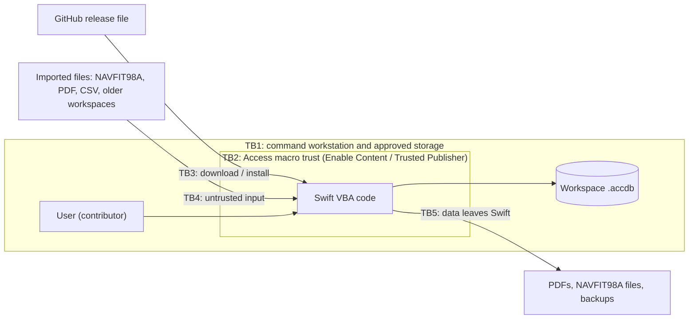

# Swift NAVFIT threat model

A lightweight threat model for a local, file-based Microsoft Access
application. It follows STRIDE (spoofing, tampering, repudiation, information
disclosure, denial of service, elevation of privilege) over Swift's assets,
trust boundaries and interfaces ([SV-1](views/SV-1.md)).

It is backlog M10 step 4. It feeds the command's mission-based cyber risk
assessment, which the ISSM owns.

**Scope:** Swift NAVFIT as delivered (the `.accdb` file and its VBA), its
workspace data, and the files it reads and writes. Out of scope: the security of
the workstation and network (STIGs, endpoint protection, account management),
which the command owns.

## 1. Assets

| Asset | Sensitivity | Where it lives |
| --- | --- | --- |
| A1 Workspace data: names, SSNs, DoD IDs, evaluations, counseling, review history | PII / CUI | The workspace `.accdb` on storage the command approves for PII |
| A2 Backups and exports: verified backups, NAVFIT98A exports and returns, report PDFs | PII / CUI | Folders the user chooses |
| A3 Application code: VBA in the delivered file | Integrity-critical | The same `.accdb`; GitHub releases |
| A4 Official-form fidelity: field maps, templates, rule packs | Integrity-critical (report correctness) | Built into the file from tracked source |
| A5 Audit and history: revisions, events, operation journal, provenance | Integrity-critical (accountability) | The workspace |

## 2. Trust boundaries

| Boundary | What crosses it |
| --- | --- |
| TB1 Workstation and storage | Folder permissions are the access control (decision C01). Anyone who can open the file can read and change it. |
| TB2 Macro trust | Enabling content lets Swift's VBA run with the user's rights. |
| TB3 Release supply chain | Release files come from GitHub; today they are unsigned. |
| TB4 Imported files | Data from outside Swift is parsed by Swift's code. |
| TB5 Outputs | PII leaves the workspace in files the user places. |

## 3. Threats and mitigations

Status key: **M** mitigated in the product; **P** partly mitigated; **A** accepted (with the reason); **C** depends on a command control.

### Spoofing

| ID | Threat | Mitigation | Status |
| --- | --- | --- | --- |
| S1 | A user picks another contributor's profile, so actions are attributed to the wrong person | Contributor choice is attribution, not authentication, and the guide and decision C01 say so. Access is limited by folder permissions. | A, C |
| S2 | A counterfeit "Swift NAVFIT" file is passed around | SHA-256 hashes are published with each release. Signing is planned (section 5). | P |

### Tampering

| ID | Threat | Mitigation | Status |
| --- | --- | --- | --- |
| T1 | Someone with file access edits tables directly in Access, bypassing Swift's rules | Table validation rules and relationships enforce structure even outside Swift. Revisions are append-only through Swift, and folder permissions limit who can open the file. Direct edits are not cryptographically detectable. | P, C |
| T2 | A modified release file carries changed or malicious VBA | Published SHA-256 hashes; download only from the GitHub release. Planned: a signed VBA project or signed package, with the publisher trusted by group policy (section 5). | P |
| T3 | A crafted import (NAVFIT98A, older workspace) injects bad values | Imported databases are opened read-only through DAO and their code is never run. Field names, types and sizes are checked against the NAVFIT98A schema; tables, queries and code objects outside it are rejected. Values are mapped, previewed and verified against the source before commit. A blank-target rule prevents silent merges. Malformed databases are tested by `test-malformed-imports`. | M |
| T4 | A crafted PDF manipulates report values | Structured import shows a preview before commit and keeps provenance. Only mapped fields are read. | M |
| T5 | Official templates or rule packs drift from the official sources | Templates are hashed (NAVFIT blank checked before every export; page images in the [SBOM](SBOM.md)). Rule packs cite their source, and the architecture view check fails on drift. | M |

### Repudiation

| ID | Threat | Mitigation | Status |
| --- | --- | --- | --- |
| R1 | A user denies making a change or a review decision | Every save is a revision with contributor and time. Review events, messages, sign-off and draft disposal are recorded. History is never deleted, except confirmed draft disposal, which records what it removed. | P (attribution, not authentication; see S1) |

### Information disclosure

| ID | Threat | Mitigation | Status |
| --- | --- | --- | --- |
| I1 | The workspace or a backup is copied off approved storage | Storage approval and folder permissions. The guide says to keep backups and exports at the workspace's sensitivity. Masking is presentation only; the file isn't encrypted (decision C01). | C |
| I2 | SSNs exposed in file names or on screen | Output file names omit SSNs (`PDFOutputFileName`). SSNs are masked in previews and merge screens. | M |
| I3 | Personnel data reaches developers or test fixtures | Fixtures are synthetic, Demo builds contain only synthetic data, and AGENTS.md forbids sending personnel data to external services. | M |
| I4 | Diagnostics or error text leak PII | Error reports name the operation and stage. The support guidance says to reproduce with synthetic data. | P |

### Denial of service

| ID | Threat | Mitigation | Status |
| --- | --- | --- | --- |
| D1 | A crafted or corrupt PDF hangs or exhausts memory during import | The reader limits file size (30 MB), decoded size (4 MB), nesting depth, tokens, packets and the revision chain, and detects cycles. `test-malformed-imports` covers a 64 MB decompression bomb, deep nesting, an xref cycle and a reference loop. | M |
| D2 | Very wide windows froze Access (fixed in 0.48.0-dev) | Widths are capped at Access's form limit, and a cleanup failure no longer loops. A regression check covers it. | M |
| D3 | The workspace grows toward Access's 2 GB file limit over years | Not yet measured. | Open (see section 4) |
| D4 | A failed save or crash loses work | Transactional saves, recovery checkpoints and verified backups, covered by forced-shutdown and late-rollback tests. | M |

### Elevation of privilege

| ID | Threat | Mitigation | Status |
| --- | --- | --- | --- |
| E1 | Enabling content runs code with the user's rights | Swift needs no administrator rights and makes no network calls. Planned signing narrows trust to one publisher instead of "enable all content" (section 5). | P |
| E2 | `ShellExecute` on a crafted path runs something other than a PDF | Swift only opens the folder or file it just generated, named from sanitized parts (`PDFOutputSafePart`) with a fixed `.pdf` extension. | M |
| E3 | XML external entities in imported data | Every parser that loads XML, including XML Swift stored itself, sets `ProhibitDTD` and `resolveExternals = False`; the source check enforces it. Code that only builds documents never parses. | M |
| E4 | A third-party library vulnerability | No third-party runtime libraries. Everything called is part of Windows or Office and patched through the command's Microsoft updates ([SBOM](SBOM.md)). | M, C |

## 4. Recommendations

| Priority | Action | Closes |
| --- | --- | --- |
| 1 | Sign releases (section 5) | S2, T2, E1 |
| 2 | *Done:* `test-malformed-imports` runs 55 malformed and control inputs against the PDF, RUAD CSV and NAVFIT98A importers. No importer defects were found. A CSV with invalid UTF-8 or a NUL character loads, with the bad bytes replaced, and is shown in the preview before anything is applied. | D1, T3, T4 |
| 3 | *Done in 0.49.0:* the 4 `VBScript.RegExp` uses (including the SSN filter in output file names) are plain VBA. Before replacing them, a side-by-side run of old and new code on 20,000 random strings and 22 edge cases matched exactly; the harnesses keep the expected values. | I2 and future availability |
| 4 | *Done:* every XML parser sets `ProhibitDTD` and `resolveExternals = False` before it loads. `check-vba-source.ps1` fails any `LoadXML` in a procedure that does not set both. | E3 (defense in depth) |
| 5 | Measure workspace growth on a large synthetic binder; document compact-and-repair and archiving guidance | D3 |
| 6 | Optional: an integrity hash over each saved revision, checked on load, to detect direct table edits | T1 |

## 5. Code-signing plan (M01)

**Goal:** a release opens under the Navy's usual Office macro policy ("disable
all except digitally signed", with trusted publishers set by group policy)
without users choosing **Enable Content**.

**Certificate:** a DoD PKI code-signing certificate, requested through the
command's ISSM or PKI office. A personal CAC signing certificate is not a
code-signing certificate. The publisher also has to be added to the Trusted
Publishers that group policy deploys to the target workstations.

**Two Access signing methods, to be decided by a rehearsal:**

1. **Sign the VBA project** (VBE → Tools → Digital Signature) in the built
   `.accdb`. Any later change to the code invalidates the signature. Whether the
   signature survives compiling to `.accde` has to be tested, because compiling
   removes the source.
2. **Package and Sign** (File → Save As → Package and Sign). This wraps the
   database in a signed `.accdc`; the user extracts it, and Access trusts the
   publisher.

**Rehearsal (no real certificate needed):**

1. Create a test code-signing certificate on a development machine with
   `New-SelfSignedCertificate -Type CodeSigningCert` or Office's `SelfCert.exe`.
   Use only disposable builds.
2. Sign a fresh build's VBA project. Under "disable all except digitally signed",
   expect the publisher prompt; after trusting the publisher, expect a clean
   open.
3. Compile the signed copy to `.accde` and check whether the signature remains.
4. Package and Sign another copy, extract it, and open it under the same policy.
5. Record the results and choose the method.

**Release integration (after the rehearsal):**

- `release-check.ps1` confirms the shipped file is signed by the expected
  certificate thumbprint, and that it opens under normal security without the
  Enable Content prompt.
- Release notes state the signer and thumbprint next to the SHA-256 hashes.
- Signing happens only on the product owner's explicit request (AGENTS.md) and
  never in the automated build.
