<!-- Generated by scripts/generate-architecture-views.ps1 from tracked source and a fresh build. Do not edit by hand. -->

# DIV-2 Logical Data Model

Entities and enforced relationships in schema 46. 80 entities; 169 relationships. Some links are deliberately not enforced as relationships (Access allows 32 indexes per table, and saves replace `ReportHead` rows); those are checked in code and listed as fields in [DIV-3](DIV-3.md).

```mermaid
erDiagram
  AuditActor ||--o{ AuditEvent : "FK_Audit_ActorID"
  Folder ||--o{ AuditEvent : "FK_Audit_NewFolderID"
  Folder ||--o{ AuditEvent : "FK_Audit_OldFolderID"
  FolderMove ||--o{ AuditEvent : "FK_Audit_FolderMoveSourceID"
  OperationJournal ||--o{ AuditEvent : "FK_Audit_JournalSourceID"
  OperationJournal ||--o{ AuditEvent : "FK_Audit_OperationID"
  Report ||--o{ AuditEvent : "FK_Audit_ReportID"
  ReportEvent ||--o{ AuditEvent : "FK_Audit_ReportEventSourceID"
  ReportMessage ||--o{ AuditEvent : "FK_Audit_MessageSourceID"
  ReportRevision ||--o{ AuditEvent : "FK_Audit_RevisionID"
  ReportRevision ||--o{ AuditEvent : "FK_Audit_RevisionSourceID"
  ReviewCommentEvent ||--o{ AuditEvent : "FK_Audit_CommentEventSourceID"
  ReviewTask ||--o{ AuditEvent : "FK_Audit_TaskID"
  ReviewTaskEvent ||--o{ AuditEvent : "FK_Audit_TaskEventSourceID"
  UserProfile ||--o{ ChangeBatch : "FK_ChangeBatch_AuthorID"
  ChangeBatch ||--o{ ChangeItem : "FK_ChangeItem_BatchID"
  Report ||--o{ ChangeItem : "FK_ChangeItem_ReportID"
  ReportRevision ||--o{ ChangeItem : "FK_ChangeItem_AppliedRevision"
  ReportRevision ||--o{ ChangeItem : "FK_ChangeItem_ExpectedRevision"
  UserProfile ||--o{ CommandMember : "FK_CommandMemberCreator"
  UserProfile ||--o{ CommandMember : "FK_CommandMemberEditor"
  ComparisonSet ||--o{ ComparisonMember : "FK_ComparisonMember_SetID"
  Report ||--o{ ComparisonMember : "FK_ComparisonMember_ReportID"
  ReportRevision ||--o{ ComparisonMember : "FK_ComparisonMember_RevisionID"
  GroupSnapshot ||--o{ ComparisonSet : "FK_ComparisonSet_GroupSnapshotID"
  CommandMember ||--o{ DirectoryMerge : "FK_DirectoryMerge_FromMemberID"
  CommandMember ||--o{ DirectoryMerge : "FK_DirectoryMerge_ToMemberID"
  OperationJournal ||--o{ DirectoryMerge : "FK_DirectoryMerge_OperationID"
  DirectoryMerge ||--o{ DirectoryMergeCounseling : "FK_DirectoryMergeCounseling_MergeID"
  MemberCounseling ||--o{ DirectoryMergeCounseling : "FK_DirectoryMergeCounseling_CounselingID"
  DirectoryMerge ||--o{ DirectoryMergeLink : "FK_DirectoryMergeLink_MergeID"
  DirectoryMerge ||--o{ DirectoryMergePrior : "FK_DirectoryMergePrior_MergeID"
  PriorEvaluation ||--o{ DirectoryMergePrior : "FK_DirectoryMergePrior_PriorID"
  DirectoryMerge ||--o{ DirectoryMergeReport : "FK_DirectoryMergeReport_MergeID"
  Report ||--o{ DirectoryMergeReport : "FK_DirectoryMergeReport_ReportID"
  DirectoryMerge ||--o{ DirectoryMergeSenior : "FK_DirectoryMergeSenior_MergeID"
  ReportingSeniorRecord ||--o{ DirectoryMergeSenior : "FK_DirectoryMergeSenior_SeniorID"
  ReportSignoff ||--o{ DraftDisposal : "FK_DraftDisposal_SignoffID"
  FieldDefault ||--o{ FieldDefaultLink : "FK_DefaultLink"
  Folder ||--o{ FieldDefaultLink : "FK_DefaultFolder"
  Report ||--o{ FieldDefaultLink : "FK_DefaultReport"
  SummaryGroup ||--o{ FieldDefaultLink : "FK_DefaultGroup"
  Workspace ||--o{ FieldDefaultLink : "FK_DefaultCommand"
  Folder ||--o{ Folder : "FK_FolderParent"
  FolderMove ||--o{ FolderBatchChange : "FK_BatchMove"
  OperationJournal ||--o{ FolderBatchChange : "FK_BatchOperation"
  Report ||--o{ FolderBatchChange : "FK_BatchReport"
  ReportRevision ||--o{ FolderBatchChange : "FK_BatchRevision"
  Folder ||--o{ FolderMove : "FK_MoveNewFolder"
  Folder ||--o{ FolderMove : "FK_MoveOldFolder"
  Report ||--o{ FolderMove : "FK_MoveReport"
  UserProfile ||--o{ FolderMove : "FK_MoveAuthor"
  GroupCompletion ||--o{ GroupCompletion : "FK_CompletionPrior"
  ReportingSeniorRecord ||--o{ GroupCompletion : "FK_CompletionSenior"
  RSCABaseline ||--o{ GroupCompletion : "FK_CompletionParent"
  RSCABaseline ||--o{ GroupCompletion : "FK_CompletionPosted"
  SummaryGroup ||--o{ GroupCompletion : "FK_CompletionGroup"
  GroupCompletion ||--o{ GroupCompletionCurrent : "FK_CurrentCompletion"
  GroupCompletion ||--o{ GroupCompletionCurrent : "FK_CurrentCompletionOwner"
  SummaryGroup ||--o{ GroupCompletionCurrent : "FK_CurrentCompletionGroup"
  GroupCompletion ||--o{ GroupCompletionReport : "FK_CompletionReportPosting"
  Report ||--o{ GroupCompletionReport : "FK_CompletionReportReport"
  ReportRevision ||--o{ GroupCompletionReport : "FK_CompletionReportRevision"
  ReportRevision ||--o{ GroupCompletionReport : "FK_CompletionRevisionOwner"
  SummaryGroup ||--o{ GroupLifecycle : "FK_LifecycleGroup"
  UserProfile ||--o{ GroupLifecycle : "FK_LifecycleAuthor"
  Report ||--o{ GroupMember : "FK_GroupMember_ReportID"
  SummaryGroup ||--o{ GroupMember : "FK_GroupMember_GroupID"
  ReportingSeniorRecord ||--o{ GroupRSCABaseline : "FK_RSGroupSenior"
  RSCABaseline ||--o{ GroupRSCABaseline : "FK_RSGroupBaseline"
  SummaryGroup ||--o{ GroupRSCABaseline : "FK_RSGroup"
  SummaryGroup ||--o{ GroupSnapshot : "FK_GroupSnapshot_GroupID"
  UserProfile ||--o{ GroupSnapshot : "FK_GroupSnapshot_AttestedBy"
  GroupSnapshot ||--o{ GroupSnapshotMember : "FK_GroupSnapshotMember_SnapshotID"
  Report ||--o{ GroupSnapshotMember : "FK_GroupSnapshotMember_ReportID"
  ReportRevision ||--o{ GroupSnapshotMember : "FK_GroupSnapshotMember_RevisionID"
  ImportReceipt ||--o{ ImportRawValue : "FK_ImportRawReceipt"
  OperationJournal ||--o{ ImportReceipt : "FK_ImportOperation"
  Report ||--o{ ImportReceipt : "FK_ImportReport"
  ReportRevision ||--o{ ImportReceipt : "FK_ImportApplied"
  ReportRevision ||--o{ ImportReceipt : "FK_ImportBefore"
  UserProfile ||--o{ ImportReceipt : "FK_ImportAuthor"
  UserProfile ||--o{ LibraryPreference : "FK_LibraryProfile"
  ComparisonSet ||--o{ MeetingProposal : "FK_MeetingProposal_SetID"
  Report ||--o{ MeetingProposal : "FK_MeetingProposal_ReportID"
  ReportRevision ||--o{ MeetingProposal : "FK_MeetingProposal_BaseRevision"
  CommandMember ||--o{ MemberCounseling : "FK_MemberCounseling_MemberID"
  CommandMember ||--o{ MemberDeparture : "FK_MemberDeparture_MemberID"
  RosterImport ||--o{ MemberDeparture : "FK_MemberDeparture_RosterImportID"
  CommandMember ||--o{ MemberReport : "FK_ReportDirectoryMember"
  Report ||--o{ MemberReport : "FK_MemberReport"
  UserProfile ||--o{ MemberReport : "FK_MemberReportAuthor"
  UserProfile ||--o{ NarrativeSnippet : "FK_SnippetProfile"
  UserProfile ||--o{ OperationJournal : "FK_OperationProfile"
  CommandMember ||--o{ PriorEvaluation : "FK_PriorMember"
  UserProfile ||--o{ PriorEvaluation : "FK_PriorCreator"
  UserProfile ||--o{ PriorEvaluation : "FK_PriorEditor"
  PriorEvaluation ||--o{ PriorEvaluationTrait : "FK_PriorTrait"
  Report ||--o{ RecoveryDraft : "FK_RecoveryReport"
  ReportRevision ||--o{ RecoveryDraft : "FK_RecoveryRevision"
  UserProfile ||--o{ RecoveryDraft : "FK_RecoveryAuthor"
  Folder ||--o{ Report : "FK_ReportFolder"
  CommandMember ||--o{ ReportDueDismissal : "FK_ReportDueDismissal_MemberID"
  Report ||--o{ ReportEvent : "FK_EventReport"
  UserProfile ||--o{ ReportEvent : "FK_EventAuthor"
  Report ||--o{ ReportHead : "FK_HeadReport"
  ReportRevision ||--o{ ReportHead : "FK_HeadRevision"
  CommandMember ||--o{ ReportingSeniorRecord : "FK_ReportingSeniorRecord_MemberID"
  UserProfile ||--o{ ReportingSeniorRecord : "FK_RSAuthor"
  ReportingSeniorRecord ||--o{ ReportingSeniorValue : "FK_RSValue"
  Report ||--o{ ReportMessage : "FK_MessageReport"
  ReportMessage ||--o{ ReportMessage : "FK_MessageParent"
  ReportNote ||--o{ ReportMessage : "FK_MessageNote"
  ReportRevision ||--o{ ReportMessage : "FK_MessageContext"
  ReportRevision ||--o{ ReportMessage : "FK_MessageRevision"
  ReviewComment ||--o{ ReportMessage : "FK_MessageComment"
  UserProfile ||--o{ ReportMessage : "FK_MessageAuthor"
  Report ||--o{ ReportNote : "FK_NoteReport"
  UserProfile ||--o{ ReportNote : "FK_NoteAuthor"
  Report ||--o{ ReportNoteDraft : "FK_NoteDraftReport"
  ReportMessage ||--o{ ReportNoteDraft : "FK_NoteDraftMessage"
  UserProfile ||--o{ ReportNoteDraft : "FK_NoteDraftAuthor"
  Report ||--o{ ReportRevision : "FK_RevisionReport"
  ReportRevision ||--o{ ReportRevision : "FK_RevisionParent"
  UserProfile ||--o{ ReportRevision : "FK_RevisionAuthor"
  Report ||--o{ ReviewComment : "FK_CommentReport"
  ReportRevision ||--o{ ReviewComment : "FK_CommentRevision"
  ReviewComment ||--o{ ReviewComment : "FK_CommentThread"
  UserProfile ||--o{ ReviewComment : "FK_CommentAuthor"
  ReviewComment ||--o{ ReviewCommentEvent : "FK_CommentEventThread"
  UserProfile ||--o{ ReviewCommentEvent : "FK_CommentEventAuthor"
  Report ||--o{ ReviewTask : "FK_TaskReport"
  ReportRevision ||--o{ ReviewTask : "FK_TaskRevision"
  UserProfile ||--o{ ReviewTask : "FK_TaskAssignee"
  UserProfile ||--o{ ReviewTask : "FK_TaskRequester"
  ReviewTask ||--o{ ReviewTaskEvent : "FK_TaskEventTask"
  UserProfile ||--o{ ReviewTaskEvent : "FK_TaskEventAuthor"
  ReportRevision ||--o{ RevisionChange : "FK_ChangeRevision"
  ReportRevision ||--o{ RevisionChoice : "FK_ChoiceRevision"
  ReportRevision ||--o{ RevisionDate : "FK_DateRevision"
  ReportRevision ||--o{ RevisionValue : "FK_ValueRevision"
  CommandMember ||--o{ RosterPresence : "FK_RosterPresence_MemberID"
  RosterImport ||--o{ RosterPresence : "FK_RosterPresence_RosterImportID"
  Report ||--o{ RouteRun : "FK_RouteRun_ReportID"
  ReportRevision ||--o{ RouteRun : "FK_RouteRun_RevisionID"
  RouteTemplate ||--o{ RouteRun : "FK_RouteRun_TemplateID"
  SummaryGroup ||--o{ RouteRun : "FK_RouteRun_GroupID"
  UserProfile ||--o{ RouteRun : "FK_RouteRun_RequestedBy"
  RouteRun ||--o{ RouteRunEvent : "FK_RouteRunEvent_RunID"
  RouteRun ||--o{ RouteRunStep : "FK_RouteRunStep_RunID"
  UserProfile ||--o{ RouteRunStep : "FK_RouteRunStep_AssigneeID"
  RouteTemplate ||--o{ RouteTemplateStep : "FK_RouteTemplateStep_TemplateID"
  UserProfile ||--o{ RouteTemplateStep : "FK_RouteTemplateStep_AssigneeID"
  ReportingSeniorRecord ||--o{ RSCABaseline : "FK_RSBaseline"
  RSCABaseline ||--o{ RSCABaseline : "FK_RSParent"
  UserProfile ||--o{ RSCABaseline : "FK_RSBaselineAuthor"
  GroupCompletion ||--o{ RSCountedReport : "FK_CountedCompletion"
  GroupCompletionReport ||--o{ RSCountedReport : "FK_CountedPostingReport"
  Report ||--o{ RSCountedReport : "FK_CountedReport"
  RulePack ||--o{ RuleDefinition : "FK_RuleDefinition_PackID"
  ISIC ||--o{ SummaryGroup : "FK_SummaryGroup_ISICID"
  RuleDefinition ||--o{ ValidationFinding : "FK_ValidationFinding_RuleID"
  ValidationRun ||--o{ ValidationFinding : "FK_ValidationFinding_ValidationRunID"
  Report ||--o{ ValidationRun : "FK_ValidationRun_ReportID"
  ReportRevision ||--o{ ValidationRun : "FK_ValidationRun_RevisionID"
  RulePack ||--o{ ValidationRun : "FK_ValidationRun_PackID"
  Report ||--o{ WizardPreview : "FK_WizardPreview_Report"
  ReportRevision ||--o{ WizardPreview : "FK_WizardPreview_Revision"
  UserProfile ||--o{ Workspace : "FK_WorkspaceProfile"
```

| Child | Parent | Fields | Relationship |
| --- | --- | --- | --- |
| AuditEvent | AuditActor | ActorID -> AuditActor.ActorID | FK_Audit_ActorID |
| AuditEvent | Folder | NewFolderID -> Folder.FolderID | FK_Audit_NewFolderID |
| AuditEvent | Folder | OldFolderID -> Folder.FolderID | FK_Audit_OldFolderID |
| AuditEvent | FolderMove | FolderMoveSourceID -> FolderMove.FolderMoveID | FK_Audit_FolderMoveSourceID |
| AuditEvent | OperationJournal | JournalSourceID -> OperationJournal.OperationID | FK_Audit_JournalSourceID |
| AuditEvent | OperationJournal | OperationID -> OperationJournal.OperationID | FK_Audit_OperationID |
| AuditEvent | Report | ReportID -> Report.ReportID | FK_Audit_ReportID |
| AuditEvent | ReportEvent | ReportEventSourceID -> ReportEvent.ReportEventID | FK_Audit_ReportEventSourceID |
| AuditEvent | ReportMessage | MessageSourceID -> ReportMessage.MessageID | FK_Audit_MessageSourceID |
| AuditEvent | ReportRevision | RevisionID -> ReportRevision.RevisionID | FK_Audit_RevisionID |
| AuditEvent | ReportRevision | RevisionSourceID -> ReportRevision.RevisionID | FK_Audit_RevisionSourceID |
| AuditEvent | ReviewCommentEvent | CommentEventSourceID -> ReviewCommentEvent.CommentEventID | FK_Audit_CommentEventSourceID |
| AuditEvent | ReviewTask | TaskID -> ReviewTask.TaskID | FK_Audit_TaskID |
| AuditEvent | ReviewTaskEvent | TaskEventSourceID -> ReviewTaskEvent.TaskEventID | FK_Audit_TaskEventSourceID |
| ChangeBatch | UserProfile | AuthorID -> UserProfile.UserProfileID | FK_ChangeBatch_AuthorID |
| ChangeItem | ChangeBatch | BatchID -> ChangeBatch.BatchID | FK_ChangeItem_BatchID |
| ChangeItem | Report | ReportID -> Report.ReportID | FK_ChangeItem_ReportID |
| ChangeItem | ReportRevision | AppliedRevision -> ReportRevision.RevisionID | FK_ChangeItem_AppliedRevision |
| ChangeItem | ReportRevision | ExpectedRevision -> ReportRevision.RevisionID | FK_ChangeItem_ExpectedRevision |
| CommandMember | UserProfile | CreatedBy -> UserProfile.UserProfileID | FK_CommandMemberCreator |
| CommandMember | UserProfile | ModifiedBy -> UserProfile.UserProfileID | FK_CommandMemberEditor |
| ComparisonMember | ComparisonSet | SetID -> ComparisonSet.SetID | FK_ComparisonMember_SetID |
| ComparisonMember | Report | ReportID -> Report.ReportID | FK_ComparisonMember_ReportID |
| ComparisonMember | ReportRevision | RevisionID -> ReportRevision.RevisionID | FK_ComparisonMember_RevisionID |
| ComparisonSet | GroupSnapshot | GroupSnapshotID -> GroupSnapshot.SnapshotID | FK_ComparisonSet_GroupSnapshotID |
| DirectoryMerge | CommandMember | FromMemberID -> CommandMember.MemberID | FK_DirectoryMerge_FromMemberID |
| DirectoryMerge | CommandMember | ToMemberID -> CommandMember.MemberID | FK_DirectoryMerge_ToMemberID |
| DirectoryMerge | OperationJournal | OperationID -> OperationJournal.OperationID | FK_DirectoryMerge_OperationID |
| DirectoryMergeCounseling | DirectoryMerge | MergeID -> DirectoryMerge.MergeID | FK_DirectoryMergeCounseling_MergeID |
| DirectoryMergeCounseling | MemberCounseling | CounselingID -> MemberCounseling.CounselingID | FK_DirectoryMergeCounseling_CounselingID |
| DirectoryMergeLink | DirectoryMerge | MergeID -> DirectoryMerge.MergeID | FK_DirectoryMergeLink_MergeID |
| DirectoryMergePrior | DirectoryMerge | MergeID -> DirectoryMerge.MergeID | FK_DirectoryMergePrior_MergeID |
| DirectoryMergePrior | PriorEvaluation | PriorID -> PriorEvaluation.PriorID | FK_DirectoryMergePrior_PriorID |
| DirectoryMergeReport | DirectoryMerge | MergeID -> DirectoryMerge.MergeID | FK_DirectoryMergeReport_MergeID |
| DirectoryMergeReport | Report | ReportID -> Report.ReportID | FK_DirectoryMergeReport_ReportID |
| DirectoryMergeSenior | DirectoryMerge | MergeID -> DirectoryMerge.MergeID | FK_DirectoryMergeSenior_MergeID |
| DirectoryMergeSenior | ReportingSeniorRecord | SeniorID -> ReportingSeniorRecord.SeniorID | FK_DirectoryMergeSenior_SeniorID |
| DraftDisposal | ReportSignoff | SignoffID -> ReportSignoff.SignoffID | FK_DraftDisposal_SignoffID |
| FieldDefaultLink | FieldDefault | DefaultID -> FieldDefault.DefaultID | FK_DefaultLink |
| FieldDefaultLink | Folder | FolderID -> Folder.FolderID | FK_DefaultFolder |
| FieldDefaultLink | Report | ReportID -> Report.ReportID | FK_DefaultReport |
| FieldDefaultLink | SummaryGroup | GroupID -> SummaryGroup.GroupID | FK_DefaultGroup |
| FieldDefaultLink | Workspace | CommandWorkspaceID -> Workspace.WorkspaceID | FK_DefaultCommand |
| Folder | Folder | ParentFolderID -> Folder.FolderID | FK_FolderParent |
| FolderBatchChange | FolderMove | AppliedMoveID -> FolderMove.FolderMoveID | FK_BatchMove |
| FolderBatchChange | OperationJournal | OperationID -> OperationJournal.OperationID | FK_BatchOperation |
| FolderBatchChange | Report | ReportID -> Report.ReportID | FK_BatchReport |
| FolderBatchChange | ReportRevision | BaseRevisionID -> ReportRevision.RevisionID | FK_BatchRevision |
| FolderMove | Folder | NewFolderID -> Folder.FolderID | FK_MoveNewFolder |
| FolderMove | Folder | OldFolderID -> Folder.FolderID | FK_MoveOldFolder |
| FolderMove | Report | ReportID -> Report.ReportID | FK_MoveReport |
| FolderMove | UserProfile | AuthorProfileID -> UserProfile.UserProfileID | FK_MoveAuthor |
| GroupCompletion | GroupCompletion | PriorCompletionID -> GroupCompletion.CompletionID | FK_CompletionPrior |
| GroupCompletion | ReportingSeniorRecord | SeniorID -> ReportingSeniorRecord.SeniorID | FK_CompletionSenior |
| GroupCompletion | RSCABaseline | ParentBaselineID -> RSCABaseline.BaselineID | FK_CompletionParent |
| GroupCompletion | RSCABaseline | PostedBaselineID -> RSCABaseline.BaselineID | FK_CompletionPosted |
| GroupCompletion | SummaryGroup | GroupID -> SummaryGroup.GroupID | FK_CompletionGroup |
| GroupCompletionCurrent | GroupCompletion | CompletionID -> GroupCompletion.CompletionID | FK_CurrentCompletion |
| GroupCompletionCurrent | GroupCompletion | GroupID -> GroupCompletion.GroupID, CompletionID -> GroupCompletion.CompletionID | FK_CurrentCompletionOwner |
| GroupCompletionCurrent | SummaryGroup | GroupID -> SummaryGroup.GroupID | FK_CurrentCompletionGroup |
| GroupCompletionReport | GroupCompletion | CompletionID -> GroupCompletion.CompletionID | FK_CompletionReportPosting |
| GroupCompletionReport | Report | ReportID -> Report.ReportID | FK_CompletionReportReport |
| GroupCompletionReport | ReportRevision | RevisionID -> ReportRevision.RevisionID | FK_CompletionReportRevision |
| GroupCompletionReport | ReportRevision | RevisionOwnerReportID -> ReportRevision.ReportID, RevisionID -> ReportRevision.RevisionID | FK_CompletionRevisionOwner |
| GroupLifecycle | SummaryGroup | GroupID -> SummaryGroup.GroupID | FK_LifecycleGroup |
| GroupLifecycle | UserProfile | ChangedBy -> UserProfile.UserProfileID | FK_LifecycleAuthor |
| GroupMember | Report | ReportID -> Report.ReportID | FK_GroupMember_ReportID |
| GroupMember | SummaryGroup | GroupID -> SummaryGroup.GroupID | FK_GroupMember_GroupID |
| GroupRSCABaseline | ReportingSeniorRecord | SeniorID -> ReportingSeniorRecord.SeniorID | FK_RSGroupSenior |
| GroupRSCABaseline | RSCABaseline | BaselineID -> RSCABaseline.BaselineID | FK_RSGroupBaseline |
| GroupRSCABaseline | SummaryGroup | GroupID -> SummaryGroup.GroupID | FK_RSGroup |
| GroupSnapshot | SummaryGroup | GroupID -> SummaryGroup.GroupID | FK_GroupSnapshot_GroupID |
| GroupSnapshot | UserProfile | AttestedBy -> UserProfile.UserProfileID | FK_GroupSnapshot_AttestedBy |
| GroupSnapshotMember | GroupSnapshot | SnapshotID -> GroupSnapshot.SnapshotID | FK_GroupSnapshotMember_SnapshotID |
| GroupSnapshotMember | Report | ReportID -> Report.ReportID | FK_GroupSnapshotMember_ReportID |
| GroupSnapshotMember | ReportRevision | RevisionID -> ReportRevision.RevisionID | FK_GroupSnapshotMember_RevisionID |
| ImportRawValue | ImportReceipt | ImportReceiptID -> ImportReceipt.ImportReceiptID | FK_ImportRawReceipt |
| ImportReceipt | OperationJournal | OperationID -> OperationJournal.OperationID | FK_ImportOperation |
| ImportReceipt | Report | ReportID -> Report.ReportID | FK_ImportReport |
| ImportReceipt | ReportRevision | AppliedRevisionID -> ReportRevision.RevisionID | FK_ImportApplied |
| ImportReceipt | ReportRevision | BeforeRevisionID -> ReportRevision.RevisionID | FK_ImportBefore |
| ImportReceipt | UserProfile | AuthorProfileID -> UserProfile.UserProfileID | FK_ImportAuthor |
| LibraryPreference | UserProfile | AuthorProfileID -> UserProfile.UserProfileID | FK_LibraryProfile |
| MeetingProposal | ComparisonSet | SetID -> ComparisonSet.SetID | FK_MeetingProposal_SetID |
| MeetingProposal | Report | ReportID -> Report.ReportID | FK_MeetingProposal_ReportID |
| MeetingProposal | ReportRevision | BaseRevision -> ReportRevision.RevisionID | FK_MeetingProposal_BaseRevision |
| MemberCounseling | CommandMember | MemberID -> CommandMember.MemberID | FK_MemberCounseling_MemberID |
| MemberDeparture | CommandMember | MemberID -> CommandMember.MemberID | FK_MemberDeparture_MemberID |
| MemberDeparture | RosterImport | RosterImportID -> RosterImport.RosterImportID | FK_MemberDeparture_RosterImportID |
| MemberReport | CommandMember | MemberID -> CommandMember.MemberID | FK_ReportDirectoryMember |
| MemberReport | Report | ReportID -> Report.ReportID | FK_MemberReport |
| MemberReport | UserProfile | UpdatedBy -> UserProfile.UserProfileID | FK_MemberReportAuthor |
| NarrativeSnippet | UserProfile | CreatedBy -> UserProfile.UserProfileID | FK_SnippetProfile |
| OperationJournal | UserProfile | AuthorProfileID -> UserProfile.UserProfileID | FK_OperationProfile |
| PriorEvaluation | CommandMember | MemberID -> CommandMember.MemberID | FK_PriorMember |
| PriorEvaluation | UserProfile | CreatedBy -> UserProfile.UserProfileID | FK_PriorCreator |
| PriorEvaluation | UserProfile | ModifiedBy -> UserProfile.UserProfileID | FK_PriorEditor |
| PriorEvaluationTrait | PriorEvaluation | PriorID -> PriorEvaluation.PriorID | FK_PriorTrait |
| RecoveryDraft | Report | ReportID -> Report.ReportID | FK_RecoveryReport |
| RecoveryDraft | ReportRevision | BaseRevisionID -> ReportRevision.RevisionID | FK_RecoveryRevision |
| RecoveryDraft | UserProfile | AuthorProfileID -> UserProfile.UserProfileID | FK_RecoveryAuthor |
| Report | Folder | FolderID -> Folder.FolderID | FK_ReportFolder |
| ReportDueDismissal | CommandMember | MemberID -> CommandMember.MemberID | FK_ReportDueDismissal_MemberID |
| ReportEvent | Report | ReportID -> Report.ReportID | FK_EventReport |
| ReportEvent | UserProfile | AuthorProfileID -> UserProfile.UserProfileID | FK_EventAuthor |
| ReportHead | Report | ReportID -> Report.ReportID | FK_HeadReport |
| ReportHead | ReportRevision | ReportID -> ReportRevision.ReportID, RevisionID -> ReportRevision.RevisionID | FK_HeadRevision |
| ReportingSeniorRecord | CommandMember | MemberID -> CommandMember.MemberID | FK_ReportingSeniorRecord_MemberID |
| ReportingSeniorRecord | UserProfile | CreatedBy -> UserProfile.UserProfileID | FK_RSAuthor |
| ReportingSeniorValue | ReportingSeniorRecord | SeniorID -> ReportingSeniorRecord.SeniorID | FK_RSValue |
| ReportMessage | Report | ReportID -> Report.ReportID | FK_MessageReport |
| ReportMessage | ReportMessage | ParentMessageID -> ReportMessage.MessageID | FK_MessageParent |
| ReportMessage | ReportNote | LegacyNoteID -> ReportNote.NoteID | FK_MessageNote |
| ReportMessage | ReportRevision | ContextRevisionID -> ReportRevision.RevisionID | FK_MessageContext |
| ReportMessage | ReportRevision | LegacyRevisionID -> ReportRevision.RevisionID | FK_MessageRevision |
| ReportMessage | ReviewComment | LegacyCommentID -> ReviewComment.CommentID | FK_MessageComment |
| ReportMessage | UserProfile | AuthorProfileID -> UserProfile.UserProfileID | FK_MessageAuthor |
| ReportNote | Report | ReportID -> Report.ReportID | FK_NoteReport |
| ReportNote | UserProfile | AuthorProfileID -> UserProfile.UserProfileID | FK_NoteAuthor |
| ReportNoteDraft | Report | ReportID -> Report.ReportID | FK_NoteDraftReport |
| ReportNoteDraft | ReportMessage | ParentMessageID -> ReportMessage.MessageID | FK_NoteDraftMessage |
| ReportNoteDraft | UserProfile | AuthorProfileID -> UserProfile.UserProfileID | FK_NoteDraftAuthor |
| ReportRevision | Report | ReportID -> Report.ReportID | FK_RevisionReport |
| ReportRevision | ReportRevision | ParentRevisionID -> ReportRevision.RevisionID | FK_RevisionParent |
| ReportRevision | UserProfile | AuthorProfileID -> UserProfile.UserProfileID | FK_RevisionAuthor |
| ReviewComment | Report | ReportID -> Report.ReportID | FK_CommentReport |
| ReviewComment | ReportRevision | RevisionID -> ReportRevision.RevisionID | FK_CommentRevision |
| ReviewComment | ReviewComment | ThreadID -> ReviewComment.CommentID | FK_CommentThread |
| ReviewComment | UserProfile | AuthorProfileID -> UserProfile.UserProfileID | FK_CommentAuthor |
| ReviewCommentEvent | ReviewComment | ThreadID -> ReviewComment.CommentID | FK_CommentEventThread |
| ReviewCommentEvent | UserProfile | AuthorProfileID -> UserProfile.UserProfileID | FK_CommentEventAuthor |
| ReviewTask | Report | ReportID -> Report.ReportID | FK_TaskReport |
| ReviewTask | ReportRevision | RevisionID -> ReportRevision.RevisionID | FK_TaskRevision |
| ReviewTask | UserProfile | AssignedTo -> UserProfile.UserProfileID | FK_TaskAssignee |
| ReviewTask | UserProfile | RequestedBy -> UserProfile.UserProfileID | FK_TaskRequester |
| ReviewTaskEvent | ReviewTask | TaskID -> ReviewTask.TaskID | FK_TaskEventTask |
| ReviewTaskEvent | UserProfile | AuthorProfileID -> UserProfile.UserProfileID | FK_TaskEventAuthor |
| RevisionChange | ReportRevision | RevisionID -> ReportRevision.RevisionID | FK_ChangeRevision |
| RevisionChoice | ReportRevision | RevisionID -> ReportRevision.RevisionID | FK_ChoiceRevision |
| RevisionDate | ReportRevision | RevisionID -> ReportRevision.RevisionID | FK_DateRevision |
| RevisionValue | ReportRevision | RevisionID -> ReportRevision.RevisionID | FK_ValueRevision |
| RosterPresence | CommandMember | MemberID -> CommandMember.MemberID | FK_RosterPresence_MemberID |
| RosterPresence | RosterImport | RosterImportID -> RosterImport.RosterImportID | FK_RosterPresence_RosterImportID |
| RouteRun | Report | ReportID -> Report.ReportID | FK_RouteRun_ReportID |
| RouteRun | ReportRevision | RevisionID -> ReportRevision.RevisionID | FK_RouteRun_RevisionID |
| RouteRun | RouteTemplate | TemplateID -> RouteTemplate.TemplateID | FK_RouteRun_TemplateID |
| RouteRun | SummaryGroup | GroupID -> SummaryGroup.GroupID | FK_RouteRun_GroupID |
| RouteRun | UserProfile | RequestedBy -> UserProfile.UserProfileID | FK_RouteRun_RequestedBy |
| RouteRunEvent | RouteRun | RunID -> RouteRun.RunID | FK_RouteRunEvent_RunID |
| RouteRunStep | RouteRun | RunID -> RouteRun.RunID | FK_RouteRunStep_RunID |
| RouteRunStep | UserProfile | AssigneeID -> UserProfile.UserProfileID | FK_RouteRunStep_AssigneeID |
| RouteTemplateStep | RouteTemplate | TemplateID -> RouteTemplate.TemplateID | FK_RouteTemplateStep_TemplateID |
| RouteTemplateStep | UserProfile | AssigneeID -> UserProfile.UserProfileID | FK_RouteTemplateStep_AssigneeID |
| RSCABaseline | ReportingSeniorRecord | SeniorID -> ReportingSeniorRecord.SeniorID | FK_RSBaseline |
| RSCABaseline | RSCABaseline | ParentBaselineID -> RSCABaseline.BaselineID | FK_RSParent |
| RSCABaseline | UserProfile | CreatedBy -> UserProfile.UserProfileID | FK_RSBaselineAuthor |
| RSCountedReport | GroupCompletion | CompletionID -> GroupCompletion.CompletionID | FK_CountedCompletion |
| RSCountedReport | GroupCompletionReport | CompletionID -> GroupCompletionReport.CompletionID, ReportID -> GroupCompletionReport.ReportID | FK_CountedPostingReport |
| RSCountedReport | Report | ReportID -> Report.ReportID | FK_CountedReport |
| RuleDefinition | RulePack | PackID -> RulePack.PackID | FK_RuleDefinition_PackID |
| SummaryGroup | ISIC | ISICID -> ISIC.ISICID | FK_SummaryGroup_ISICID |
| ValidationFinding | RuleDefinition | RuleID -> RuleDefinition.RuleID | FK_ValidationFinding_RuleID |
| ValidationFinding | ValidationRun | ValidationRunID -> ValidationRun.ValidationRunID | FK_ValidationFinding_ValidationRunID |
| ValidationRun | Report | ReportID -> Report.ReportID | FK_ValidationRun_ReportID |
| ValidationRun | ReportRevision | RevisionID -> ReportRevision.RevisionID | FK_ValidationRun_RevisionID |
| ValidationRun | RulePack | PackID -> RulePack.PackID | FK_ValidationRun_PackID |
| WizardPreview | Report | TargetReportID -> Report.ReportID | FK_WizardPreview_Report |
| WizardPreview | ReportRevision | ExpectedRevisionID -> ReportRevision.RevisionID | FK_WizardPreview_Revision |
| Workspace | UserProfile | ActiveProfileID -> UserProfile.UserProfileID | FK_WorkspaceProfile |
