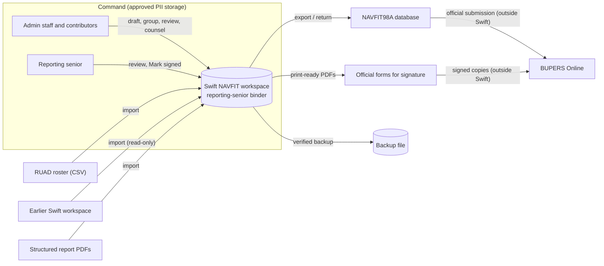

# OV-1 High-Level Operational Concept

Swift is the command's working binder for performance reports. Administrative
staff and contributors prepare reports, groups and counseling records in it. The
reporting senior reviews them and marks them signed after signing the official
copies. Every exchange with the outside is a file the user chooses. Official
signature and submission stay in the existing Navy process, outside Swift.
