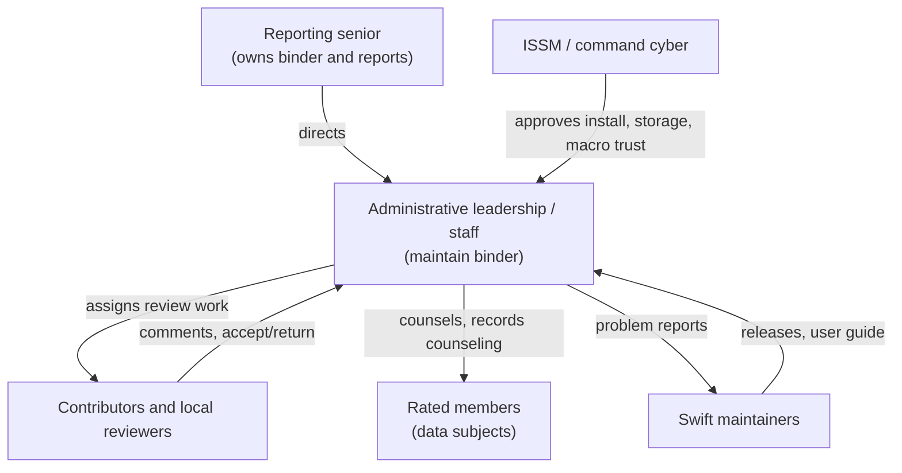

# OV-4 Organizational Relationships

| Role | Relationship in Swift |
| --- | --- |
| Reporting senior | Owns the binder. Reports are marked signed in their name after the official copies are signed. |
| Administrative staff | Contributor profiles that create reports and groups, run review routes and record counseling. |
| Contributors and reviewers | Contributor profiles that receive assignments and route steps. Attribution only: no authentication (decision C01). |
| Rated members | Appear only as data. They never operate Swift. |
| ISSM | Outside Swift. Approves the workstation, PII storage and macro trust, and holds risk acceptance. |
| Maintainers | Outside the command. Release builds and documentation; never receive personnel data. |
