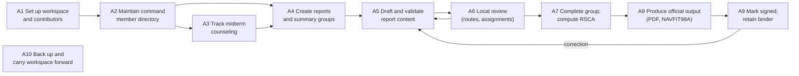

# OV-5b Operational Activity Model

| Activity | Description | Supporting SV-4 function | User guide |
| --- | --- | --- | --- |
| A1 Set up workspace and contributors | Configure the command; choose or add a contributor at each launch | F1 Workspace and contributors | §2 |
| A2 Maintain command member directory | Add members, import a RUAD roster, merge duplicate Sailors | F2 Command directory | §8 |
| A3 Track midterm counseling | Record sessions; see due and overdue members | F3 Counseling | §8.5 |
| A4 Create reports and summary groups | Create single or batch reports; group them; apply shared defaults | F4 Reports and groups | §4, §9 |
| A5 Draft and validate content | Edit the fixed NAVPERS pages; live and saved validation against rule packs | F5 Report editor; F6 Validation | §4, §6 |
| A6 Local review | Ordered routes, individual assignments, message log | F7 Review and messages | §5, §12, §13 |
| A7 Complete group; compute RSCA | Trait grid, ITA, group average, PSG RSCA projection and accounting | F8 Group calculations | §10, §11, §14 |
| A8 Produce official output | PDF output on official templates; NAVFIT98A export and return | F9 Interchange | §14, §15, §16 |
| A9 Mark signed; retain binder | Lock signed reports; reopen for correction; optional draft disposal | F10 Lifecycle and history | §4.4, §7 |
| A10 Back up and carry forward | Verified backup and restore; import from earlier versions | F11 Continuity | §17 |
