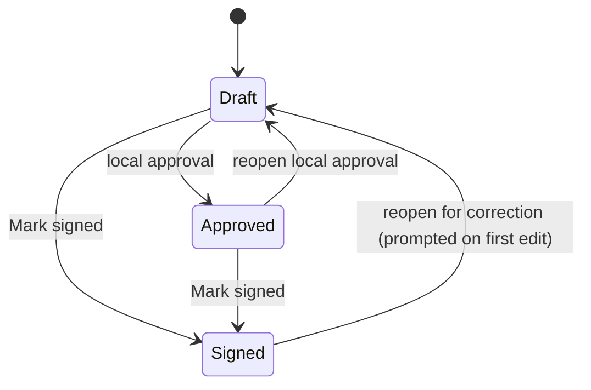
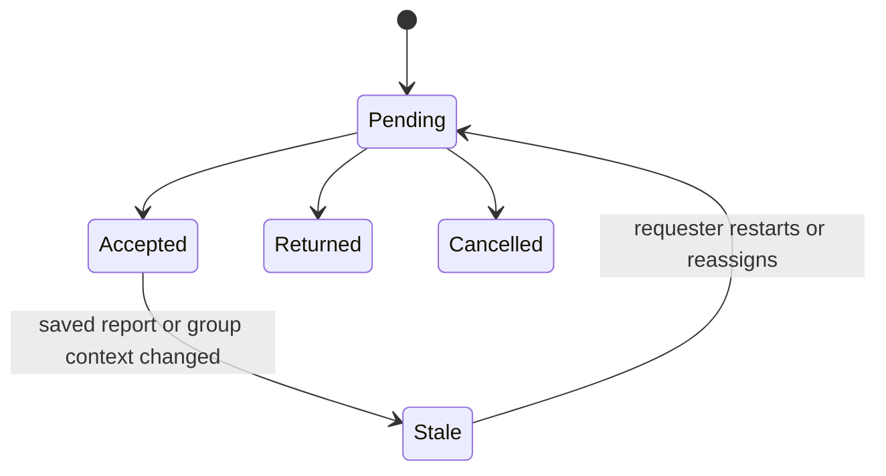

# OV-6b State Transitions

The states below are values the schema enforces through table validation rules.
`test-architecture-views` checks the lists marked **checked** against the build.

## Report workflow (`Report.WorkflowState`) — checked

<!-- states:Report.WorkflowState Draft,Approved,Signed -->

Archiving is separate from the workflow state: `IsArchived` hides a report
without changing its state, and Recover reverses it. Draft disposal (after Mark
signed) empties superseded drafts but keeps their revision rows.

## Summary group (`SummaryGroup` lifecycle) — checked

```mermaid
stateDiagram-v2
  [*] --> Initialized
  Initialized --> In_Work: work begins
  In_Work --> Ready_for_Signature
  Ready_for_Signature --> Completed: one signed date; marks member reports Signed
  Completed --> In_Work: reopen; reopens member reports
```

<!-- states:GroupLifecycle.WorkflowState Initialized,In-Work,Ready for Signature,Completed -->

## Review assignment and route step

