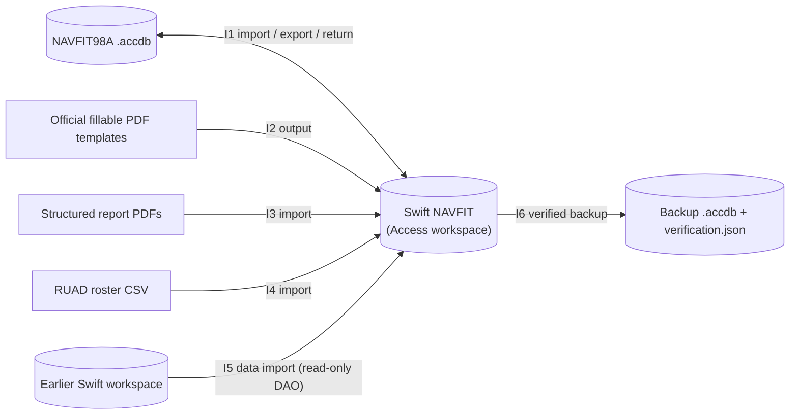

# SV-1 Systems Interface Description

Swift NAVFIT is one system. Every interface is a file the user selects. There
are no network interfaces, services or background connections.

| ID | Interface | Direction | Format | Safeguards | Test runner |
| --- | --- | --- | --- | --- | --- |
| I1 | NAVFIT98A exchange | both | Access database (DAO) | Mapped field coverage; export baselines; returns reconciled before apply; source never modified | `test-navfit-adapter`, `test-navfit-group-export`, `test-ux-navfit`, `test-navfit-upgrade`, `test-malformed-imports` |
| I2 | Official PDF output | out | PDF on NAVPERS fillable templates | Unique sanitized filenames without SSNs; overflow handling; readback of saved fields | `test-pdf-output`, `test-pdf-expanded` |
| I3 | Structured PDF import | in | PDF (embedded form data) | Preview before commit; provenance retained | `test-pdf-import`, `test-pdf-counseling-status`, `test-malformed-imports` |
| I4 | RUAD roster import | in | CSV | Match preview; manual-change protection | `test-ruad-import` (manual), `test-import-rank`, `test-malformed-imports` |
| I5 | Earlier-workspace import | in | Access database, schemas 1–34 | Read-only DAO; source code never executed; every value verified before commit; blank target only | `test-swift-data-import`, `test-bulk-workspace-import` |
| I6 | Backup and restore | out / in | Access database + JSON verification | Row-by-row verification; restore only into a blank workspace | `test-backup` |
